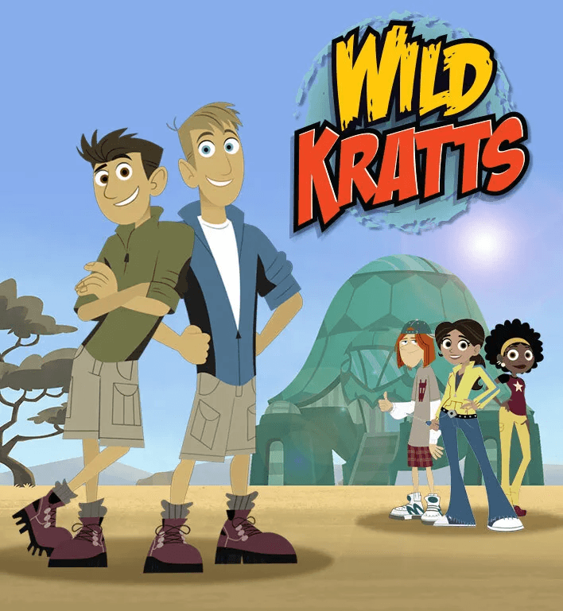
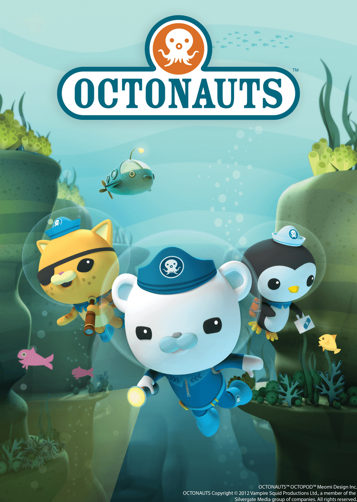
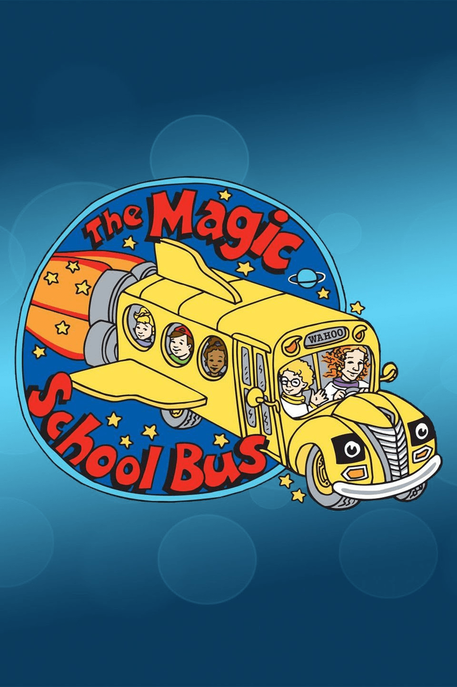
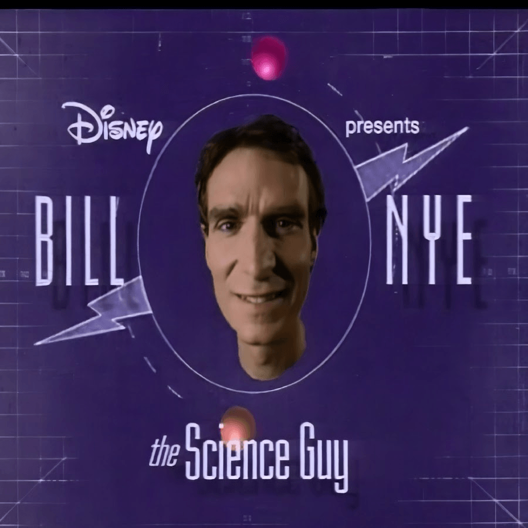
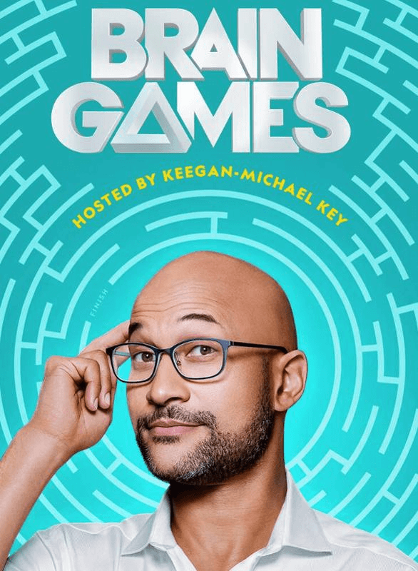
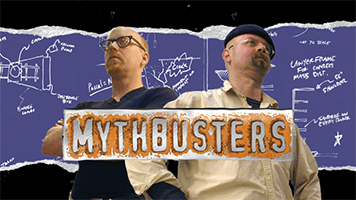

Hello everyone! 🌟 Welcome to another edition of the ChemQuest Official Newsletter! If you haven’t noticed, we have a new site! This week, we’re diving into some groundbreaking science news: from the latest research on dark energy that could change our understanding of the universe 🌌, to exciting developments in stem cell treatment for spinal cord injuries 🧠. We’ll also spotlight some awesome science TV shows to fuel you and your future scientist’s curiosity!

*“Science is the key to our future, and if you don’t believe in science, then you’re holding everybody back.” - Bill Nye (the Science Guy)*

## STEM News 📰

### Dark energy isn't what we thought – and that may transform the cosmos

New research from the Dark Energy Spectroscopic Instrument (DESI) suggests that dark energy, which drives the universe's accelerated expansion, may be weakening over time, challenging long-held cosmological theories.

-   **DESI's findings**: Data from 15 million galaxies analyzed over three years shows dark energy may change over time, contradicting the standard cosmological model (lambda-CDM).

-   **Dark energy's impact**: It could mean the universe's expansion rate is slowing, rather than speeding up.

-   **Statistical significance**: The results reach 4.2 sigma but could hit 5 sigma within two years, solidifying the discovery.

-   **Potential consequences**: If dark energy weakens, future cosmic scenarios like the "big crunch" may become more plausible, where the universe contracts instead of expanding.

-   **Ongoing research**: Future surveys and experiments are expected to refine these findings, with the DESI data leading to new theoretical models of the universe's fate.

[Read the full article on New Scientist](https://www.newscientist.com/article/2471743-dark-energy-isnt-what-we-thought-and-that-may-transform-the-cosmos/)

### Stem Cell Treatment Shows Promise for Paralysis Recovery

A recent trial using reprogrammed stem cells to treat spinal cord injuries has shown promising results, offering new hope for individuals with paralysis.

-   **Participants:** Four men received neural stem cell injections derived from induced pluripotent stem (iPS) cells. The participants ranged in age, with two over 60 years old.

-   **Treatment method:** Two million neural precursor cells were injected into each participant’s injury site, aiming to regenerate neurons and glial cells.

-   **Results:** One participant regained the ability to stand and is now training to walk. Another regained movement in arms and legs but cannot stand. Two participants showed minimal improvements in movement and sensation.

-   **Safety:** No serious adverse effects were observed during the trial, and participants were given immune-suppressing drugs to prevent cell rejection for six months.

-   **Future research:** Larger trials are planned to better understand the potential of iPS cells for spinal injury recovery.

[Read the full article in Nature](https://www.nature.com/articles/d41586-025-00863-0)

## Great Science TV Shows 📺

### Wild Kratts

-   **Theme:** Animal exploration and conservation

-   **Premise:** Brothers Chris and Martin Kratt travel around the world using their "creature power suits" to learn about animals and their environments.

-   **Key Focus:** Biology, ecology, animal behavior, and conservation.

-   **Target Audience:** Preschool and early elementary-aged children.

### Octonauts

-   **Theme:** Underwater exploration and marine life

-   **Premise:** A team of underwater explorers, led by Captain Barnacles, embarks on adventures to help sea creatures and explore the ocean.

-   **Key Focus:** Marine biology, oceanography, environmental conservation, and teamwork.

-   **Target Audience:** Preschool to early elementary-aged children.

### The Magic School Bus

-   **Theme:** Science adventures and discovery

-   **Premise:** Ms. Frizzle takes her class on magical field trips, traveling inside the human body, to outer space, and more to explore scientific concepts.

-   **Key Focus:** Biology, chemistry, physics, and earth science through creative, hands-on experiences.

-   **Target Audience:** Elementary-aged children.

### Bill Nye the Science Guy

-   **Theme:** Fun, accessible science education

-   **Premise:** Bill Nye makes science fun by conducting experiments and explaining complex scientific concepts in a way that middle schoolers can understand.

-   **Key Focus:** Physics, chemistry, biology, environmental science, and engineering.

-   **Target Audience:** Middle school-aged children (ages 10-14).

### Brain Games

-   **Theme:** Neuroscience and cognitive psychology

-   **Premise:** A game-based show that explores the science of the brain through interactive puzzles, challenges, and experiments.

-   **Key Focus:** Psychology, neuroscience, perception, and cognitive science.

-   **Target Audience:** Middle and high schoolers, though it’s entertaining for all ages.

### MythBusters

-   **Theme:** Engineering, physics, and debunking myths

-   **Premise:** Hosts test popular myths, urban legends, and scientific claims through hands-on experiments and real-life testing.

-   **Key Focus:** Engineering, physics, problem-solving, critical thinking, and scientific methodology.

-   **Target Audience:** Middle and high school-aged children (ages 11-16).

