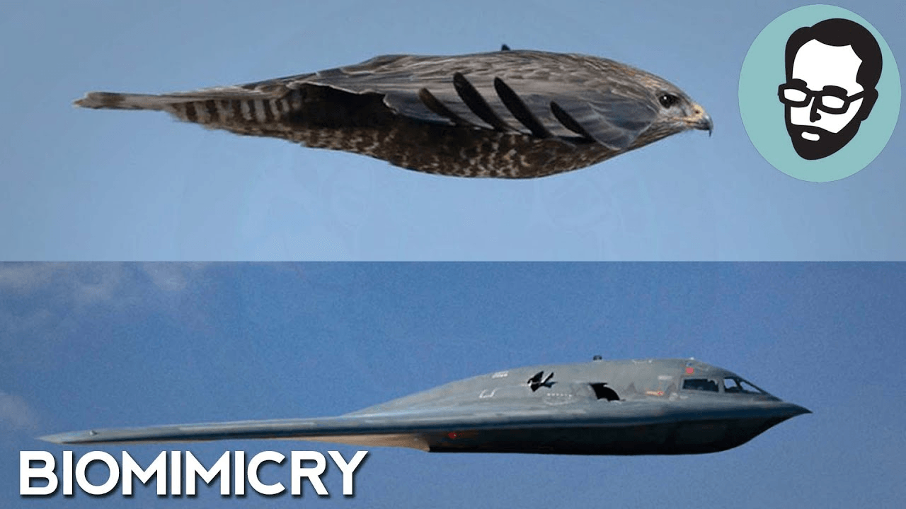

As we get closer to spring and nature begins to come alive, so does science! This week, we’ll explore how the natural world 🌿 isn’t just beautiful, it’s brilliantly engineered! From bullet trains modeled after birds to groundbreaking brain research and regenerative medicine 🧬, this week’s issue explores how science is evolving by learning from the world around us. Discover the future of biomimicry, uncover how one bad meal becomes an unforgettable brain imprint, and dive into Japan’s game-changing stem cell innovations. 🧠

*“Nature’s inventions are millions of years ahead of us— we’re just catching up.” - Janine Benyus, founder of the Biomimicry Institute*

## STEM News 📰

### Japan’s Stem-Cell Revolution

*With Nobel Prize-winning roots and government-backed investment, Japan is leading the way in regenerative medicine, using iPS cell technology to treat diseases once thought incurable.*

-   **Major Investment & Innovation**: Over ¥110 billion (~US$760 million) invested; based on Shinya Yamanaka’s Nobel-winning iPS cell discovery.

-   **iPS Cell Advantages**: Can turn into any tissue; avoids ethical concerns of embryonic stem cells.  

-   **Breakthrough Trials**:

    -   *Vision:* Masayo Takahashi’s macular trial; 10-year cell survival, halted vision loss.

    -   *Cornea:* Kohji Nishida; vision improved in 3 of 4 patients.

    -   *Parkinson’s:* Jun Takahashi; 4 of 7 improved, some regained independence.

    -   *Spinal Injuries:* Hideyuki Okano; 1 patient stands, 2 partially recovered.

-   **Fast-Track System**: 2013 law allows conditional approval if safe and likely effective; includes health coverage during extended trials.  

-   **Ongoing Challenges**: Small sample sizes, high costs, long-term uncertainty, and two withdrawn treatments due to limited effectiveness.

[Read the full article in Nature](https://www.nature.com/articles/d41586-025-01143-7)

### Why You’ll Never Forget Food Poisoning

*Scientists uncover how flavor memories become seared into the brain with insights that could transform how we understand trauma, addiction, and mental health.*

-   **Powerful Brain Circuit**: Princeton researchers traced how the amygdala and CGRP “alarm” neurons work together to link taste to gut pain.  

-   **How It Works**: One exposure + sickness = lasting memory; amygdala neurons light up with unfamiliar food, then get reinforced if illness follows.  

-   **Experiment Details**: Mice drank grape Kool-Aid, were made ill after 30 minutes, and avoided the flavor days later showing the brain's ability to link delayed events.  

-   **Neuroscience Tools**: Used transparent brains, light-sensitive genes, and live brain tracking to map flavor-sickness connections.  

-   **Beyond Taste**: Novelty plays a role in humans, unfamiliar spices, restaurants, or food combos can trigger the memory.  

-   **Mental Health Relevance**: Findings may explain how aversive learning leads to trauma or addiction; future therapies could target these circuits.

[Read the full article in Science News](https://www.sciencenews.org/article/mouse-brain-food-poisoning-amygdala)

## 🌿 STEM & Nature: Biomimicry

### What’s Biomimicry?

Biomimicry is when engineers, scientists, and inventors take inspiration from nature to solve human problems. From animals to ecosystems, nature is the ultimate problem-solver.

### 🚄 Cool Innovations Inspired by Nature

- 🔊 **Bullet Trains & the Kingfisher:** The front of Japan’s bullet train was redesigned based on the kingfisher’s beak, allowing it to travel faster without loud tunnel booms, and it uses 30% less energy.  

- 🧲 **Velcro & Burr Seeds:** Inspired by the tiny hooks on burdock burrs, Velcro was invented after an engineer’s dog got covered in them. Now it’s used in everything from sneakers to spacecraft.  

- ❄️ **Arctic Antifreeze & Fish:** Some Arctic and Antarctic fish produce natural antifreeze proteins that stop their blood from freezing in icy waters. Scientists are studying these proteins to design freeze-resistant crops, organ preservation tech, and even better ice cream!  

- 🌊 **Sharkskin Swimsuits:** Olympic swimsuits have been modeled after sharkskin, which reduces drag in water. This same texture is now used to design bacteria-resistant surfaces in hospitals.  

- 🦎 **Gecko-Inspired Adhesives:** Geckos can climb smooth walls using tiny hair-like structures on their feet. Scientists copied this to create reusable adhesives, like tape that can hold multiple pounds with no glue.

