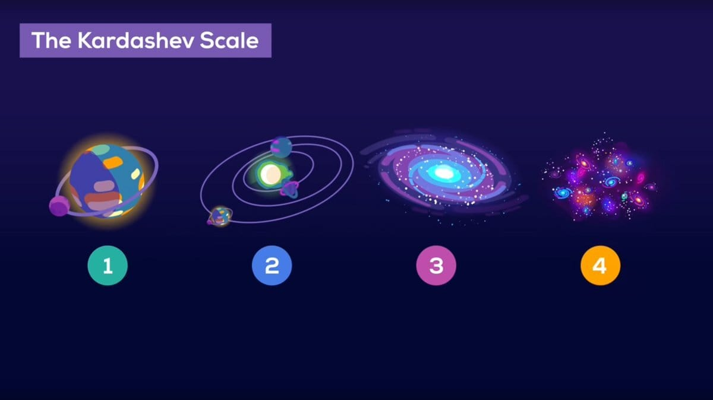
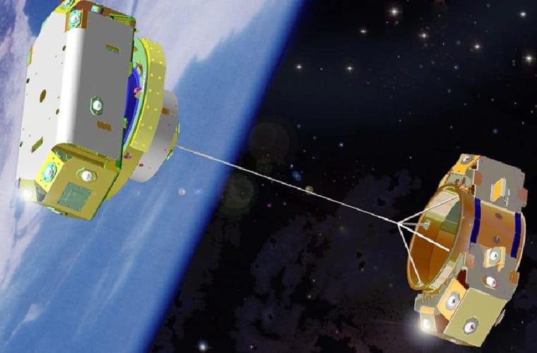
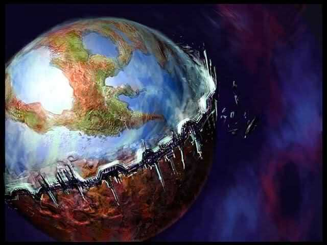
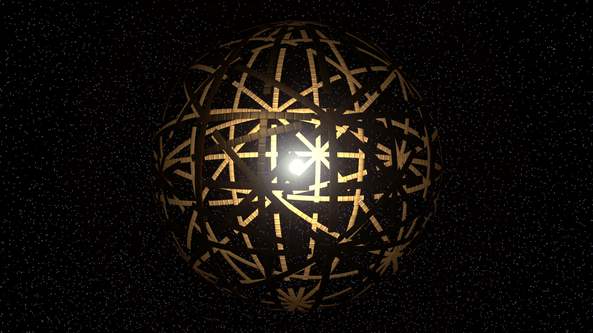

This month, we’re gazing beyond our skies and diving deep into the greatest mysteries of the cosmos 🚀. Why haven’t we found aliens yet 👽? Could humanity one day build cities in space or harness the power of stars? From the Fermi Paradox to the Kardashev Scale, we’re exploring science that sounds like science fiction, but may shape our future reality. Perfect for curious minds of all ages, this newsletter invites you to think big, wonder wildly, and imagine the science of tomorrow. 🛸

*“The sky calls to us. If we do not destroy ourselves, we will one day venture to the stars.” - Carl Sagan*

## Debated Theories & Paradoxes 🛸

### The Question: The Fermi Paradox

**What is it?**  
There are **billions of stars** ⭐ in our galaxy and many have planets like Earth. So, where is everyone?

Physicist **Enrico Fermi** asked: “If the universe is so big and old, and life seems so likely...  
**Why haven’t we found aliens yet?**” 👽

This big mystery is called the **Fermi Paradox**.

**Attempts to Solve:**

-   Giant radio telescopes 🔭 listen for signals
-   Spacecraft scan for signs of life
-   Rovers explore Mars and icy moons

### An Answer: The Dark Forest Theory

One chilling idea to answer the Fermi Paradox is the **Dark Forest Theory**.

Imagine the universe is like a **dark forest**. Every civilization is a **hunter**, quietly hiding in the trees. 

Why? Because…

-   They **don’t know if other civilizations are friendly**

-   They **can’t risk being attacked**

-   So they **stay silent** 🤫, just in case

Everyone’s listening, but no one’s speaking 🔇

## The Future of Space Science 🌌

### The Kardashev Scales & Advanced Civilization

**What is it?**  
The Kardashev Scale, developed by Nikolai Kardeshev, is a way scientists imagine how advanced a civilization is, based on how much energy it can use.

- 🪴 **Type I** – Uses **all of a planet’s energy** (like wind, solar, water, geothermic).  
    → 🌍 **Where we are now:** Earth is at about **0.73**, not a Type I yet  

- ☀️ **Type II** – Uses the energy of a **whole star** (like the Sun).  

- 🌌 **Type III** – Uses the energy of an **entire galaxy**!  

**Why it matters:**  
It helps scientists think big and imagine how humans (or aliena) might grow over thousands of years.

### Space Tethers, Solar Sails, New Propulsion

**Tired of rockets? So are scientists!** These two new tech ideas are changing how we think about space travel:

- 🧵 **Space Tethers** – Imagine a giant cable in space that can fling or catch spacecraft, kind of like a slingshot

- ⚡ **Space Elevators** – A super-strong cable stretches all the way from Earth to space. Instead of using rockets, we could send cargo or even people up this "elevator" using electric-powered climbers. 

- 🌞 **Solar Sails** – Instead of fuel, some spaceships are using **sunlight as wind**, gliding through space on reflective sails

**What we’re doing now:**  
NASA’s **“NEA Scout”** uses a solar sail to explore asteroids. Space tethers are being tested on satellites today.

### Terra-forming & Space Colonization

**Terraforming** means **changing a planet** (like Mars or Venus) so humans can live there. That means:

-   Adding breathable air

-   Warming it up

-   Maybe even growing plants

While full terraforming is still science fiction, scientists are already:

-   Testing plant growth in Martian soil

-   Building habitat domes in harsh climates on Earth (like Antarctica or deserts)

-   Sending robotic missions to prepare for **human colonization of Mars**

### Dyson Sphere & Megastructres

Real science of dreaming big. These are plans that scientists have laid out by the time humanity reaches a Level I-II on the Kardashev scale. 

-   **Dyson Sphere/Swarm** – A giant structure around a **star** to catch all its energy through the use of mirrors  

-   **Megastructures** – Space cities, planet-size machines, and rotating habitats that could one day house humans in deep space

