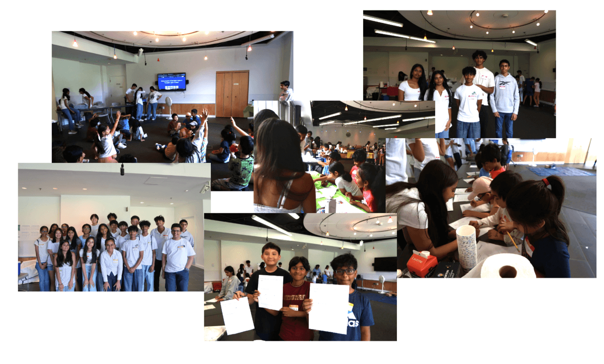

This week, we’re venturing into Earth’s hottest, driest, and most extreme landscapes; the deserts ☀️🌵! From singing sand dunes to lost cities buried beneath the sands ⏳, deserts hold secrets that push the boundaries of science and survival 🧬. In this newsletter, we will explore how Mars rovers train in the Atacama, how light tricks our eyes into seeing mirages 🌈, and how scientists are creating futuristic tech that pulls water from thin air 💧. 

*“In the silence of the desert, we find the loudest echoes of ourselves.” - William Langewiesche*

## ChemQuest News 🗞️

### ChemQuest Event! 🧪

ChemQuest Youth Organization is happy to announce that our 5th official event was a great success! We saw a great turnout of students at the Brandywine Hundred Library all excited to learn about science filled with our wonderful volunteers eager to spread the joy. 

## STEM at Earth’s Extremes: Dunes to Discoveries 🏜️

### The Atacama Desert: Earth’s Driest Place

The Atacama in Chile is one of the **driest places on Earth**; some parts haven’t seen rain 🌧️in centuries! 

-   But **microbes** still live here, surviving in salty rocks 🪨and harsh sun ☀️.

-   NASA uses Atacama’s extreme dryness to **test Mars rovers**, because its soil is similar to the Red Planet’s.

### Singing Sand Dunes & Whispering Deserts

In deserts around the world, like in China, Namibia, and the U.S., **sand dunes can “sing”**! 🎶

-   When the sand shifts just right, it creates **deep, eerie hums** that can last for minutes.

-   Scientists think it’s caused by **layers of sand grains sliding together** at just the right speed and size.

### Desert Mirages & Light Bending Illusions

Ever seen a “water puddle” on a hot road? That’s a mirage! In deserts, extreme **heat bends light** rays, creating illusions like:

-   Water that isn’t there 💧

-   Floating cities on the horizon 🏙️

-   Doubling or flipping of distant objects 🔄

💡 *It’s all about **physics**, and our eyes getting tricked by refracted light!* 🌈

### Ancient Cities Lost to Sand

Under desert sands ⏳, archaeologists are discovering:

-   Ancient roads and homes **buried for centuries**

-   Desert pyramids and underground tombs

-   Fossils from when deserts were once seas! 🦴

*New tech like* ***ground-penetrating radar*** *and* ***satellite imaging*** *is helping uncover lost civilizations without digging!*

## The Future of Desert Survival & Tech ☀️

### Solar Farms & Clean Energy Powerhouses ⚡

**Deserts get intense sunlight**, making them ideal for solar energy. Massive solar farms are being built in:

-   The Sahara

-   Arizona

-   The Middle East

💡 *Some are even testing* ***floating mirrors*** *and* ***solar towers*** *that generate electricity using heat!*

### Water Harvesters & Air-to-Drink Tech 💧

With no lakes or rain, desert scientists are developing water tech like:

-   Fog nets that trap water from morning mist 🌫️

-   Solar-powered devices that **pull water from thin air**

-   **Artificial oases** that recycle and purify every drop

### Smart Cactus Tech & Drought-Proof Plants 🌵

Desert plants survive with almost no water. Now, scientists are:

-   Designing crops that mimic cacti roots and waxy skins

-   **Using genetics** to grow plants that can store water or survive heat

-   Monitoring desert plants with AI to **learn their survival secrets** 🧠

💡*This could help farmers in dry regions and future space colonies* ***grow food.***

### Astronomy in the Desert 🔭

Deserts have:

-   Clear skies ☁️❌

-   Low pollution 💨

-   High altitude 🏔️

That makes them perfect for telescopes! Major observatories in deserts like:

-   The ALMA Array in Chile (radio telescopes)

-   JWST prep labs in dry Arizona climates
