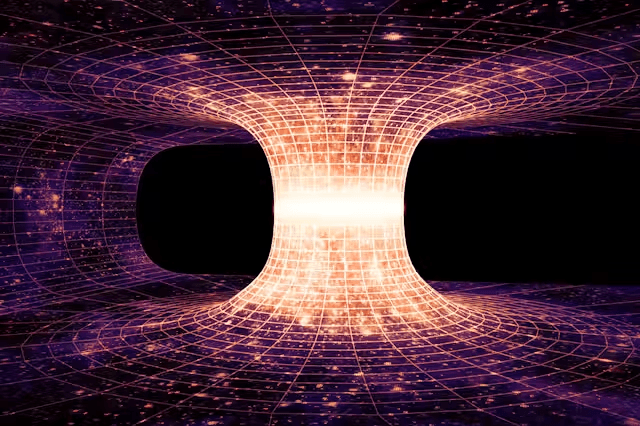
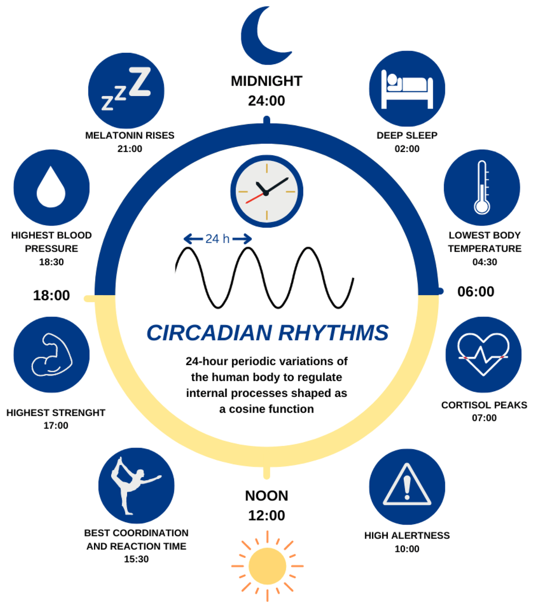

This week, we’re unraveling the mysteries of time itself ⏱️. The ticking force behind every heartbeat, sunrise, and satellite in orbit! From ancient sundials to atomic clocks, and Einstein’s mind-bending theories to futuristic time travel models, science is uncovering how time works, how it warps, and how we might one day bend it. In this newsletter, explore the strange world of circadian rhythms that rule your sleep 😴, learn how time slows down near black holes 🕳️, and discover how quantum physics might unlock the door to time machines! ⏳🧠

*Time travel is not only possible— it’s happening all around us, all the time. We are all traveling into the future, one second at a time. - Neil deGrasse Tyson*

## ChemQuest News 🗞️

### New ChemQuest Recruiting Alert!

Are you passionate about science, innovation, and making a difference? ChemQuest is looking for enthusiastic and dedicated **rising freshmen to juniors** to help continue our mission of spreading STEM education and empowering the next generation of young scientists! 🧑‍🔬

If you're **curious**, **creative**, and **ready to take initiative**, we want YOU on our team! ✨ 

Join us in expanding ChemQuest’s impact through exciting events, research, and outreach projects.

📩 [Apply to join the ChemQuest team (Google Form)](https://docs.google.com/forms/d/e/1FAIpQLScken4jlLQHjMaou428_uz1YSJlU3pX0SFNI0tmNFSx2HvtqA/viewform?usp=dialog)

### ChemQuest at Concord Township

📅 **Saturday, September 6th**  
🕐 **4:00 PM – Dusk**  
📍 **687 Smithbridge Rd, Glen Mills, PA 19342**

Join us for a fun-filled day with ChemQuest! We’ll be handing out sweet treats, testing our STEM skills with exciting science quizzes, and enjoying a great time together.

We’ll also share future opportunities for your kids and give you a sneak peek at upcoming, exciting ChemQuest events.

We’d love for you to stop by and be part of the fun!

## Science of Time: Loops, Clocks & Time Travel 🕰️

**Atomic Clocks: Earth’s Most Precise Timekeepers**  
Atomic clocks measure time using the vibrations of atoms (mostly cesium or rubidium).

They are accurate to within a **second over millions of years!**

-   Used in GPS satellites, space missions, and global timekeeping 🔬

-   Even the smallest error in time could throw off your location by miles! 🌍

**Relativity & Time Dilation: Time Doesn’t Tick the Same for Everyone**  
Einstein’s theory of relativity shows that time **slows down** the faster you move or the closer you are to a massive object.

-   Astronauts age slower in orbit than on Earth 🚀

-   Near black holes, time nearly stops; one hour could equal years back on Earth! 🕳️

This is **NOT** science fiction. It’s been proven by comparing **two synchronized atomic clocks**: one on Earth, one on a fast-moving jet.

### Body Clocks: How Time Lives Inside You

Humans have **biological clocks** called circadian rhythms that regulate:

-   Sleep and wake cycles 😴

-   Hormone release and metabolism 🧠

-   Body temperature and alertness

Disruptions (like jet lag or night shifts) can mess with mood, memory, and health.  
💡 New tech is helping us “reset” our body clocks with **light therapy** and **chrono-nutrition**!

**Time Travel Theories: Can We Travel Through Time?**  
Scientists and sci-fi writers alike wonder: *can we really move through time?*

-   **Wormholes:** Hypothetical tunnels in space-time that could connect two distant points in time 🌀 

-   **Closed Time-like Curves (CTCs):** Mathematical loops where time might circle back on itself ♾️   

-   **Quantum Entanglement:** Could particles influence each other across time as well as space? ⏳

While still theoretical, physicists are building models and running simulations **in search of answers.**

## The Future of Time Science ⏰

-   Quantum clocks that could **map underground tunnels and magma**

-   Research into how time emerges from **quantum fields**

-   **Time crystals:** a new phase of matter that **moves without energy** input

-   **AI** predicting shifts in *circadian rhythms* for medicine and mental health

As we explore time’s secrets, we may change how we understand everything— from our memories to the universe itself!

