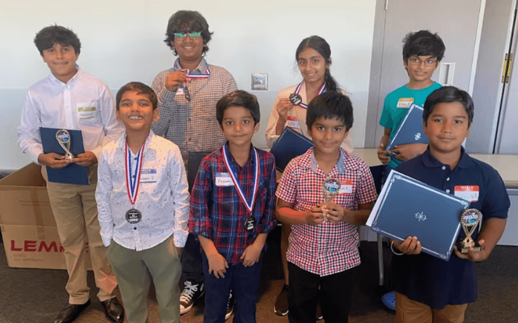

Welcome back to the ChemQuest Newsletter! This week, we’re preparing for one of our biggest events of the year-The Annual ChemQuest Science Fair. Whether you’re a budding researcher 📚 or an experimenter 🔬, this is your chance to showcase your curiosity, creativity, and STEM skills. If you’re not feeling fully confident about participating, this week’s edition will guide you toward a stronger understanding and help you prepare. And don’t forget: science fairs aren’t just about projects, they’re about discovering what excites you most in science! 🚀

*“The important thing is not to stop questioning. Curiosity has its own reason for existing.” - Albert Einstein*

## ChemQuest News 🗞️

**Second Annual ChemQuest Science Fair!**
📍 Brandywine Hundred Library  
🎓 For Middle School Students Only

ChemQuest is excited to announce our **Second Annual Science Fair**! This is a chance for middle schoolers to dive into the world of research and showcase their creativity and curiosity. Participants can choose to either conduct an **experiment** or present a **literature review** on a scientific topic of their choice.

Whether you're testing a hypothesis or exploring existing research, this is your moment to shine—**discover, present, and inspire!**

[Sign up for the ChemQuest Science Fair](https://chemquestpa.wixsite.com/chemquest/about-5)

## Science Fair Success Guide 🔬

Science fairs are an exciting chance to dive deep into a scientific idea, showcase your creativity, and sharpen your research skills. 

But before you begin, you’ll need to choose how to structure your project. Two powerful approaches are available: **a literature review** (analyzing existing research to answer a big question) or **an experimental design** (planning and conducting your own investigation). 

## Literature Review Path: Investigating Ideas Through Research 📚

Not every project needs a lab setup. A literature review allows you to explore an important scientific question by analyzing and synthesizing existing studies. Instead of collecting new data, you become the detective piecing together what’s already known.

**Steps to Success:**
1.  Choose a Focused Question - Example: *How effective are multispectral imaging systems for biometrics compared to traditional infrared?*
2.  Gather Reliable Sources - Use journals, scientific databases, and credible organizations.  

3.  Organize Findings - Compare methods, note gaps in knowledge, and highlight key patterns.  

4.  Draw a Conclusion - Summarize where research stands and what directions could come next.  

**Why Choose This?**
-   Great for students with strong analytical and writing skills.  

-   Ideal if lab resources are limited.  

-   Prepares you for future academic research.

## Experimental Design Path: Discovering Through Data 🔬

If you love hands-on science, experimental design is your chance to bring curiosity to life. You’ll form a hypothesis and collect data to test it directly.

**Steps to Success:**
1.  Identify a Testable Question - Example: *Does recycled plastic concrete maintain strength compared to traditional concrete?*  

2.  Form a Hypothesis - Make a clear, testable prediction.  

3.  Design Your Experiment - Plan variables, controls, and materials.  

4.  Collect Data Carefully - Keep detailed, consistent records.  

5.  Analyze & Present - Use graphs, statistics, and visuals to explain your findings.  

**Why Choose This?**
-   Perfect for students who like building, tinkering, or experimenting.  

-   Offers unique results that are 100% your own.  

-   Strengthens problem-solving and critical thinking skills.
