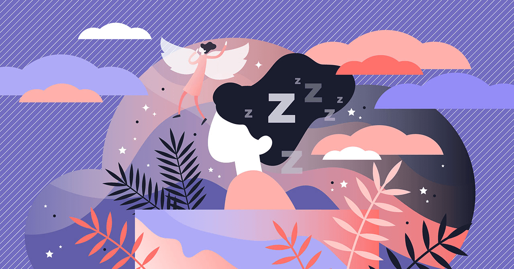
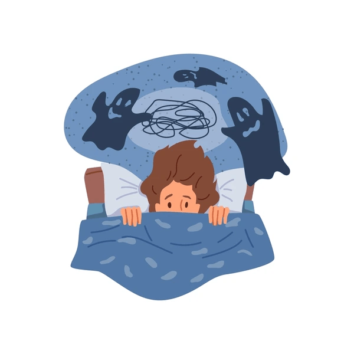

Hello! This week, we’re diving into one of science’s most mysterious frontiers—the world inside our minds. 🧠✨What happens when we sleep? Why do dreams feel so real, and could technology one day record or even control them? Whether you’re curious about memory, imagination, or even the possibility of recording dreams one day, this edition will guide you through the cutting edge of consciousness research. Get ready to explore the science of sleep, where biology meets mystery 🔎and the boundaries of reality start to blur. 🌌

*“Dreams are the laboratories of the imagination.” - Unknown*

## Dream Science & Consciousness

### Lucid Dreaming & Sleep Cycles 🌙

Sleep isn’t just rest, it’s a cycle of shifting brain states.

-   **REM sleep** is where most vivid dreams occur.  

-   In **lucid dreams**, people realize they are dreaming and can sometimes control the dream world.  
     

*Scientists use these unique states to study **consciousness**, **creativity**, and **memory formation**.*  

### Brainwave Tracking Tech 📡

The brain never stops firing, even while we sleep. With **EEG technology**, researchers can measure electrical patterns across different states of awareness:

-   **Delta waves** → deep sleep  

-   **Theta waves** → dreaming & imagination  

-   **Beta waves** → alert wakefulness  

### Memory Implants & Dream Recording 🧩

Cutting-edge research is blurring the line between science fiction and reality:

-   **Memory implants** could help strengthen learning during sleep.  

-   **Dream recording** is being explored using brain scans + AI to recreate fragments of dream imagery.  

*These advances raise ethical questions about **privacy**, **identity**, and how much of the inner mind should be made **visible**.*  

### Neuroscience of Imagination 🎨

Dreams and imagination share surprising overlaps:

-   The **visual cortex** activates whether you see an image or imagine it.  

-   Athletes practicing mentally trigger the **motor cortex** as if they were moving in real life.

This suggests imagination is more than “just pretend”—it’s a tool for **problem-solving**, **creativity**, and **preparing for the future**!  

### Altered States & Consciousness Expansion 🌀

Beyond dreams, the brain can enter altered states through **meditation**, **hypnosis**, or even **sensory deprivation**. Scientists study these states to:

-   Understand how reality is constructed by the brain  

-   Explore potential therapies for trauma and anxiety  

-   Push the boundaries of what “consciousness” really means

## The Dark Side of Dreams: Sleep Paralysis & Nightmares 😱

Not all sleep is peaceful. Sometimes your **brain and body fall out of sync**, creating eerie experiences that feel terrifyingly real.

### Sleep Paralysis 🛌

-   Happens when your brain wakes up but your body remains “asleep.”  

-   You may be unable to move or speak, sometimes feeling **pressure** on your chest or sensing a presence in the room.  

-   Scientists think it’s a mix of REM **sleep intrusion** and **heightened awareness**.  

*Cultures worldwide have myths about demons, aliens, or spirits—many of which might be inspired by sleep paralysis!* 👻  

### Night Terrors & Scary Dreams 🌙

-   Different from regular nightmares, night terrors mostly occur in **non-REM sleep** and can make you scream, thrash, or wake up confused.  

-   Common in children, but adults can experience them too, especially under **stress**.  

### The Brain’s Trickery 🧠

-   During REM sleep, your **amygdala** (fear center) is highly active, while logic areas of the brain take a backseat.  

-   That’s why some dreams can feel terrifyingly real, even though you “know” it’s not happening.  

### Why Study the Scary Stuff? 🔬

-   Understanding sleep paralysis and nightmares helps scientists learn **how the brain processes fear** and safety.  

-   Could lead to **treatments** for insomnia, PTSD, and other sleep-related disorders.  

-   Offers insight into the thin line between conscious and unconscious thought; and how **imagination and reality collide**.  

💡 ***Fun Fact:*** *Researchers are exploring ways to “hack” sleep, using gentle cues like sounds or lights, to help people overcome nightmares or even reduce sleep paralysis episodes!*

