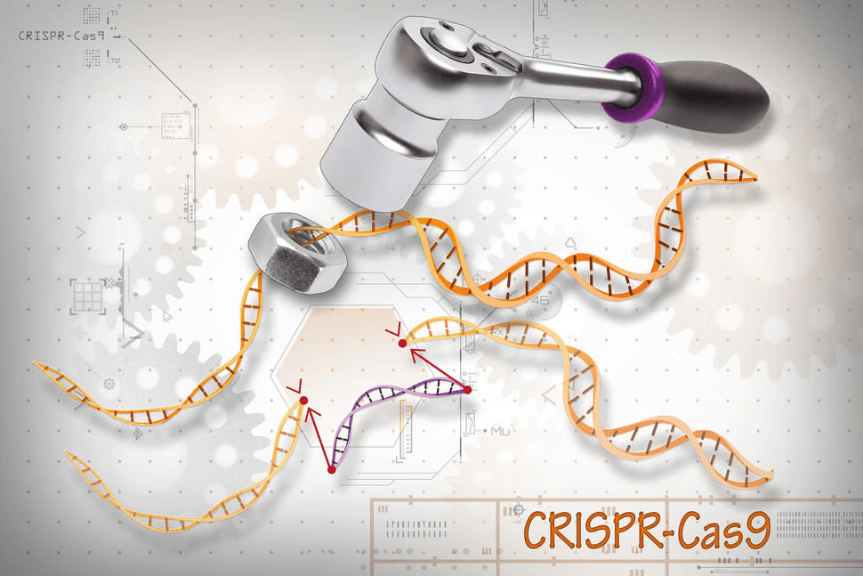
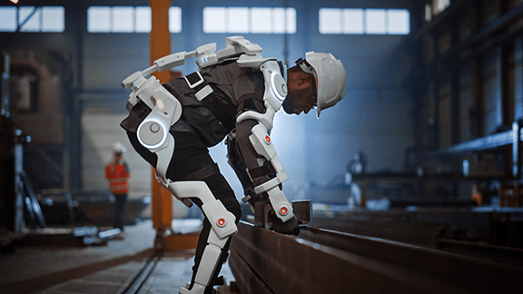

Hello! This week we’ll be exploring an exciting scientific frontier! 🧬⚡What if we could reprogram our genes, connect our brains to computers, or even grow new body parts in the lab? From CRISPR breakthroughs to wearable tech that feels straight out of sci-fi, the quest to optimize the human body is transforming medicine, ethics, and even what it means to be human. Get ready to explore the science of human enhancement, where biology meets engineering! 🚀

*“Genetic engineering may one day eradicate disease, but it may also redefine what it means to be human.” - Leon Kass*

## Gene Editing: Rewriting Our Genetic Code 🧬

Our DNA is the instruction manual for life, and with **CRISPR-Cas9** scientists can now edit it with incredible precision.

-   **Disease Eradication:** Imagine removing mutations that cause sickle cell anemia or cystic fibrosis!  

-   **Designer Genes?** Gene editing could one day enhance traits like intelligence, strength, or appearance. But… this raises huge ethical questions/concerns.  

-   **DIY Biology:** Community labs worldwide let citizens experiment with gene editing tools, sparking debates about safety and accessibility.

## Wearable Tech & Brain-Computer Interfaces 🧠

The line between humans and machines is getting thinner:

-   **Neural Implants:** Devices like Elon Musk’s Neuralink aim to let people control computers with thought alone.  

-   **Exoskeletons:** Wearable robotics help paraplegics walk again, and may one day boost strength in healthy users.  

-   **Smart Skin & Sensors:** Flexible electronics can track health in real time, from glucose levels to brainwaves.

## Lab-Grown Muscles & Synthetic Skin 🧪

Biology is no longer just grown, it’s engineered.

-   **Tissue Engineering:** Scientists are growing muscle fibers in labs to test drugs or repair injuries.  

-   **Synthetic Skin:** Bioengineers have developed skin that can sense pressure, touch, and even heal itself.  

-   **Organ Printing:** 3D bioprinters may one day create custom livers, hearts, or kidneys on demand.

## The Ethics of Human Enhancement ⚖️

Just because we *can* upgrade humans… should we?

-   **Fairness:** Who gets access? Only the wealthy?  

-   **Identity:** If we upgrade our bodies and minds, are we still “us”?  

-   **Boundaries:** Should enhancements be used only for medical reasons, or also to boost healthy people?

Ethicists argue that human upgrades could create a “genetic divide”, a world of the enhanced and the unenhanced. The decisions we make now could shape humanity’s future forever, so they must be considered in all possibilities.

## Beyond Biology: The Rise of DIY Biohackers 🔧

Outside of labs, **biohackers** experiment with everything from nootropics to implantable chips:

-   **NFC/RFID Implants:** Tiny chips under the skin to unlock doors or store data.  

-   **Nootropics:** Supplements claimed to boost memory, focus, and creativity.  

-   **Citizen Science:** Open-source biology movements are pushing innovation but also raising safety concerns.
