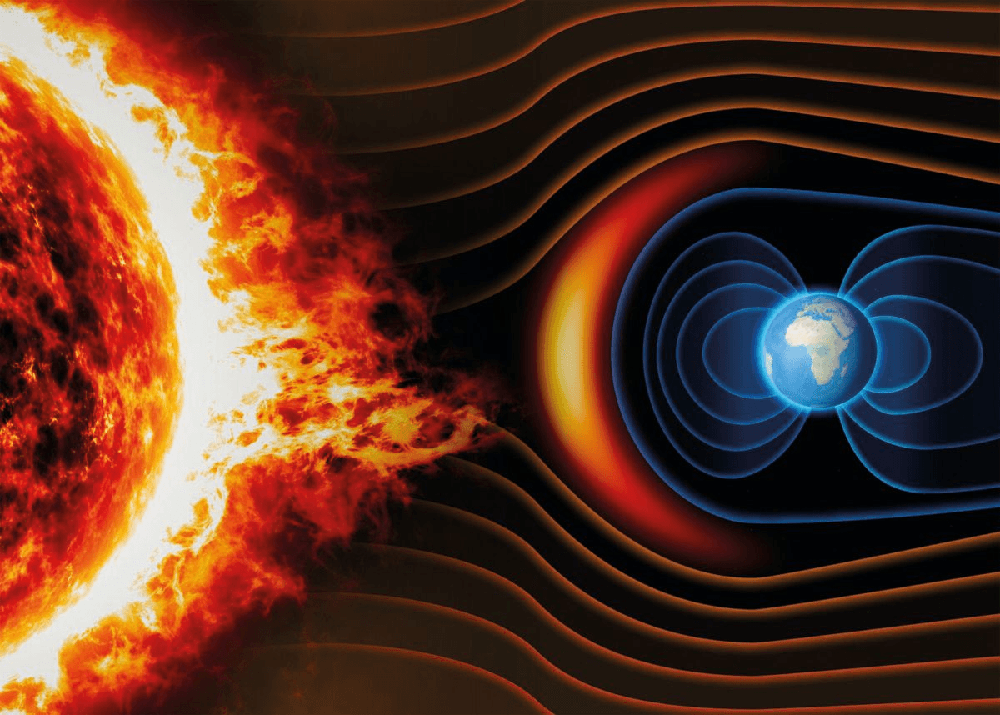
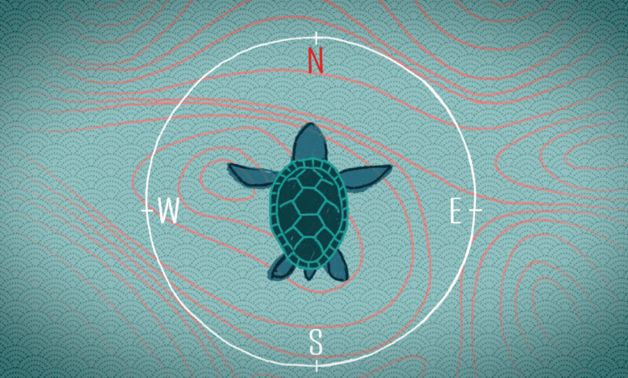

Hello everyone! This week we’ll be exploring the unseen powers that shape our world: invisible forces! 🌍✨ From the gravity that keeps your feet on the ground to the magnetism that makes a compass point north, they are all around us, quietly controlling how everything moves. Get ready to uncover the hidden world of invisible forces, always at work but never in sight! ⚡🧲

*“If you want to find the secrets of the universe, think in terms of energy, frequency, and vibration.” -Nikola Tesla*

## Gravity: The Force That Holds The Universe 🌍✨

Gravity might be one invisible force that first comes to mind. It is the force by which a planet or other body draws objects toward its center. 

**Planets & The Solar System** 🪐: Gravity is the invisible force that holds planets in orbit around the sun, and our moon in orbit around the Earth.

**Gravitational Lensing** 🔭: Albert Einstein discovered that massive objects like stars and black holes can bend light. Gravity can warp the fabric of spacetime!

**Black Holes 🕳️:** Their gravitational pull is so strong that not even light can escape it.

## Magnetism & Electromagnetic Fields: The Invisible Forces Shaping Our World 🧲⚡

The invisible forces that shape our universe are everywhere: 

**Earth’s Magnetic Shield** 🧭: Deep inside the earth, hot liquid metal moves around its core, making electrical currents. These currents create Earth’s magnetic field.

**Thunderstorms & Lightning ⛈️⚡:** The heat from the lightning makes the air explode outward, causing thunder. When it strikes, the moving electric charges create temporary magnetic fields in the surrounding air.

**Solar Flares & Space Storms** 🌞🌌: The sun’s magnetic field can suddenly realign, releasing bursts of energy known as solar flares. When these solar flares reach Earth, they can disrupt satellites, power grids, and radio signals.

## Invisible Wavelengths 🌈

Light is just one small part of a wide range of electromagnetic waves that travel through space. Most of them are invisible to our eyes.

**Electromagnetic Radiation 👁️**: Although all electromagnetic radiation is light, we can only see a small part of it. Most wavelengths are too large or too small for our eyes to see.

**Infrared and Ultraviolet Light** 🔴🟣: Infrared light lets us see heat and is used in night vision and remote controls. Ultraviolet light helps produce Vitamin D but can also cause sunburn.

**Electromagnetic Spectrum in Technology** 📡💻: Different wavelengths power our technology, from radio waves that carry broadcasts to X-rays used to see inside the human body.

## Sound Waves and Vibrations 🎵

Sound travels through air and matter as vibrating waves, carrying energy that lets us communicate, listen, and feel the world around us.

**Vibrations & Mediums** 🌊💨: When something vibrates, waves that move through solids, liquids, and gases are created. Without a medium, like air or water, sound cannot travel.

**Pitch & Volume** 🎶🔊: The speed of vibrations determines pitch and the strength of vibrations determines volume. Faster vibrations make higher sounds, while slower vibrations make lower sounds.

**Echoes & Reflection** 🦇: When sound waves hit surfaces, they can bounce back as echoes. This reflection helps animals like bats and dolphins navigate.

## Forces In Nature 🌿

Incredible forces are at work all around us in the natural world!

**Animal Magnetoreception** 🐦🧭: Some animals, like migratory birds and sea turtles, can sense Earth’s magnetic field to navigate long distances.

**Plant Phototropism** 🌱☀️: Plants can sense light using specialized photoreceptors in the plant's tip. This signals cells to grow unevenly and bend the plant towards the light.

**Lightning ⚡:** Lightning is an example of static electricity on a large scale. Electrical charges build up in storm clouds until they are released in a rapid discharge–a lightning bolt. 

## Latest In Science! Detecting Magnetism 🔬🧲

Scientists have just discovered a new way to detect the faintest magnetic signals in common metals.

**Hidden Magnetism** ✨: Even non-magnetic metals like copper, gold, and aluminum have subtle magnetic signals, which we thought were impossible to measure until recently.

**Light & Lasers** 💡🔵: Researchers used a technique where lasers helped measure how magnetism altered the reflection of light. They improved its sensitivity with higher tech and were able to pick up on these magnetic signals. 

**Why Does It Matter?** 🌟: Using light instead of tiny electrical wires makes detecting magnetism much simpler and less invasive. This breakthrough could help engineers create faster electronics and new technologies in the future.

### Sources

- [Shedding new light on invisible forces: Hidden magnetic clues in everyday metals unlocked (Phys.org)](https://phys.org/news/2025-07-invisible-hidden-magnetic-clues-everyday.html)
- [Earth’s Magnetosphere: Protecting Our Planet from Harmful Space Energy (NASA)](https://science.nasa.gov/science-research/earth-science/earths-magnetosphere-protecting-our-planet-from-harmful-space-energy/)
- [Visible Light (NASA)](https://science.nasa.gov/ems/09_visiblelight/)
- [What Is Gravity? (NASA Space Place)](https://spaceplace.nasa.gov/what-is-gravity/en/)
