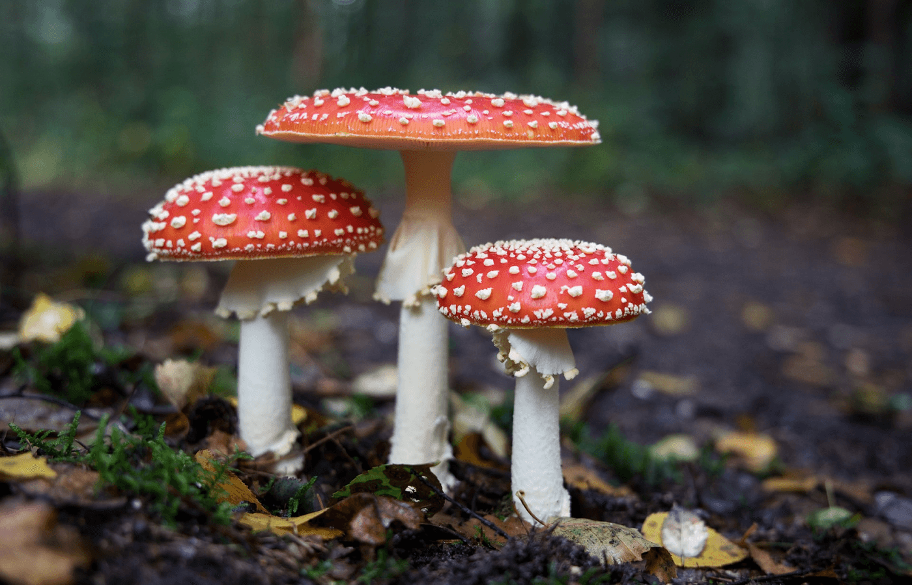
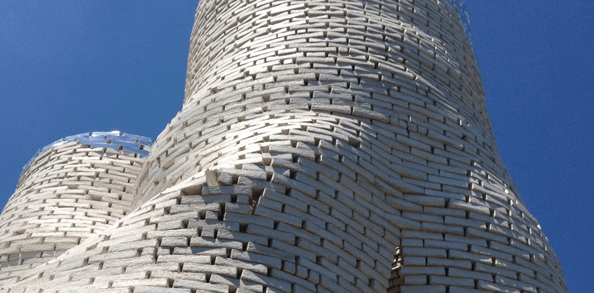
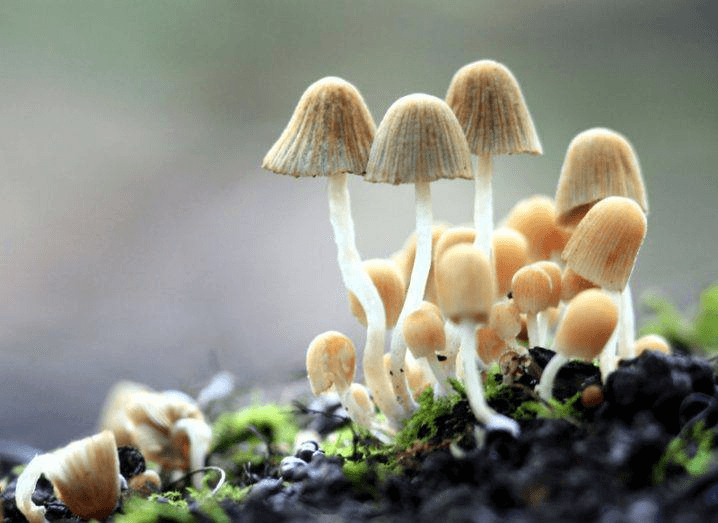

Hello everyone! This week we’ll be diving into the hidden, underground world of fungi 🍄. From their vast networks connecting entire forests to plastic-eating fungi that could help save our planet, these unique organisms do it all. Get ready to explore how fungi shape life on Earth (and maybe beyond) through their underground connections, surprising abilities, and tricks of survival! ✨🌎🌲

*“Nature alone is antique, and the oldest art a mushroom.” - Thomas Carlyle*

## Fungi? What are they? 🤔

-   Fungi are their own kingdom of eukaryotic organisms, separate from plants or animals. 🌱

-   They are vital to the ecosystem as decomposers of organic matter. ♻️

-   Some examples include mushrooms, molds, mildews, and yeast. 🍞

-   Fun fact! 🤩The largest organism on Earth is a single honey fungus in Oregon covering over 2,000 acres underground! 

## The Wood Wide Web 🌲💬

Nicknamed the Wood Wide Web, underground networks of fungal threads allow trees and other plants to communicate.

**Mycorrhizal Signaling** 🌐: Trees are able to send chemical signals through these networks to warn each other about diseases, pests, droughts, and other natural disasters.

**Mother Trees** 🌳🌱: Older and larger trees called mother trees use this network to connect to younger saplings and provide them with plant sugars and nutrients. This increases their chance of survival by around four times!

**Symbiosis** 🤝: Fungi attach to plant roots, helping the plant reach more water, phosphorus, and nitrogen from the soil. In return, plants feed the fungi sugars made through photosynthesis! 

### Mycelium: Nature’s Living Architecture 🍄

Mycelium is the underground network of fungal threads that help forests thrive. It acts as nature’s glue, binding materials together while growing itself!

**Sustainable Structures** 🏡: Scientists are using mycelium as a renewable alternative to concrete and plastic. It’s lightweight, durable, and even compostable when no longer needed.

**Design That Grows 🌍:** Architects are shaping entire buildings from mycelium bricks, letting walls and furniture quite literally grow into form.

**Closing the Loop** 🔄🌿: When mycelium-based materials reach the end of their life, they can return safely to Earth.

## Eating Plastic: Nature’s Recyclers 🌎

Millions of tons of plastic waste end up in landfills and oceans each year, but fungi might be the key to breaking it down.

**Fungi vs Plastic** 🧫: Certain fungi that decompose wood can also break down plastics, since both have similar carbon-based structures.

**Enzymes** 🧪: These fungi use compounds like laccases and peroxidases to break down plastic into smaller, natural molecules.

**The Future Of Recycling ♻️:** Researchers are exploring how these fungi could help clean up our planet. Someday, we might even use fungi in compost bins or recycling plants to reduce plastic waste!

## Parasitic Fungi 🦠

Parasitic fungi invade and feed on other living beings, from insects to trees, taking control in ingenious ways.

**Zombie Makers** 🧟: Some fungi hijack insects’ minds, turning them into spore-spreading puppets before consuming them from within.

**Tree Takers** 🌱🌳: Others infect plants, drawing nutrients from their host while slowly altering ecosystems in unseen ways.

**Nature’s Balances ♻️:** Though destructive, parasitic fungi play vital roles in maintaining ecological balance by regulating populations and cycling nutrients.

## Fungi In Space 🪐

Certain fungi can survive where no plant or animal could live, thriving in intense radiation and zero gravity.

**Cosmic Resilience** 🌌: On the International Space Station, fungi have continued to grow despite cosmic rays that would destroy most life.

**Martian Builders 👽:** Scientists envision growing fungal shelters on Mars using local soil and spores, reducing the need to haul building materials from Earth.

**Future Bio-Shields** 🚀: These fungi could help create living radiation shields, protecting astronauts and equipment on deep-space missions.
