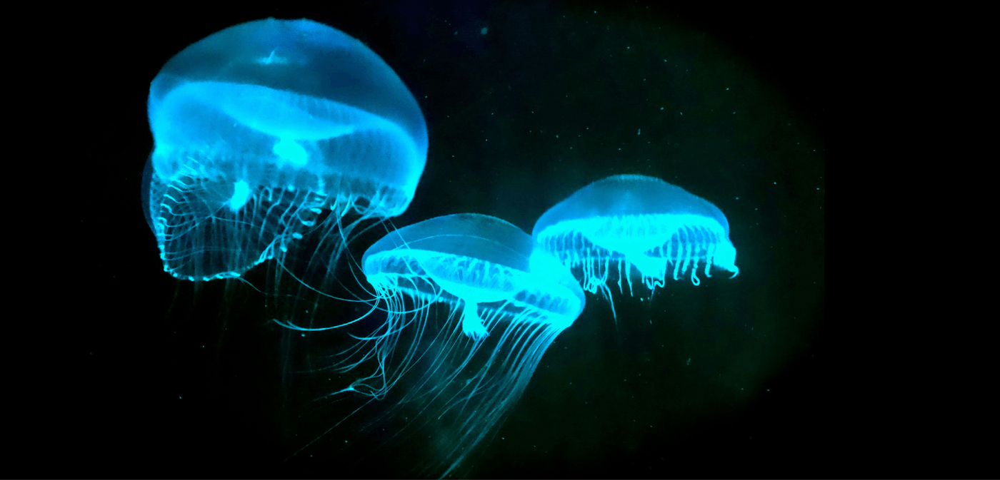

Hello everyone! 🌞 We hope you are having a wonderful Sunday! In this week’s newsletter, we’ll cover our recently hosted science fair and share one of many new, exciting advancements in science. Then we will dive into this week’s topic of bioluminescence! 🌟The production and emission of light from living organisms, it helps us develop tools for discovery while also creating incredible tourist spots!

🌊🌌*“In the ocean, bioluminescence is the rule rather than the exception.“ - Edith Widder*

## ChemQuest News 🗞️

**Second Annual ChemQuest Science Fair!**
-   The second annual ChemQuest Science Fair was a success! Everyone did so well and brought amazing projects that showcased their creativity and hard work. Thank you to all the students and parents who attended and supported the event!

-   Congratulations to our winners!

    - 🥇 Sriyan Vajrala

    - 🥈 Grace Joseph

    - 🥉 Sonali Patel-Ankeny

-   A special thanks to the dedicated organizers behind ChemQuest, whose hard work helped make this fair run smoothly. We look forward to seeing even more innovative projects and science enthusiasts at next year’s ChemQuest Science Fair!

### Latest In Science! Biocomputers 🧠💻

Scientists are experimenting with lab-grown human brain cells that act like tiny computers! These “blobs” of neurons, only about the size of a grain of sand, can receive and respond to electrical signals. Some have even learned to play Pong or recognize braille letters. This research could help us better understand the brain and lead to new, efficient biological computers!

## Bioluminescence in Science & Medicine 🧪🔬

Scientists have harnessed nature’s glow and turned it into tools for discovery.

**Tracking Life:** By adding glowing genes to cells, researchers can observe how cancer spreads or how medicines move through the body.

**Detecting Pollution:** Bioluminescent bacteria can act as living sensors in water. When their light dims or disappears, it signals the presence of harmful toxins. 

**Lighting the Future:** Engineers are developing glowing wood from bioluminescent materials. Someday, this technology may provide an energy-efficient and sustainable alternative to electric streetlights.

## Chemical Reactions Behind the Glow 🧪✨

Nature’s light shows come from amazing chemistry at work inside living creatures.

**Producing Light:** Bioluminescence occurs when an enzyme called luciferase reacts with a molecule called luciferin in the presence of oxygen. This reaction releases energy as visible light instead of heat.

**Energy Efficiency:** Because the glow comes from a controlled chemical reaction, almost no energy is wasted as heat, making it more efficient than typical light bulbs.

**Color Production:** The color of the glow depends on the specific types of luciferase and luciferin, as well as environmental factors, like pH and metal ions within the organism’s tissues.

## Deep Sea Wonders 🌊🐟

Most bioluminescent organisms live in the deep sea, where the water is pitch black. Creating their own light becomes a crucial tool for survival.

**Vampire Squids:** Instead of dark ink like squid on the surface, vampire squids eject a cloud of glowing mucus to startle their predators. They can also produce flashes of light for the same reason. 

**Color of the Ocean:** Light emitted by marine animals is often blue or green because these colors are more visible in the ocean, and most marine organisms are only sensitive to them.

**Counterillumination:** Some animals like lanternfish, hatchetfish, and squid produce light on their underside that matches the light coming from above. This camouflages them from predators below.

## A Glowing Earth 🌍💡

Bioluminescence can be seen in more than individual animals—it can light up entire ecosystems!

**Glowing Waves:** Bioluminescent bays are coastal bodies of water full of plankton like dinoflagellates that glow when disturbed. A single stroke of the water can make millions of plankton light up! These bays are so rare that there are only 5 in the world.

**Fungi in Forests:** Some species of bioluminescent fungi, like foxfire mushrooms, emit light to attract insects that help spread fungi spores. They glow green on decaying logs and leaves in the forest.

**Glowworms:** These tiny, glowing creatures hang from sticky silk threads at the top of caves to attract prey. Thousands of larvae create a starry effect inside dark caves.
