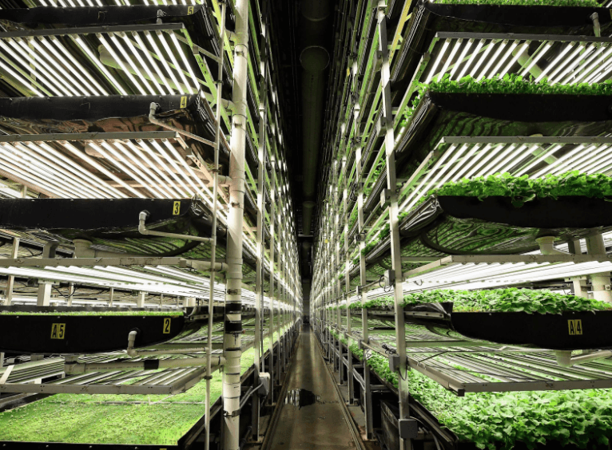
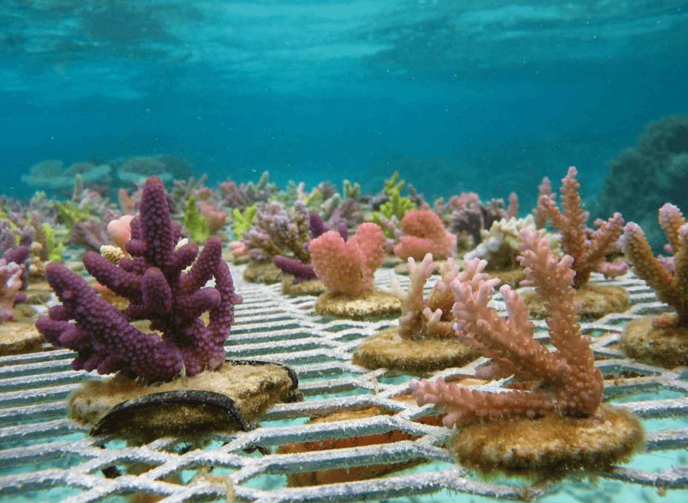

Happy Sunday! Welcome back to ChemQuest’s official newsletter. This week, we’ll spotlight a recent scientific discovery: scientists have uncovered a new species of flying reptile by examining fossilized vomit. Then, we’ll explore the exciting idea of science in survival! Whether that be protecting species at the edge of extinction, preserving resources used in agriculture, or restoring forests through advanced techniques, science and technology can always be found at the root of our planet’s resilience. 

*“We do not inherit the Earth from our ancestors; we borrow it from our children.”*

*\- Native American Proverb*

## Science News: New Dinosaur! 🦕

Scientists in Brazil discovered a new pterosaur species inside a 110 million year old pile of fossilized vomit. The regurgitated bones, likely expelled by a spinosaur, belonged to two previously unknown pterosaurs, now named *Bakiribu waridza* (“comb mouth” in the local Kariri language). This species was a filter feeder with bristly teeth and is the first of its kind discovered in Brazil. It’s the first time a new species has ever been identified entirely from fossilized vomit!

## Preserving Genes 🧬 🧫

What happens if a species on Earth is threatened with extinction? We store genetic information in many facilities as a precaution.

**Gene Banks:** These are used around the world to store genetic information of plants and animals. Their mission is simple—to preserve the genetic diversity of living organisms in case of a disaster.

**Seed Vaults:** A type of gene bank that stores seeds in multiple backup locations all around the world. Deep inside a mountain in Norway is the Svalbard Global Seed Vault, the most well-known example. 

## Vertical Farms 🌿 🏙️

By stacking farmland upward in tall racks, we’re able to produce more food using fewer resources!

**Why Indoors?:** Temperature, weather, soil, and light can all be carefully controlled. Because everything happens indoors, food can be produced continuously and in harsh climates.

**Hydroponics & Aeroponics:** Instead of soil, plants grow in nutrient-rich water (hydroponics) or fine mist (aeroponics). This cuts water usage by up to 95 percent!

**Artificial Intelligence:** Sensors track levels that correlate to plant health, and AI systems manage conditions in real time!

## Reforestation Drones 🌱🌲

Forests are the lungs of the Earth, but deforestation wipes out millions of trees every year. Drone technology is helping us reverse the damage effectively and efficiently.

**Aerial Planting:** Specialized drones can plant thousands of seed pods per day across difficult terrain, speeding up reforestation where human access is limited.

**AI Mapping:** Machine learning analyzes soil, moisture, and topography data to determine where each seed type has the best chance to grow, ensuring smarter and more efficient replanting.

**Monitoring Growth:** Infrared and thermal sensors track tree health, carbon capture, and biodiversity changes over time, all without disturbing wildlife or ecosystems.

## Coral Restoration 🪸🌊

Our oceans are warming, and coral reefs are under threat. Scientists and engineers are fighting back with innovative techniques to restore them.

**Coral Nurseries:** Researchers grow small coral fragments in underwater or lab-based nurseries, then transplant them back onto damaged reefs. These “replanted” corals can repopulate large reef areas over time!

**Genetic Resilience:** By studying which corals survive higher temperatures, scientists can selectively breed or engineer more heat-resistant species so that reefs can withstand future climate conditions.

**3D Printing:** Using eco-friendly materials, specialists design and print reef structures that mimic natural habitat shapes. Marine life quickly colonizes these artificial reefs, bringing ecosystems back to life!

