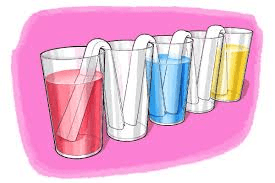
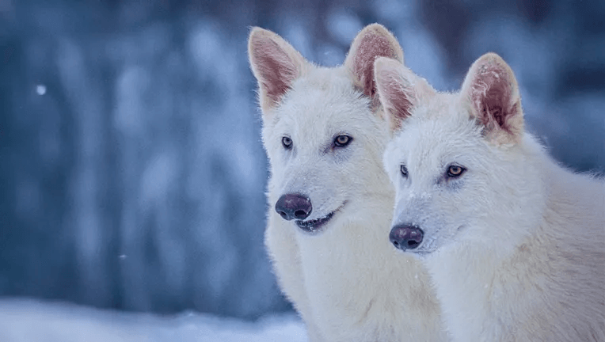
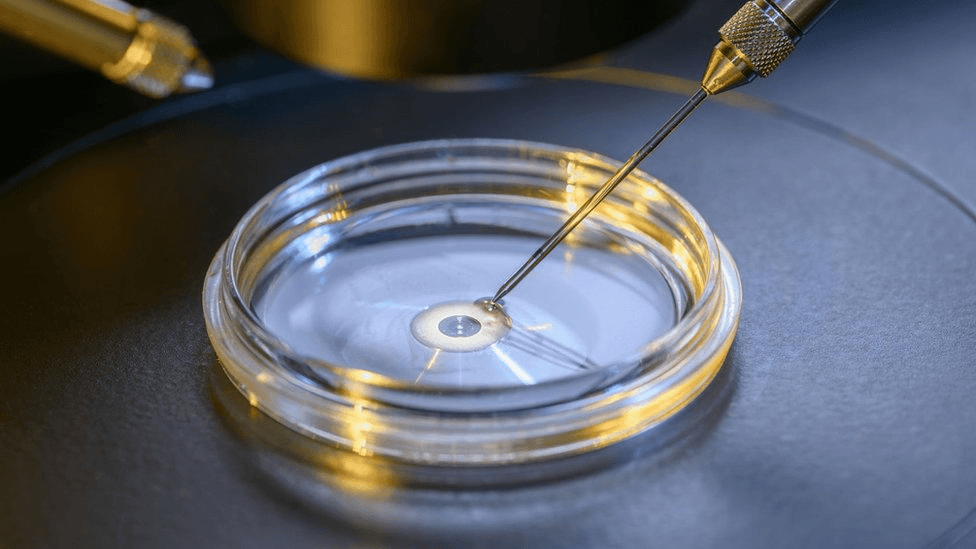

Hello everyone! ☀️In this week’s newsletter, we’ll briefly cover a recent scientific discovery, then introduce a fun, family-friendly science experiment to try at home. Our science topic of the week is… the science of the past! 🎉 From bringing back woolly mammoths to rediscovering the ancient ways of human life, science can tell us so much about the past and opens up infinite possibilities for the future. 

*“When we study ancient life, we’re not looking backward — we’re unlocking blueprints for the future.“* 

*\-Unknown*

## Latest In Science: Water On Mars? 🪐💧

Peculiarly bleached rock on Mars suggests that the planet may have been a humid, tropical region in the past! These rocks, discovered by NASA’s Perseverance rover, turned out to be kaolinite, a type of clay that almost always forms in warm, humid conditions. This opens up a greater mystery: How could a notoriously cold and dry planet have had tropical conditions? The leading theory is that Mars lost its water sometime between 3 and 4 billion years ago. Satellite images appear to show larger deposits of kaolinite in currently unexplored places on the Martian surface, and until we are able to reach them, this mystery remains unsolved.

## A Quick and Easy Science Experiment! 🥼🧪

You’ll need 5 clear cups, food coloring, paper towels, water, and patience.

1.  Fill 3 cups with water and arrange all 5 cups in this order:  full–empty–full–empty–full

2.  Using your food coloring, dye each cup of water a different color (preferably red, blue, and yellow)

3.  Roll a paper towel into a long rope, bend it in the middle to form a V shape, and place it between a full cup and an empty cup. Make sure one side of it is fully submerged into the water and the other is directed inside the empty cup. Repeat this step 3 more times to connect the rest of the cups.

4.  Then wait to see what happens!

Ask yourself a few questions. What do you think will happen? Did the result match your hypothesis? Why do you think this happened? Now do some research to understand the science! (Here’s a hint: capillary action)

## De-Extinction: Reviving the Past 🦣

Scientists are reviving extinct species through DNA extraction, cloning, and gene editing.

**Dire Wolves:** Using DNA from preserved remains in Alaska and other regions, researchers have produced the first dire wolf-like pups with enhanced size and traits!

**Woolly Mammoths:** By combining Asian elephant DNA with mammoth genes for cold resistance, shaggy coats, and massive tusks, scientists are developing elephant-mammoth hybrids to repopulate and protect Arctic grasslands.

**Dodo Bird:** Gene-editing pigeons could recreate dodo-like birds, potentially helping to revive island ecosystems!

## Ancient DNA 🧬

Fragmented DNA preserved in bones, teeth, and sediments reveals human migrations, diets, and lost worlds through advanced extraction methods.

**Neanderthal Genomes:** Complete sequences from finger bones show interbreeding with modern humans, contributing genes that still influence our immune systems today.

**The Iceman:** 5,300-year-old Alpine mummy DNA uncovers heart disease genes and a lactose-intolerant diet.

**Mummy Microbiomes:** Egyptian remains preserve gut bacteria that trace ancient diets, plagues, and hygiene habits, linking past pandemics to modern pathogens.

## Frozen Viruses and Microbial Mysteries ❄️🦠

As permafrost thaws, it can release ancient microorganisms and viruses preserved in ice for millennia.

**Yuka Mammoth RNA:** Scientists have extracted RNA up to 39,000 years old from a Yuka mammoth mummy in Siberia, making it the oldest RNA ever discovered.

**Pithovirus:** This 30,000-year-old giant virus from ice was revived in labs, larger than some bacteria and harmless to humans, but a wake-up call for amoebas!

**Lokiarchaeota:** Microbes from Arctic permafrost bridge the gap between simple and complex life, revealing early evolution’s origins.

## Early Technology & Engineering 💻🤖

Pioneering biotech fuses synthetic biology with fossil genes to engineer lost traits and resilient life forms!

**CRISPR Editing:** Precise tools insert extinct genes into living relatives.

**Synthetic Embryos:** Stem-cell technology enables embryos without eggs, offering potential surrogates for de-extinction.

**Organoid Biofactories:** Laboratory mini-organs grown from ancient DNA test immune responses and disease resistance, guiding future hybrid species for environmental renewal.
