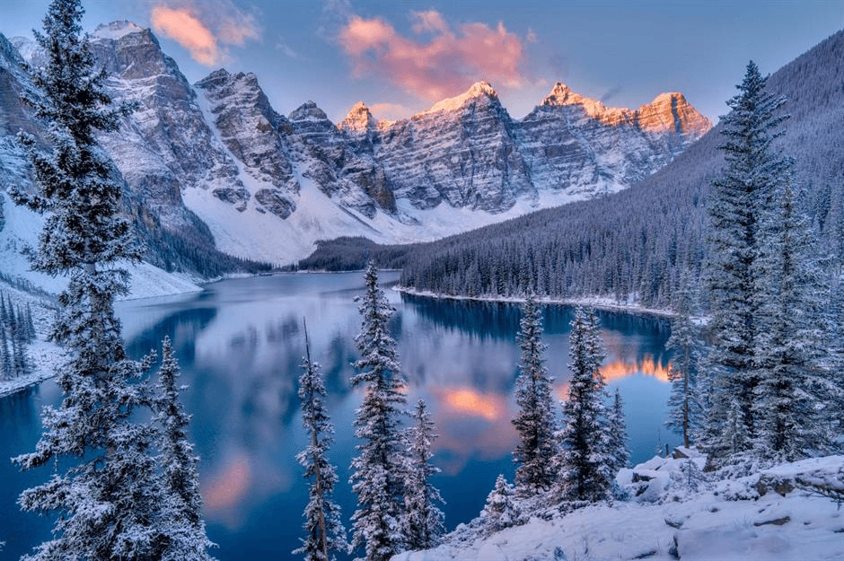
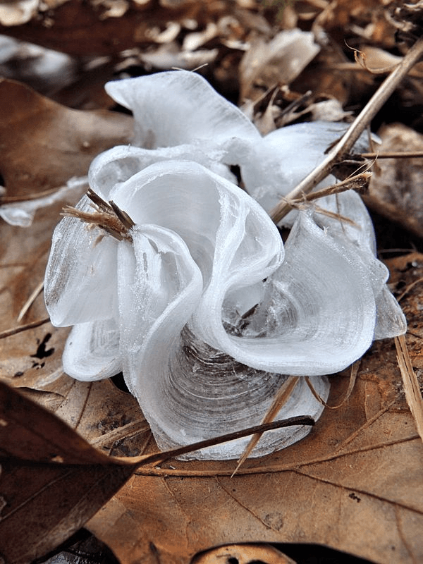
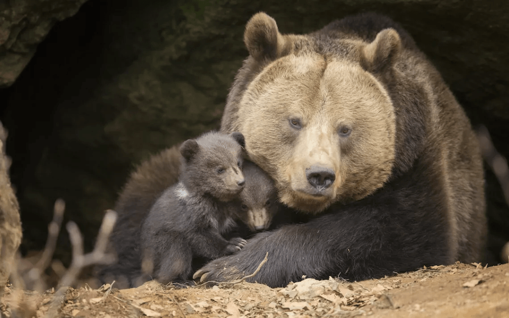

Hello everyone, and happy holidays! 🎄In the spirit of this snowy, joyful season, we’ll cover the many winter phenomena happening in the natural world around us. From perfectly unique snowflakes to changes in sunlight, the winter air seems to be full of magic. ❄️✨But as we know, it’s not magic, it’s science!

*“Winter is a glorious spectacle of glittering fractals complete with a soundscape and atmosphere entirely of its own.“ - Anders Swanson*

## Winter Phenomena ❄️

Winter changes the world around us in amazing ways, from how snowflakes form in the clouds to how animals and humans adapt to freezing temperatures! Scientists study these transformations to understand how energy, weather, and life all connect during the coldest months of the year. By exploring these patterns, we can uncover the science behind winter’s chill and see how nature stays balanced, even in the frostiest season.

## Ice Formations 🧊☃️

When water meets winter air, it can form many unique structures often overlooked in our day to day lives. 

**Snowflakes:** Snowflakes form when water vapor freezes onto a tiny particle like dust. As the flake falls through different atmospheric conditions, more water freezes onto it, creating intricate and unique patterns. 

**Frost:** Similarly, when water vapor freezes onto a solid surface, it creates frost that lightly covers windows, grass, and leaves. Think of it like the formation of dew, but below the freezing point.

**Frost Flowers:** Between fall and winter when the ground is still warm, but the air is freezing, plant sap expands and pushes out of cracks in the stem to form ribbon-like structures. 

## Winter Weather 🌨️🥶

Cold air behaves differently from warm air, and winter’s shifting winds bring weather events that scientists can now track and model with incredible precision!

**Wind Chill:** Moving air removes the thin layer of warmth surrounding your body, increasing heat loss and making temperatures feel much colder than they really are. 

**Polar Vortex:** High-altitude winds circle the winds in a powerful current. When this vortex weakens, icy Arctic air can spill southward, causing sudden and extreme cold snaps.

**Snowstorms:** Interactions between cold and moisture-rich air masses create snowfall, with accumulation shaped by wind, terrain, and atmospheric conditions.

## Heat Energy in the Cold 🔥🌡️

Understanding how heat moves is especially important in winter, as it helps explain why we feel cold and how to keep warm.

**Why Metal Feels Cold:** Metal has high thermal conductivity, allowing it to transfer heat away from your hand more rapidly than other materials like wood or plastic.

**Insulation:** Insulation slows heat transfer, often by trapping air, which is a poor heat conductor. Materials like wool or foam hold still air between warm objects and their colder surroundings.

**Water vs Land:** Water has a higher heat capacity than land, meaning it heats and cools more slowly. In winter, lakes and oceans stay warmer than surrounding land, influencing weather patterns. 

## The Biology of Winter 🐿️ 💤

During the winter, organisms face fewer resources, less daylight, and colder temperatures, but through different survival strategies, they find creative ways to adapt!

**Hibernation vs. Torpor:** Some animals enter deep hibernation, slowing their heart rates and metabolism for months to save energy, while others use torpor, short rest periods that help them conserve warmth and energy for a shorter time.

**Shivering:** When body temperature drops, rapid muscle contractions generate heat, a quick way for animals to warm back up.

**Seasonal Light Changes:** Shorter winter days affect circadian rhythms, influencing migration, reproduction, metabolism, and daily activity.

