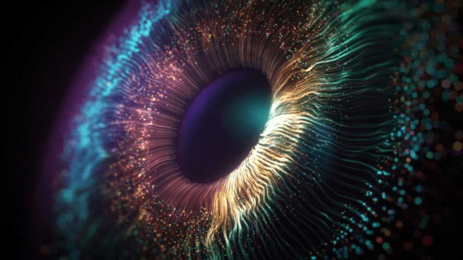
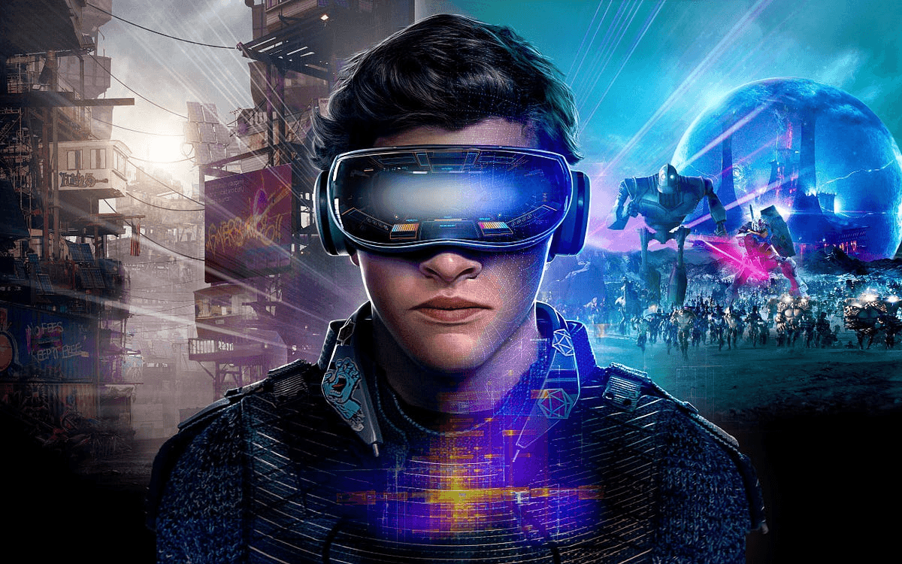

Happy Sunday, everyone! ☀️ This week, we’ll be exploring sensory science, the hacking of sight, smell, and sound. Through our five senses, we experience the world as it is. But what happens when science lets us understand, use, and alter perception? For good or for bad, what might come of outsmarting our brains? 

✨*“Reality is merely an illusion, albeit a very persistent one.“ - Albert Einstein*

## Bionic Eyes and Echolocation 🧠👁️

Technologies and animals can help us sense the world in ways we normally can’t.

**Bionic Eyes:** These devices help people with vision impairments by converting light into electrical signals that simulate the retina or optic nerve, partially restoring sight.

**Echolocation:** Some animals like bats and dolphins emit sounds that bounce off objects, letting them “see” with sound. Researchers are now creating devices that help humans navigate using similar principles!

**Human Applications:** Combining these technologies, scientists are designing wearable systems that can guide visually impaired people, blending auditory and visual signals.

## Smell-Based Disease Detection 🐶

Our noses might be more powerful than we think; they are able to detect subtle chemical changes linked to disease!

**Dogs Detecting Illness:** Specially trained dogs can sniff out diseases like cancer, diabetes, and infections by recognizing unique chemical compounds in sweat or breath.

**Electronic Noses:** Scientists are developing sensors that mimic a dog’s nose, detecting volatile organic compounds associated with diseases for faster, non-invasive testing. 

**Early Detection:** Using smell to detect disease early could transform healthcare, allowing treatments before symptoms even appear.

## Sonic Weaponry and Acoustic Levitation 🔊

Sound can carry energy and influence objects or people in surprising ways.

**Sonic Weapons:** High-intensity sound waves can cause discomfort, nausea, or disorientation, sometimes used in crowd control or security scenarios.

**Acoustic Levitation:** By using precisely tuned sound waves, scientists can lift and move small objects in mid-air without physical contact, creating “floating” demonstrations in labs.

**Scientific Potential:** Acoustic manipulations could eventually revolutionize medicine, manufacturing, and materials science by moving delicate substances without touching them.

## Virtual Reality vs. The Brain 🥽🧠

Virtual reality tricks our senses and immerses the brain into a simulated, computer generated world.

**Engaging the Senses:** Through sight, sound, and physical movement, VR allows our senses to experience a different reality than the one we’re truly living in. 

**Cybersickness:** Virtual reality is so powerful in altering perception that it can cause motion sickness despite relative stillness. 

**Real Responses:** While users know the virtual world isn’t real, people can demonstrate physical responses such as increased heart rate to virtual threats.

## Latest In Science! 🔭🌟

Astronomers working with the Hubble Space Telescope have confirmed the first detection of a mysterious object known as “Cloud-9”. Located about 14 million light-years away, it is rich in gas and contains no stars. Scientists believe it was a failed galaxy, but it still has the potential of forming a one! Cloud-9 gives us a rare look into a cloud dominated by dark matter. It acts as a glimpse into what exists in the universe beyond stars.
