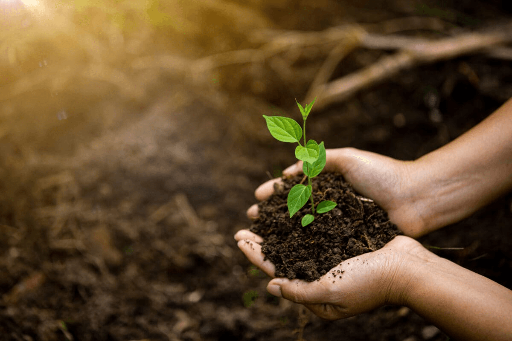

Have you ever wondered how humans interact with the Earth? How we change the world around us and work with it. This week, we’ll cover topics of environmental science! 🌎How the climate is rapidly changing, how plants and creatures are affected, how plastic pollutes the world, and the methods we use to prevent it. Lastly, we’ll cover a new discovery in science, microbes living in trees, and of course, a random fun fact! 

🌲*“Forests are the lungs of our land”- Franklin D. Roosevelt* 🌳

## Climate Change ☀️

As large-scale human activities increase, long-term shifts in Earth’s average climate occur.

**Global Warming:** Earth’s average surface temperature has been rapidly increasing, driven by things like fossil fuel burning and human-produced greenhouse gases.

**Deforestation:** Primarily for agriculture and urbanization, humans permanently clear forested land. However, this has many negative consequences related to climate change. 

**Desertification:** More and more fertile land is becoming dry and arid, caused by both global warming and deforestation. In other words, deserts are expanding.

## Coral Bleaching 🪸

Healthy corals are actually transparent, with their colors coming from symbiotic algae called zooxanthellae living in their tissue. 

**Stress:** Coral bleaching is triggered by stressful conditions in the environment. The most common is increasing ocean temperatures, but other disturbances in water quality can also trigger bleaching. 

**Toxic Algae:** As the surrounding water warms, the algae begin to produce toxic chemicals.

**The Aftermath:** In response, the coral expels the algae to protect itself, becoming white (bleached) and more susceptible to disease and starvation.

## Hidden Pollution 🔍

Plastic materials often exist in tiny, hard-to-see forms that still cause serious environmental damage.

**Microplastics:** Coming from larger plastics breaking down or from products like clothing fibers and cosmetics, these tiny plastic pieces are now found in oceans, soil, air, and even drinking water!

**Styrofoam Pollution:** Lightweight and easily broken, Styrofoam spreads quickly through wind and water. It doesn’t biodegrade and can harm wildlife that mistake it for food.

**Impact on Ecosystems:** These materials harm wildlife and ecosystems when ingested and can move through food chains.

## Powering the Planet 🌍♻️

How we produce and use energy plays a major role in environmental health.

**Renewable Energy:** Solar, wind, and water power generate energy with little pollution and don’t rely on limited fossil fuels.

**Energy Efficiency:** Using less energy through efficient technology and conservation reduces waste and strain on the environment.

**Sustainable Choices:** By balancing energy needs with environmental protection, a healthier planet can be sustained over time.

## Latest In Science: Nature’s New Filter? 🌳🦠

Scientists have recently discovered trillions of tiny microbes living in tree bark that help remove potent greenhouse gases from the atmosphere, a finding that could change how we understand forests’ role in Earth’s climate! Researchers found that these microscopic organisms consume gases like methane, hydrogen, and carbon monoxide, using them for energy as they live on tree surfaces. This “hidden” microbial activity potentially removes millions of tons of gases annually, reshaping future conservation and reforestation strategies.

## Did you know…

You are only about 43% human! The rest of your body’s total cell count consists of bacteria, viruses, and fungi.

Check out our Instagram for more fun facts! [ChemQuest on Instagram (@chemquestpa)](https://www.instagram.com/chemquestpa)
