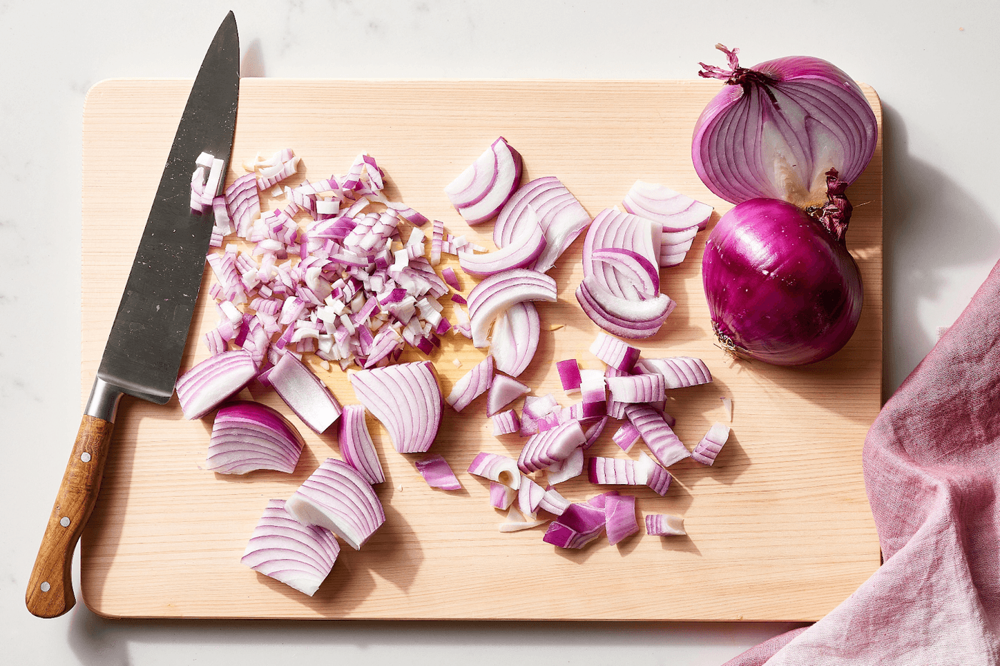
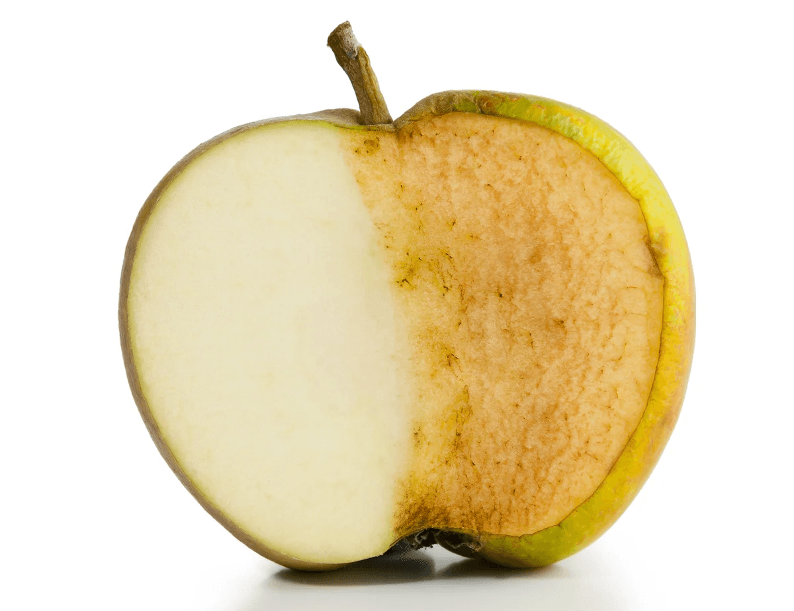
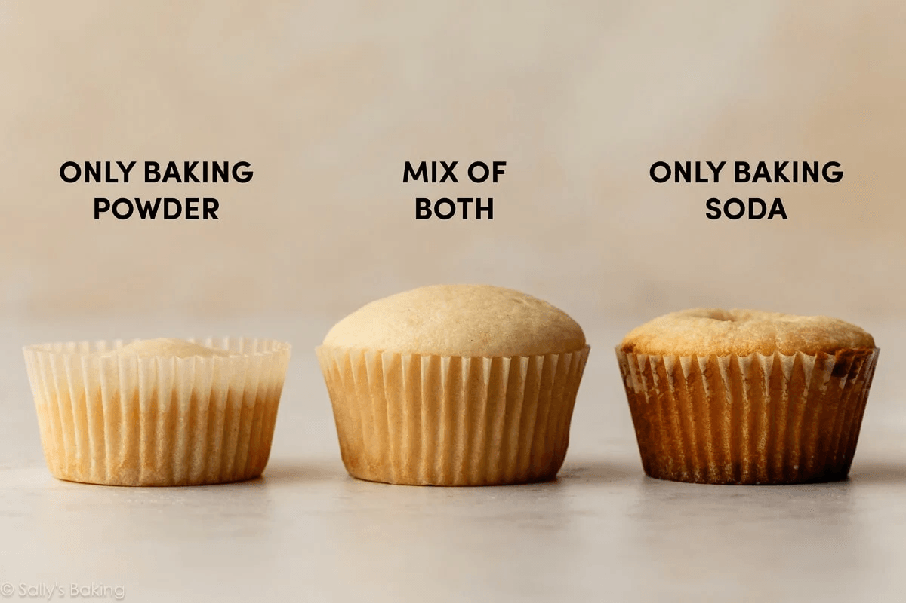
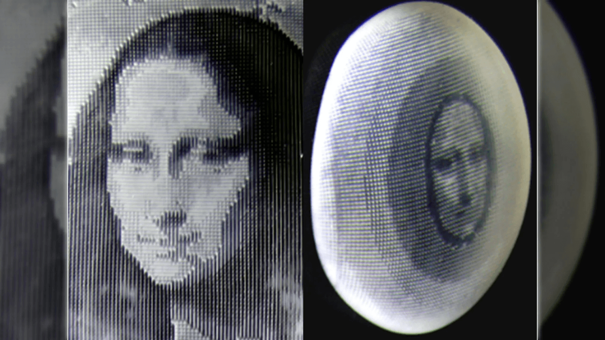

☀️Hello everyone, and happy Sunday! Have you ever wondered why cooking can make your eyes water, your mouth burn, or your food change right before your eyes? This week, we’ll explore the chemistry behind everyday cooking. From onions that make us cry to the reactions that help baked goods rise, the kitchen is full of science we experience every day, even if we don’t always notice it!

🍳*“Cooking is chemistry. And chemistry is life.“ - Bonnie Garmus*

## Why Do Onions Make You Cry? 🧅💧

Have you ever been bawling over a board of freshly chopped onions and wondered why it happens? Well it isn’t because they make us sad (at least not usually). When you slice into an onion, you break apart cells, mixing amino acids with enzymes. This releases a gas called syn-propanethial-S-oxide that reacts with the water in your eyes to create sulfuric acid, stinging your eyes. 

## What Makes Food Go Stale? 🥖

As food sits out, moisture moves in or escapes, affecting texture and making it feel dry or chewy. At the same time, fats in the food can react with oxygen in the air, causing flavors to fade or taste off. These chemical changes are what make food seem stale, even if it’s still safe to eat.

## How Do Nonstick Pans Work? 🍳

In regular pans, the surface has small cracks in it that food gets stuck in. The surface of nonstick pans is covered with a coating of polytetrafluoroethylene or PTFE that makes it smooth on a microscopic level. It acts as a barrier that prevents food from chemically bonding to the pan. This PTFE coating does not react with or adhere to food because its composition of bonded carbon and fluorine atoms is incredibly stable.

## Why Do Apples Turn Brown? 🍎🍋

When an apple is cut, its inner cells are exposed to oxygen in the air. This triggers a chemical reaction called oxidation, where an enzyme in the apple reacts with oxygen and causes the flesh to turn brown. Lemon juice helps prevent this because it contains vitamin C and citric acid, which slow down oxidation by lowering the pH and reacting with oxygen first. This keeps the apple looking fresh for a longer time.

## Why Does Spicy Food Feel Hot? 🔥

Spice is actually an illusion! In your mouth, pain receptors called TRPV1 receptors respond to things like high heat and damage. A compound called capsaicin, found in spicy foods, binds to these pain receptors, tricking them into firing. So really, spice is pain, not a flavor. Over time, TRPV1 receptors can even be desensitized, so spice tolerance builds with exposure. 

## The Science Behind Baking Powder/Soda 🫧🍰

Baking powder and baking soda help baked goods rise by producing carbon dioxide gas. When baking soda mixes with an acid, it creates bubbles that expand in the oven, making dough or batter light and fluffy. Baking powder already contains its own acid, so it only needs moisture and heat to work. These chemical reactions are what give cakes, muffins, and breads their soft texture.

## Latest in Science: Octopus-Inspired Skin 🐙

Inspired by the way octopus skin shifts colors and textures, researchers at Penn State developed a new programmable hydrogel material that acts like smart synthetic skin. It's made with a special 4D printing technique that embeds digital instructions directly into the material. As an example, the team encoded an image of the Mona Lisa that was revealed only when the skin was stretched, exposed to heat, exposed to liquid or adjusted from a 2D to a 3D shape.

