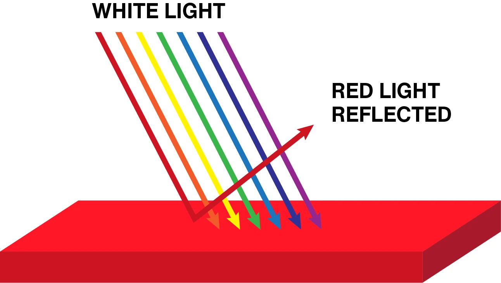
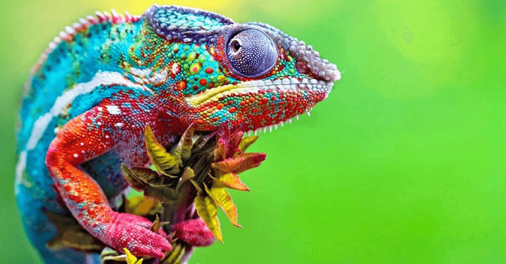
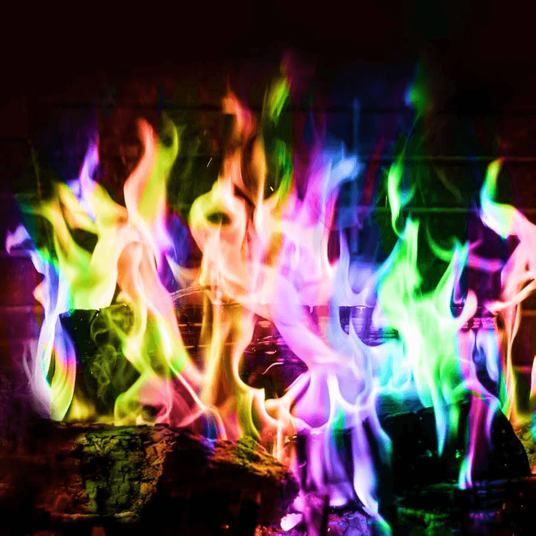

Hello everyone! Happy Sunday! ☀️Have you ever looked at our bright, colorful world and wondered about the science behind it all? This week, we’ll dive into the workings of color and explore its presence all around us. We’ll cover topics like how we perceive color and light, the ways it shows up in nature, the chemistry behind colorful fire, and answer the long-standing question, why is the sky blue?

🌈*“Color is a power which directly influences the soul“ - Wassily Kandinsky*

## How Our Eyes See Color 👁️ 🧠

We see light as color based on its wavelength, and that light takes a long path before it’s perceived by our brains as color. 

**Light Reflection:** The color we see on an object is actually the only color that doesn’t exist on its surface! When light hits an object, it absorbs some light and reflects others. The reflected wavelengths are the ones that reach our eyes.

**Cones:** The human eye contains roughly 6 million photoreceptor cells called cones, primarily in the fovea, which are responsible for color vision. 

**The Brain:** Cones send signals to the brain’s visual cortex, which uses information from the different kinds of cones to determine which color we see.

## Color in Nature 🍁 🍂

Nature is full of color, from the patterns on animals to the changing leaves in fall. Colors can help organisms survive, signal danger, or attract attention.

**Camouflage:** Some animals blend into their environment to avoid predators or sneak up on prey. Chameleons can shift their colors, and some insects mimic leaves so they can hide in plain sight.

**Warning Colors:** Bright colors can signal danger. Many animals, like poison dart frogs and monarch butterflies, use vivid patterns to warn predators that they are toxic or taste bad.

**Autumn Leaves:** As days get shorter and temperatures drop, chlorophyll in leaves breaks down. Other pigments, such as carotenoids and anthocyanins, become visible and turn the leaves yellow, orange, and red.

## Why is the Sky Blue? 💙

Have you ever wondered why the sky isn’t red, purple, green, or violet? It’s blue during the day for a variety of reasons including rayleigh scattering, wavelengths, and the human eye. 

**Rayleigh Scattering:** This phenomenon causes the scattering of light by particles much smaller than light’s wavelength. Shorter wavelengths scatter more than longer wavelengths. 

**Wavelengths:** Blue and violet light travel in much shorter and smaller waves than red light, making them the colors that are scattered most by rayleigh scattering. 

**The Human Eye:** Then why isn’t the sky violet? Although violet light has an even shorter wavelength than blue light, the human eye is much more perceptive to blue light and the sun also emits more blue than violet.

## Why Fire Has Different Colors 🔥

Fire isn’t just hot, it’s colorful too! The color of a flame depends on a few factors.

**Temperature:** Hotter flames look blue or white, while cooler flames glow yellow, orange, or red.

**Material**: Different materials burn with different colors. Wood flames are usually orange or yellow, while gas flames are often blue. Some substances can even create sparks or unusual flame colors.

**Chemical Reactions:** When things burn, their atoms and molecules get excited and release energy as light. Different substances release different colors of light, so certain chemicals can make flames appear green, purple, or other colors.

## Latest In Science: Spider Silk 🕷️

Scientists have just discovered why spider silk is tougher than steel: a molecular glue between arginine and tyrosine amino acids acts like tiny stickers. They pull silk proteins into droplets that harden into unbreakable fibers during spinning, blending strength and stretch, possibly inspiring bulletproof vests or color-changing clothes in the future!
