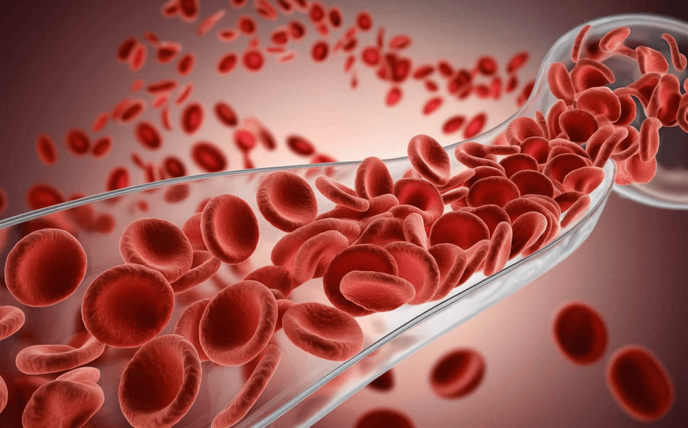
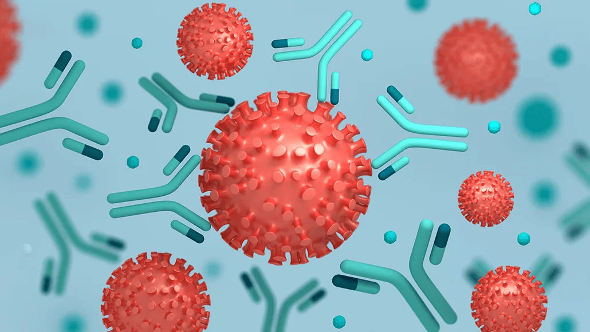

Happy Sunday! ☀️ Have you ever thought about how your body manages to keep everything running smoothly? This week, we’ll explore the science behind how our bodies keep us alive and working every single day. From our protective reflexes to the ways our bodies regulate temperature, and even fight foreign invaders, there’s a lot happening inside us that we rarely even notice!

*“The body is a community made up of its innumerable cells or inhabitants.” - Thomas A. Edison* 

## Reflexes

Reflexes are fast, automatic reactions that help protect the body or respond quickly to changes in the environment.

**Blinking:** Protecting eyes from dust, bright light, or sudden movement, blinking also spreads tears across the eye to keep it moist and clear.

**Goosebumps:** When tiny muscles around hair follicles contract, small bumps appear on the surface of your skin, usually when you’re cold or frightened. In our ancestors, this reflex helped trap heat and made body hair stand up to appear larger to predators!

**Sneezing:** Sneezing helps clear irritants like dust, pollen, or germs from the nose. The burst of air forces the particles out of the nasal passages.

## Controlling Our Temperature 🌡️

In a process called homeostasis, the human body constantly works to keep its internal conditions stable, including body temperature. The brain monitors temperature and triggers different responses to cool down or warm up.

**Sweating:** When your internal temperature rises above normal, sweat glands release moisture onto the skin. As the sweat evaporates, it carries heat away from the body and helps cool you down.

**Shivering:** When the body gets cold, muscles rapidly contract and relax in a process called shivering. These movements produce heat to warm the body. 

**Blood Flow:** Blood vessels near the skin can widen or narrow to control heat loss. When it’s hot, they widen to release heat, and when it’s cold, they narrow to keep warmth inside the body.

## The Brain 🧠

The brain is like the body’s control center, regulating thought, emotion, memories, and nearly all its various physical functions.

**Memories:** Through a process called consolidation, the brain strengthens connections between neurons and moves memories from short-term to long-term storage.

**Reaction Time:** Your brain receives a stimulus, processes it, and sends signals to your muscles to act, all within a fraction of a second!

**Sleep Cycles:** These repeated sequences of brain activity alternate between non-REM and REM sleep, typically with 4-6 cycles occurring per night. 

## The Immune System 🤒

The immune system is a complex network across your body that works to defend it from germs and other foreign substances.

**White Blood Cells:** Also called leukocytes, these cells are created in the bone marrow and circulate in the blood, destroying any harmful pathogens they come across. 

**Antibodies:** These are Y-shaped proteins in the body that bind to specific antigens on pathogens to mark them for destruction or neutralize them. 

**Inflammation:** The body responds to injury or other harmful stimuli through inflammation. It initiates the healing process, despite causing pain.

## Latest in Science: Pig Liver Transplant in a Human 🐷

A medical team at the Xijing Hospital in Xi’an China successfully connected a 56-year-old man experiencing liver failure to a genetically modified pig liver. The organ was connected externally and filtered his blood for several days while he waited for a human liver transplant! Xenotransplantation, the procedure of transplanting genetically modified animal organs into humans, can help reduce the number of deaths that occur while waiting for a donated organ. 

