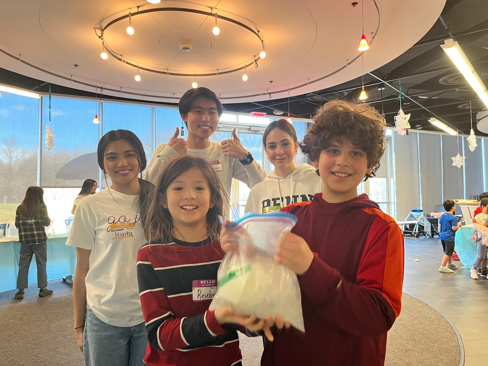

Hello everyone, and happy Sunday! ☀️We are excited to announce that ChemQuest is hosting a new Science Exploration Event for students in April! In this week’s newsletter, we will be covering the event details and volunteer opportunities for high schoolers.

✨*“Every brilliant experiment, like every great work of art, starts with an act of imagination.”* ✨

*– Jonah Lehrer*

## ChemQuest News 🗞️

**ChemQuest Event!** 🧪
ChemQuest Youth Organization will be hosting our 6th event for kids aged 4-12! Join us for an exciting day of science and discovery 🔍 designed to spark ✨and inspire young minds! There will be fun, interactive science stations 🔬, educational experiments, guidance and support from trained volunteers, and a welcoming environment for all!

## Quick Participant Details 📌

📍**Where?**

-   Brandywine Hundred Library (1300 Foulk Rd, Wilmington, DE 19803)

🗓️**When?** 

-   April 25th, 2026

-   12:00 P.M.–3:30 PM

👥**Who?**

-   Kids ages 4–12

💵**How much?**

-   Absolutely FREE

## ChemQuest Science Exploration Event 🔍

In this event, participants will rotate through a variety of fun, educational activities, including robotics, strawberry DNA extraction, making oobleck, and much more! The ChemQuest team and event volunteers will set up stations, each with its own experiment, teaching important scientific principles. We’ll all gather for large group experiments, and we’ll also have special guests present, the GV Robotics Team, to demonstrate their robots!

Sign up here: [participant sign-up form](https://docs.google.com/forms/d/e/1FAIpQLSdvJ75x7VEroDU-RQebb-pyhtBbKMPM0q0w773XAagQVF9btw/viewform?usp=header)

**(RVSP Deadline: 4/21)**

## Volunteer Opportunity Information! ℹ️

\*For volunteers, this event will run from 11:30 A.M. - 4:30 P.M. to include set up and clean up.

**Why Volunteer?**
-   Earn 6 community service hours

-   Help run fun STEM activities for kids

-   Teach fundamental science concepts

-   Become eligible for a future Chemquest officer position

**What You’ll Do:**
-   Set up and assist in running hands-on STEM activity stations

-   Explain simple science concepts to kids

-   Guide families and clean up

**Additional Info:**
Volunteers will need to attend a brief Volunteer Informational Meeting on April 23rd at 5:00 P.M. to discuss the proceedings of the event.

Please fill out the [volunteer sign-up form](https://forms.gle/J3nFspRgEEkybzZKA) to join us in making this event successful!

## Special Guests: GV Robotics Team 🤖

At this event, we’ll welcome our special guests, the Garnet Valley High School Robotics Team! They have a strong history, including reaching the PA FTC State Championship and the FTC East Super-Regional Championship. The team will be there to show their robots, teach robotics basics, and answer any questions!
