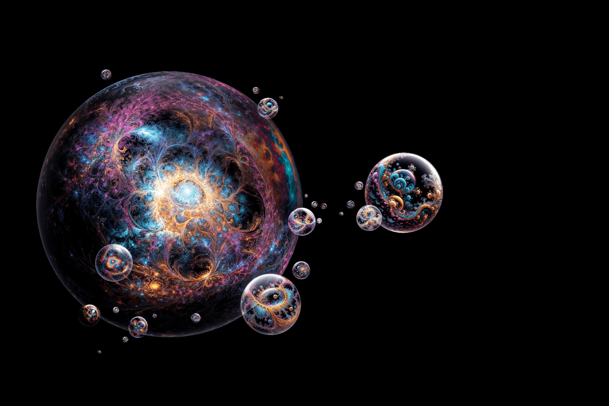
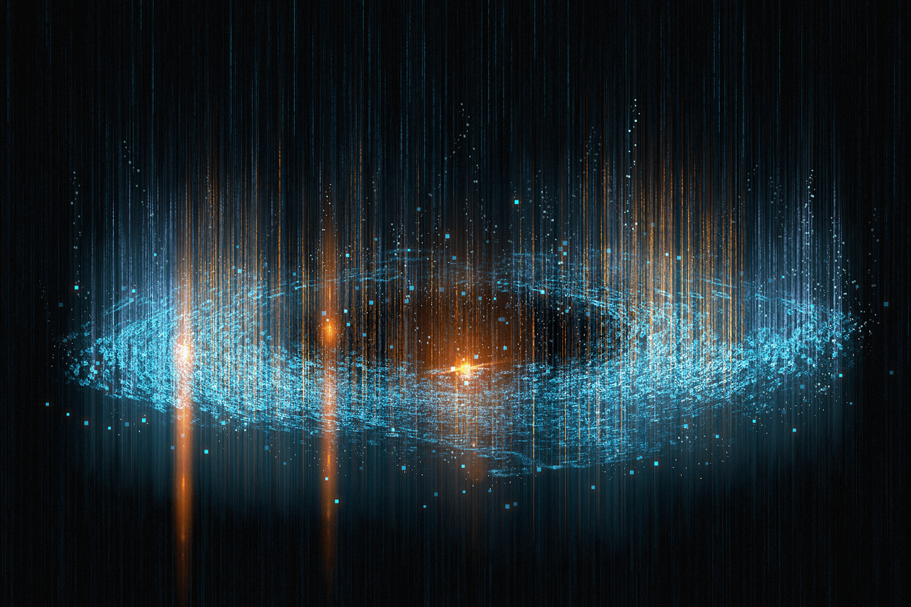

Happy Sunday! ☀️ Welcome back! Have you ever gazed up at the stars and wondered if there was anything out there? What if there were entire universes parallel to ours? This week, we’ll dive into a world (or many) of theory and speculation. We’ll cover a few of the leading hypotheses, like bubble universes, string theory, and more. We’ll ask the big question: Could there be a multiverse? 🌌

✨*“Not only is the universe stranger than we imagine, it is stranger than we can imagine.“* ✨

*\- Arthur Stanley Eddington*

## What Is A Multiverse? 💫🪐

The multiverse is the theory that our universe is one of many, possibly infinite, universes out there! It stems from theories like eternal inflation, string theory, and the Big Bang. Max Tegmark’s theory organizes many of the possible multiverses into a 4-category system:

Level 1 – Extension of our Universe: Comes from the idea that if the universe is infinitely expanding, an almost exact version of our universe must happen again somewhere out there by chance.

Level 2 – Bubble Universes: These are completely separate pockets or “bubbles”, each with different laws of physics. 

Level 3 – Quantum Many-Worlds: If one quantum event creates many outcomes, maybe all of them happen, each branching off into its own timeline. 

Level 4 – Ultimate Mathematical Universe:  Every conceivable mathematical structure and physical law exists as a real universe.

## Bubble Universe Theory 🫧

Some scientists believe our universe may be just one “bubble” in a much larger cosmic system.

**Eternal Inflation:** After the Big Bang, space expanded rapidly in a process called inflation. Some theories suggest this expansion never completely stopped, creating isolated “bubble universes”.

**Physical Laws:** Each bubble universe could have slightly different conditions, like variations in gravity, particles, or even the constants of physics.

**Colliding Universes:** Some scientists have proposed that if bubble universes exist, they may occasionally collide. Evidence of these collisions could appear as unusual patterns in cosmic background radiation.

## String Theory 🧵

String theory suggests that everything in the universe is made of tiny, vibrating strings rather than point-like particles, allowing for the possibility of multiple dimensions and universes.

**Vibrating Strings:** According to this theory, particles are actually tiny strings vibrating at different frequencies. Each vibration creates a different type of particle, like electrons or quarks.

**Extra Dimensions:** String theory predicts that there may be more dimensions than the three we experience. These extra dimensions could be hidden or curled up at extremely small scales.

**Multiple Universes:** Because there are many possible ways these dimensions and strings could exist, string theory allows for many possible universes, each with its own structure and physical laws.

## The Simulation Hypothesis 🎮

What if we are all living in a simulation? If that’s the case, then wouldn’t it be likely that there are other simulated worlds out there?

**Simulation Hypothesis:** The simulation hypothesis proposes that our reality is a simulation run by a more advanced civilization, almost like we’re characters in a computer game. 

**Bostrom’s Argument:** Bostrom argues that in the very distant future, humans will likely reach a post-human stage capable of running massive ancestor simulations. In this case, it’s far more likely that we live in one of the many simulations rather than the one original reality. 

**A Simulated Multiverse:** So if we happen to live in a simulation, it would also be possible for there to be a multiverse of other simulations.

## Is There Any Real Evidence of A Multiverse?

As of now, there is no direct proof that the multiverse exists. Most ideas about it come from mathematical models and theories rather than observable evidence. Scientists are still searching for clues, like patterns in cosmic radiation or unusual properties of space, but for now, the multiverse remains an open question in modern physics.

## Upcoming Event! 🔬🥽

Don’t forget ChemQuest’s upcoming Science Exploration Event! Hosted at the Brandywine Hundred Library on April 25th, there will be a variety of fun, interactive, and educational science experiments for ages 4-12. This is 100% free to attend, just remember to register here! [Science Exploration Event registration form](https://docs.google.com/forms/d/1wdtU44U9E6u-44HUVO7A5xt1zYG0XddmgNiDKtJgtho/viewform)

Any high schoolers interested in volunteer hours? Click here to sign up for the event: [volunteer sign-up form](https://docs.google.com/forms/d/e/1FAIpQLSdYdgnpazBMeGE6EbcSjHuQNjQzPxrSKjjt1Ovmhgc4NCyJig/viewform)

For more details about the event, check out last week’s newsletter! [Our Spring Science Exploration Event](/newsletter/our-spring-science-exploration-event/)
