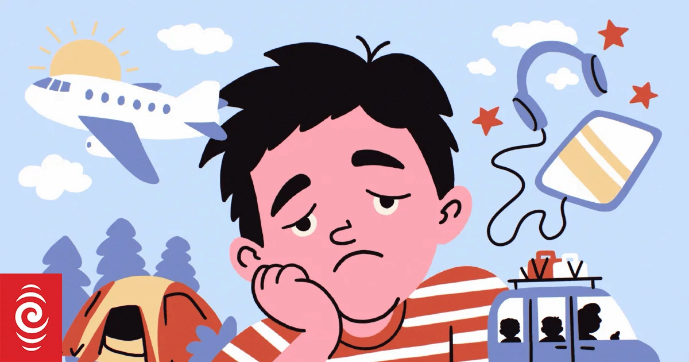
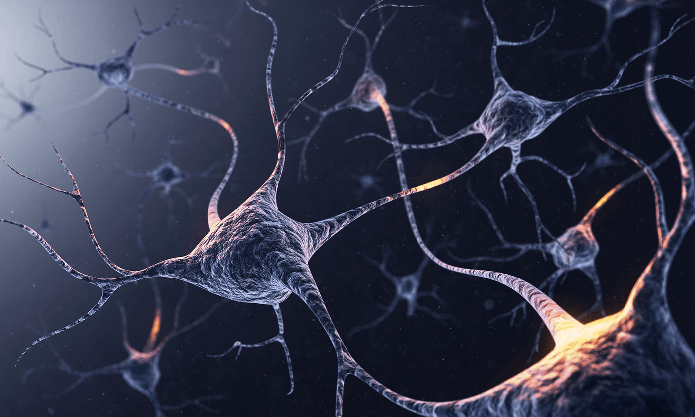

Happy Sunday, everyone! ☀️ Have you ever wondered why your brain works the way it does, like how easy it is to procrastinate even when you know something is important? These experiences are rooted in how your brain is wired, and this week, we’ll explore the science behind it and how neuroscience and psychology help explain the way we think, feel, and respond to the world around us.

*“The universe perceives itself through us, or to be more specific, through our neurons.“ - Abhijit Naskar*

## Why Boredom Feels Painful 😐

A signal from the brain for stimulation, engagement, or something to focus on.

**Low Dopamine Levels:** Boredom is linked to low levels of dopamine, a chemical involved in motivation and reward. When dopamine is low, activities feel less interesting and harder to focus on.

**Lack of Stimulation:** When the brain isn’t challenged or engaged, it becomes restless. This discomfort causes it to seek out something more interesting.

**Attention Struggle:** If a task is too easy or repetitive, your attention drifts, making time feel slower and less enjoyable.

## Déjà Vu 🌀

Have you ever been going about your day when it suddenly feels like a new situation feels oddly familiar, like you’ve been here or done this before? That’s the feeling of déjà vu, and there are a few possibilities for why it happens. 

**The “Brain Glitch”:** This phenomenon is thought to be like a “brain glitch,” when the brain’s memory systems briefly misfire, causing a new experience to be incorrectly flagged as familiar.

**Memory Mix-Up:** When a current situation closely resembles a past experience, your brain can mix up the two memories. 

**Prediction:** Your brain is constantly anticipating what will happen next, and when it predicts something correctly by chance, it can create a false sense of recognition.

## The Neuroscience of Procrastination ⏳

Procrastination occurs when the brain prioritizes comfort and short-term rewards, causing different systems to compete against each other.

**Emotion vs. Logic:** The limbic system seeks comfort and avoids stress, while the prefrontal cortex handles planning and decision-making. Procrastination happens when the limbic system overrides logical thinking.

**Fear and Stress:** Tasks that feel overwhelming or stressful can trigger avoidance. Instead of starting, the brain looks for easier, less demanding activities.

**Instant Reward:** The brain prefers immediate rewards over long-term benefits. Activities like using your phone provide quick dopamine boosts, making it more difficult to focus on tasks that require effort.

## Why are Habits So Hard to Break? 🔁

When we’ve built the habit of doing something repeatedly for a long time, it can often be hard to change.

**Going on Autopilot:** When a habit is repeated over and over again, it starts running automatically with little conscious control. This makes it harder to stop because it feels natural. 

**Reward Systems:** Habits can be tied to rewards like comfort or relief. Your brain learns to crave that reward, reinforcing the behavior over time.

**Triggers:** Habits are often tied to specific cues—like time, place, or emotions—that automatically trigger the behavior.

## Latest In Science: Artemis II 🚀

NASA’s Artemis II mission is the first crewed flight of the Artemis program, and it sent four astronauts on a 10-day journey around the Moon. The mission was designed as a fly-by rather than a landing to test the Orion spacecraft’s life support systems, navigation, and deep-space operations in preparation for future lunar landings. The astronauts successfully returned to Earth on April 10, 2026 and set a record for the farthest we’ve sent humans from Earth. 

