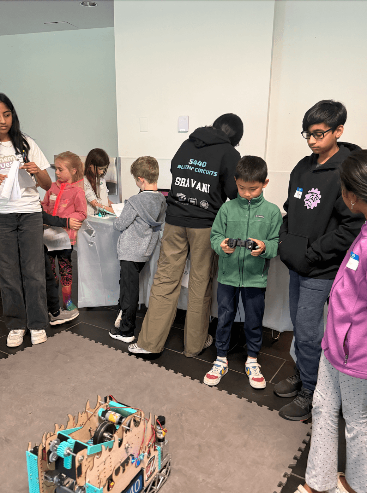

3.5 to 4 billion years ago, the first signs of life appeared on Earth in the form of simple microbes. 3.5 to 4 billion years later, our planet is populated with millions of thriving species of plants, animals, fungi, and other forms of complex life. The way all living things came to be is a fundamental question that humans have tried to explain in many ways. Today, we’ll cover its scientific explanation – the theory of evolution. 

 ✨*“The love for all living creatures is the most noble attribute of man.” - Charles Darwin* ✨

## ChemQuest News 🗞️

**Science Exploration Event!**

-   Our science exploration event was a great success, with our participants rotating between interactive stations and experiments. At the end, we played a Jeopardy game to show what everyone learned!
-   A special thanks to the dedicated organizers behind ChemQuest and our volunteers, whose hard work helped make this event run smoothly!

-   If you would like to help fund events like this in the future, feel free to donate to our Venmo! [https://account.venmo.com/pay?recipients=Chemquest26](https://account.venmo.com/pay?recipients=Chemquest26)

## The Theory of Evolution 🌱

Proposed by Charles Darwin and Alfred Russel Wallace, the theory of evolution explains how life changes and evolves over time.

**Genetic Variation:** A key concept of evolution, genetic variation is the diversity of traits within a population’s gene pool, driven by mutation, gene flow, and sexual reproduction.

**Natural Selection:** Organisms that are better adapted to their environment tend to survive and produce more offspring. These offspring tend to inherit the same traits of their parents and have an advantage in survival over other organisms of the same species.

**Descent with Modification:** Those changes made from natural selection seem small, but they build up over time, leading to the emergence of new species from common ancestors.

## Evidence of Evolution 🦴

Scientists have gathered several forms of evidence that show how species have changed over time. 

**Fossils:** Preserved remains or traces of ancient organisms that show how species have changed over millions of years.

**Comparative Anatomy:** Different species often share similar body structures, like the bones in human hands and bat wings, suggesting a common ancestor.

**DNA Evidence:** The genetic code of organisms can be compared to see how closely related they are. Species with more similar DNA are more closely related and share a more recent common ancestor.

## How did Humans Evolve? 🐒

Humans, like any other animal, also began as a different species, then evolved over time to become the humans we are today. 

**Hominins:** These early human ancestors began to walk upright and use tools. The term encompasses any species more closely related to modern humans than chimpanzees.

**Homo Erectus:** These humans were among the first to control fire, and were the first to migrate out of Africa into Eurasia.

**Homo Sapiens:** Now the only living species of human, we have high intelligence, complex brains, and advanced tool use. 

## Genetic Drift 🧬

A process where random changes in a population’s genes occur over time, especially in small populations. Unlike natural selection, these changes happen by chance.

**Bottleneck Effect:** When a population is drastically reduced by a disaster, only a small group survives. This can limit genetic diversity and change which traits are common in future generations.

**Founder Effect:** When a small group leaves a larger population to start a new one, they carry only a fraction of the original genetic variation.

**Random Chance:** Some traits become more or less common simply by luck, and over time, this can significantly change a population’s genetic makeup.
