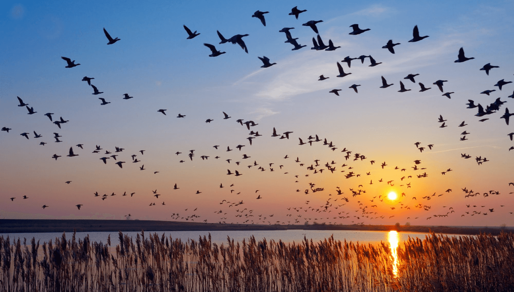
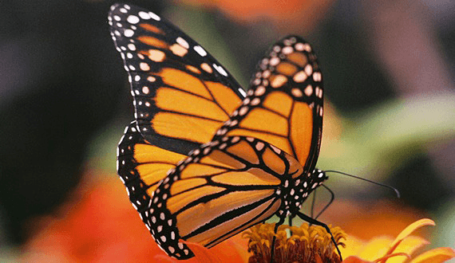

Happy Sunday! ☀️Have you ever wondered how animals know when it’s time to travel thousands of miles across oceans, skies, and continents? Migration is one of nature’s most incredible survival strategies, allowing animals to move from one place to another in search of food, warmer climates, or better conditions for survival. This week, we’ll explore the science behind animal migration and how creatures navigate the world around them.

*“Nature never hurries, yet everything is accomplished.” - Lao Tzu*

## Why do Animals Migrate? 🌱

Animals migrate for the purpose of survival, but the specific reason differs between species. 

**Climate:** Many species migrate to escape extreme temperatures, such as geese leaving during the winter. 

**Food:** Animals often have to migrate in search of food sources that aren’t available all year-round.

**Breeding:** Migration can also be to areas that provide safer nesting and more abundant food.

## What Happens During Migration? 🧭

Migration involves timing, navigation, and long-distance travel that can take days, months, or even years. Animals rely on both environmental cues and internal biological systems to guide them.

**Internal Compass:** Many animals can sense Earth’s magnetic field, helping them navigate across long distances.

**Seasonal Signals:** Changes in daylight, temperature, and food availability signal to animals when it’s time to begin traveling.

**Stopover Ecology:** During migration, many animals stop at specific locations to rest and refuel. These stopover sites help provide food and shelter before the next part of their journey.

## Migration Patterns 🌍

Not all animal migrations happen the same way, with some occurring unpredictably, and others going in different directions.

**Complete vs Partial:** Complete migration, which is highly synchronized, involves all individuals in a population leaving together. During partial migration, only some individuals migrate, while others stay behind. 

**Irruptive Migration:** This is the irregular, unpredictable southward migration of a northern species, most commonly referring to birds. Irruptive migration is often caused by food shortages. 

**Vertical Migration:** One of the largest examples of this is diel vertical migration, the movement of aquatic organisms like zooplankton between the ocean’s surface at night and deeper waters during the day. 

## Meet the Animals! 🐾

Animals all over the world migrate in different ways, from flying across continents to swimming through entire oceans.

**Monarch Butterflies:** Monarch butterflies travel thousands of miles between North America and Mexico. Amazingly, several generations complete the migration cycle each year.

**Wildebeest:** Over a million wildebeest migrate across the African savanna in search of fresh grass and water. This journey is one of the largest land migrations on Earth.

**Arctic Terns:** Arctic terns complete the longest known migration of any animal, traveling from the Arctic to Antarctica and back each year, covering tens of thousands of miles.

## Science Fun Facts: Did You Know? 

☁️Despite looking like fluffy cotton candy, a typical cumulus cloud weighs over 1 million tons!

🌕Our moon is actually slowly moving away from Earth at a rate of approximately 3.8 cm or 1.5 inches per year.

💩The largest piece of fossilised dinosaur poo discovered is over 30cm long and over two litres in volume. It’s believed to come from a T-Rex!

💧Because most scientists define wetness as a liquid’s ability to maintain contact with a solid surface, water itself might not be wet, only able to make other objects wet.
