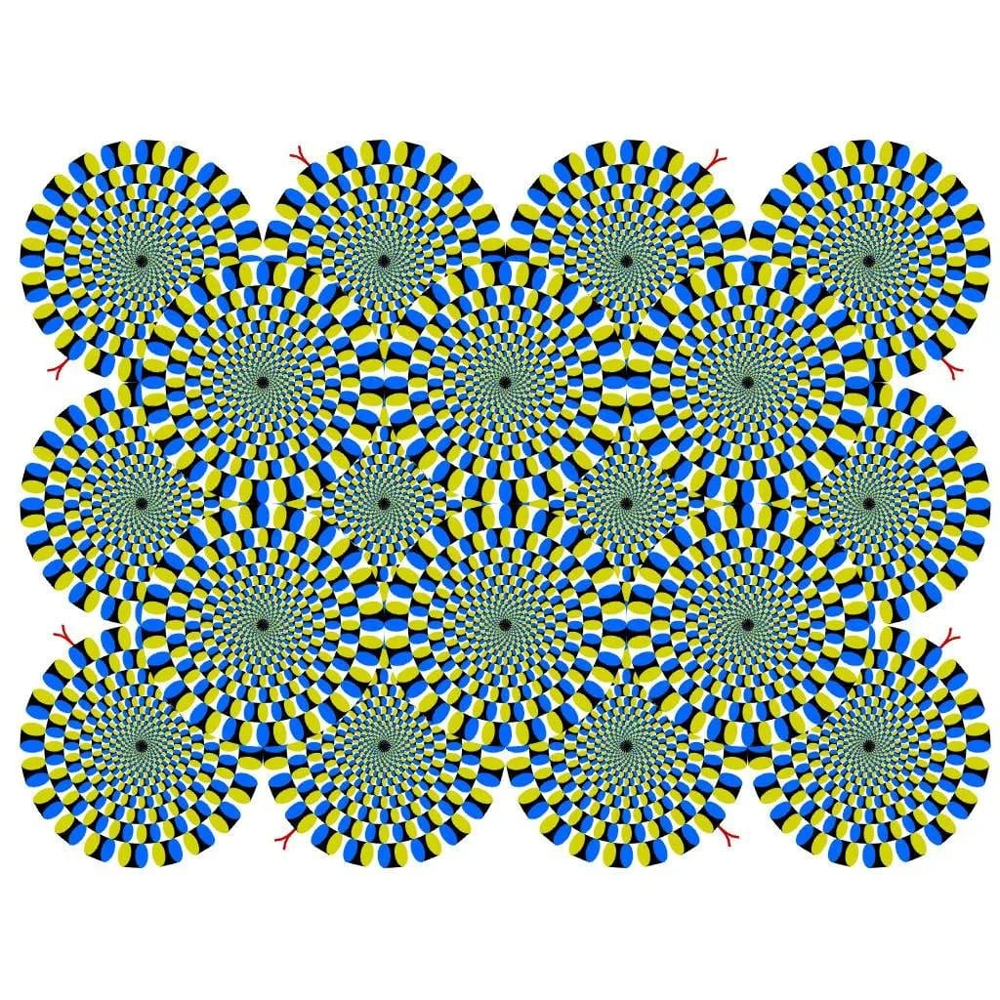
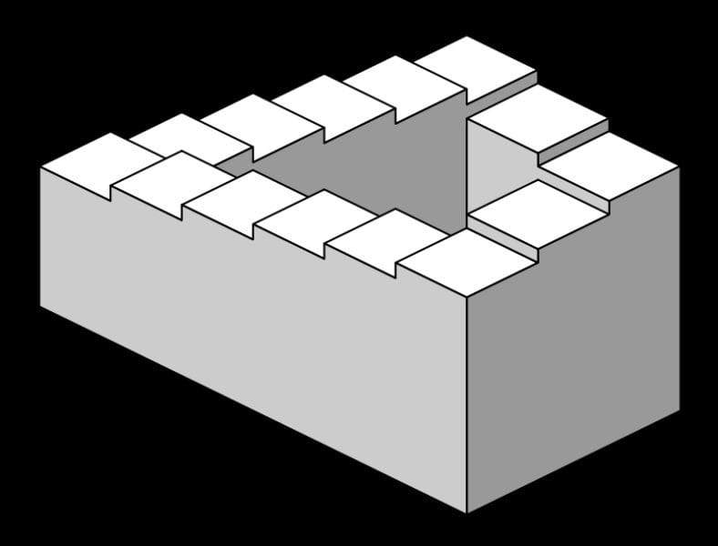

Illusions are a distortion in the senses or the mind that causes our perceptions to contrast with reality. Oftentimes, the brain interprets the senses incorrectly, creating our own subjective reality. This week, we’ll take a look at the various kinds of illusions and what causes them. We’ll explore the phenomena of impossible objects, uncanny valley, and the creation of vivid, false memories. 🧠😵‍💫

✨*"Reality is merely an illusion, albeit a very persistent one."* ✨

*— Albert Einstein*

## Optical Illusions 👁️🌀

When tricked with color, light, or perspective, sometimes what you see is different from reality.

**Heuristics:** These are mental shortcuts your brain uses to process the world rapidly by making assumptions and filling in the blanks. For example, the brain automatically adjusts color brightness, making the same color look vastly different with different backgrounds. 

**Peripheral Drift:** Illusions where a still image appears to move or spin, typically when viewed out of the corner of the eye. Microsaccades, tiny involuntary eye movements, force the brain to continuously update visual information. Peripheral drift illusions often use repeating patterns with carefully arranged brightness contrasts that are processed at slightly different speeds. As signals from different parts of the pattern reach the brain at different times, the brain interprets the constantly shifting retinal image as motion, even though the image itself is completely stationary.

**Impossible Objects:** 2D drawings of what appears to be real objects can trick the brain into mapping the 2D lines onto a 3D object. However the rules of the object are impossible to recreate in a 3D world. Take a look at these Penrose Stairs! It continues either going up or down, yet connects back with itself. 

Check out this peripheral drift illusion! The entire image is static, but appears to move. Look at any one circle to see how it isn’t really moving.

## Auditory Illusions 🎵

Auditory illusions are sounds that trick the brain into hearing something different from what is actually there.

**The McGurk Effect:** This happens when the visual movement of a person’s lips tricks your brain into hearing a completely different sound than the one being played.

**Phantom Words:** When you listen to a fast, repeating loop of meaningless noise, your brain gets restless and searches for patterns. Before long, you may start hearing distinct words that aren’t actually there.

**The Shepard Tone:** An audio track that sounds like it is constantly rising in pitch forever. This effect is created by overlapping notes, with new ones fading in at the bottom as others fade out at the top.

## Predictive Processing 🔮

Instead of perceiving every little detail of the world around us, it’s easier to rely on past experiences and our expectations of reality to assist in creating our perception of reality. 

**Top-Down Processing:** The brain is constantly creating general hypotheses about the environment based on past experience, prior knowledge, and beliefs. It makes educated guesses about the world based on what it’s learned before. 

**Bottom-Up Processing:** Sensory data from the eyes, ears, nose, etc. are also used in part to figure out what something is. This information helps your brain check whether its guesses about the world are correct.

**Uncanny Valley:** Predictive processing is what causes uncanny valley, a drop in comfort that can happen when something looks almost human, but not quite. This is because the brain expects something to look human, but small, almost indetectable peculiarities in things like the eyes or nose contradict with the way the brain expects a human to look, creating a feeling of unease.

## False Memories 🧠

False memories happen when your brain pieces together bits of information incorrectly, making you remember events differently than how they actually occurred.

**The DRM Effect:** If you read a list of words like “bed, awake, tired, dream,” your brain will often falsely remember seeing the word “sleep.” This happens because your mind automatically groups related ideas together.

**The Lost in the Mall Study:** In a famous psychological experiment, researchers successfully implanted entirely fake childhood memories in people’s minds. After several conversations, adults genuinely believed they had been lost in a shopping mall as children.

**The Mandela Effect:** This occurs when a huge group of people all share the same false memory. For instance, millions of people vividly remember a monocle on the Monopoly Man, even though he has never worn one.

## Science Fun Facts: Did You Know?

🍄 A giant fungus growing in Oregon is officially the largest single organism on Earth, stretching across nearly four square miles of forest.

🍓A strawberry is not technically a berry at all, but a banana, watermelon, and avocado actually are!

🌳There are more trees on Earth than there are stars in the Milky Way, with our planet hosting three trillion trees compared to 400 billion cosmic stars.

🌊 More people have traveled to the Moon than have visited the deepest part of the ocean.
