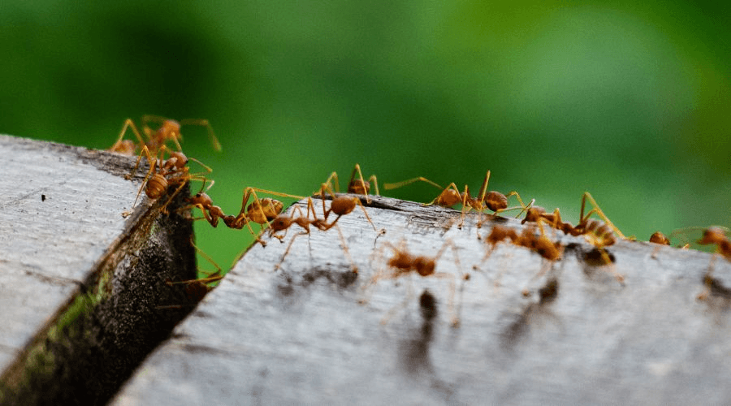

☀️Happy Sunday! Have you ever wondered how living things communicate without using words? All around us, plants, animals, and even tiny insects are constantly sending and receiving messages. This week, we’ll explore the many different ways organisms communicate, from warning nearby plants of danger to using chemicals, sounds, and other signals to survive.

✨ *“In nature, nothing exists alone.“* ✨

*\- Rachel Carson* 

## Melodies

Many animals, including humans, use sound to communicate, but some sing their own melodies.

**Bird Songs:** Using a special organ called the syrinx, birds will sing highly complex songs to defend territory and flaunt health to females. Males will sing the loudest in the morning, when cool air allows sound to travel farther.

**Whales:** Whales have regional dialects in their songs! Male whales in one region tend to sing similar melodies that evolve over time.

**Apes:** Gibbons produce highly structured vocalizations to communicate, often engaging in vocal battles with their neighbors to establish territorial boundaries.

## Plant Communication 🌱

Through chemicals, underground networks, and airborne signals, plants can exchange information to respond to danger and changing conditions.

**Warning Signals:** When insects begin eating a plant, it can release airborne chemicals that alert nearby plants to strengthen their own defenses before they are attacked.

**The Wood Wide Web:** Underground fungal networks connect the roots of many plants, allowing them to share nutrients and send chemical signals across vast distances.

**Defense Signaling:** When damaged, some plants release specific scents that attract predators, such as parasitic wasps, which feed on the insects attacking the plant.

## Electric Fish ⚡

Some weakly electric fish use electric organ discharges to communicate information to other fish.

**The Language:** Instead of spoken language, they control the frequency, timing, and waveform of their electric pulses.

**What do they say?:** They use electricity to signal things like aggression, submission, species, sex, and social status.

**Strategic Pauses:** Before delivering important information, these fish can actually make dramatic pauses, preparing the other fish to receive a more significant message.

## Chemical Signaling 🧪

Many organisms communicate by releasing chemicals into the environment. These signals help them attract mates, warn of danger, mark territory, or help members of the same species work together.

**Pheromones:** Ants leave invisible chemical trails that guide other ants to food, while many insects use pheromones to attract mates over long distances.

**Alarm Signals:** When fish are injured, they release chemicals into the water that warn nearby fish, prompting them to flee or hide.

**Territory Marking:** Animals such as wolves and tigers use scent markings to communicate territory boundaries, identity, and reproductive status.

## Did you know…

🦦Sea otters hold hands while sleeping so they don't drift apart.

👃Your nose can distinguish at least a trillion different smells, according to some scientific estimates.

🃁 There are way more possible ways to shuffle a deck of cards than there are atoms that make up this Earth.

🪼Some jellyfish can revert to an earlier stage of life instead of dying from old age.
