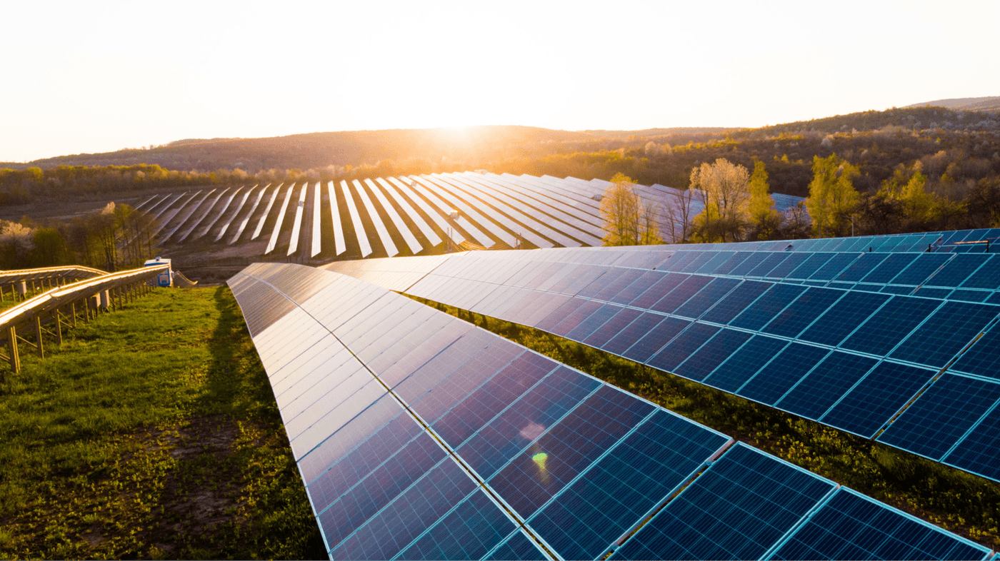
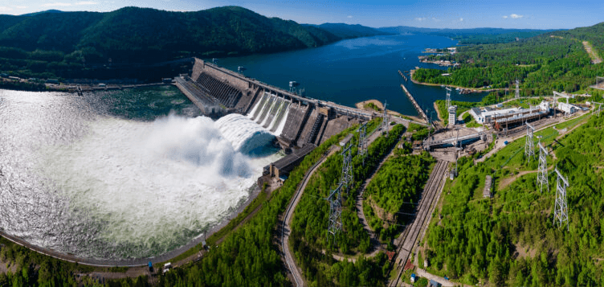
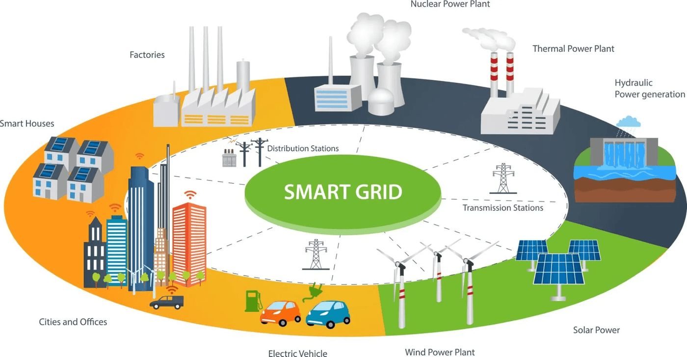
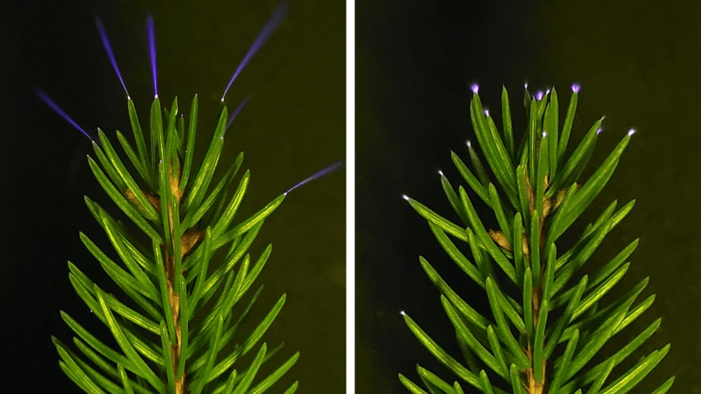

As the demand for electricity has skyrocketed and awareness of sustainable energy has grown, we’ve seen a dramatic shift in how electricity is generated around the world. Over the past 50 years, the world’s electricity system has evolved from being dominated by fossil fuels to incorporating a growing share of renewable energy sources. This week, we’ll discuss the innovative use of sun, wind, and water power to generate electricity sustainably and on a large scale. ⚡ ⚡ ⚡ 

*“We are the first generation to feel the impact of climate change, and the last generation that can do something about it.” - President Barack Obama*

## Solar Power ☀️

Converting sunlight into electricity, solar power provides a renewable source of energy that produces little to no greenhouse gas emissions during operation.

**Photovoltaic Cells:** Solar panels contain photovoltaic cells that convert sunlight directly into electricity. When light strikes the cells, it causes electrons to move, generating an electric current.

**Solar Farms:** Large groups of solar panels can be arranged into solar farms that generate electricity for thousands of homes and businesses.

**Advantages and Challenges:** Although solar energy is clean and abundant, its effectiveness depends on weather and daylight conditions. Energy storage systems, such as batteries, help provide power when the sun isn’t shining.

## Hydroelectricity 🌊

Harnessing the natural flow of water, hydroelectricity accounts for about 14% of global electricity generation

**Dams:** A large barrier called a dam is built across a waterway to control waterflow and create an artificial reservoir.

**Reservoirs:** Most hydropower plants store water in reservoirs and release it to meet demand. Others function without reservoirs, diverting part of a river through a powerhouse before it rejoins the main river.

**Fish Ladders:** Because dams block migratory fish like salmon from swimming upstream to spawn, engineers have built fish ladders or passageways for wildlife to cross.

## Wind Energy 🌬️

Wind energy converts the kinetic energy of moving air into electricity, providing a renewable source of clean power.

**Turbines:** Wind turns the blades of a turbine, which spins a generator that produces electricity.

**Offshore Wind Farms:** Wind turbines placed in oceans and large lakes often generate more electricity as winds are stronger and more consistent over water.

**Environmental Impact:** Wind power produces no air pollution during operation. However, engineers work to minimize impact on wildlife and local ecosystems when designing wind farms.

## The Smart Grid 🌐🔌

With the rise of renewable energy also comes a smart grid that optimizes and distributes energy resources to improve the traditional power grid that sends electricity one way. 

**Smart Meters:** Making the traditional grid “smarter” involves installing smart meters which measure energy usage and generation. They provide homeowners with more detailed data on when they use the most energy and help utilities detect outages and manage renewable energy more effectively.

**Rerouting Electricity:** If a power outage were to occur, the smart grid can automatically reroute electricity around the affected area. This helps restore service more quickly and reduces the number of people impacted.

**Using Renewable Energy:** A smart grid can coordinate electricity from many different sources—such as solar panels, wind farms, hydroelectric plants, and battery storage—to better match electricity supply with demand. This makes the grid more efficient and can reduce reliance on fossil fuels.

## Latest In Science: Thunderstorm Electricity in Trees 🌩️🌳

New research has shown that tree tops and branches can emit tiny flashes of electricity during thunderstorms. Using special ultraviolet cameras, scientists observed faint flashes of electricity known as corona discharges appearing on leaves and branches as storm charges built up in the atmosphere. 

Although researchers have theorized about this phenomenon for nearly a century, this marks the first direct observation in nature. Scientists are now investigating whether these electrical sparks could influence air quality by helping break down pollutants during storms.

