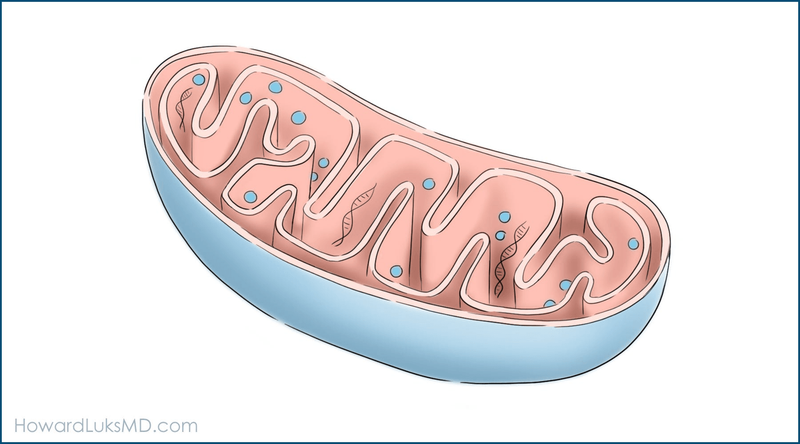
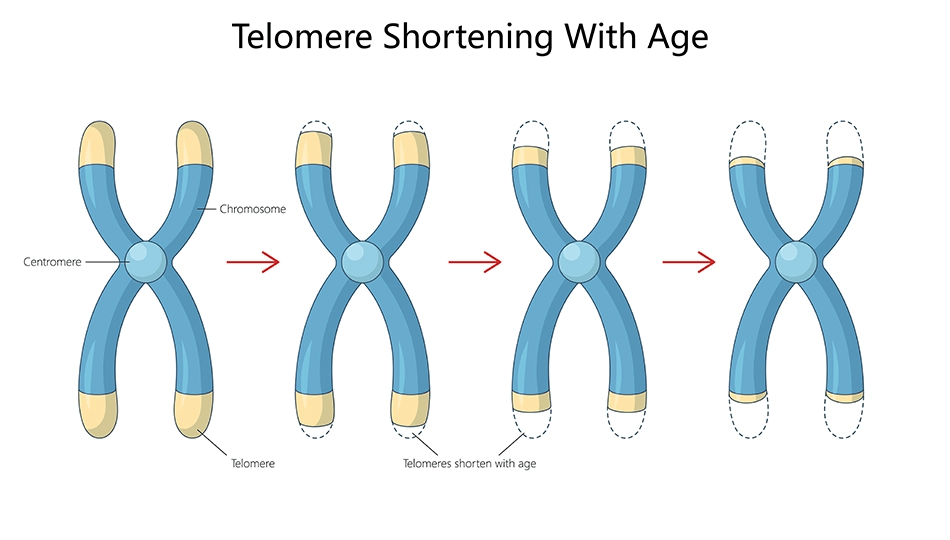
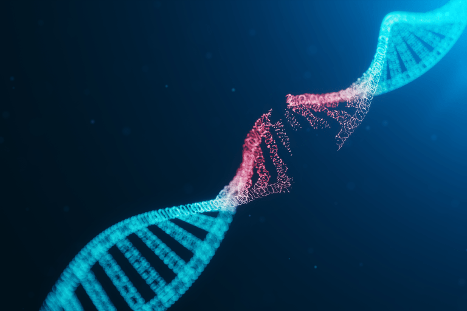

Hello everyone! Have you ever wondered how age affects living things and why? Aging is a natural part of life, but scientists are still working to understand exactly what causes it and how it affects our cells over time. This week, we’ll explore the science of aging, from the protective caps on our DNA to the damage that accumulates in cells as we grow older.

*“We don’t get older, our cells just lose the instructions on how to remain young.“ - Dr. David Sinclair*

## Why do we age? 👴 👵

Over time, our cells change and accumulate damage, causing our bodies to age. One explanation for why aging developed stems from the theory of evolution and natural selection:

### Mutation Accumulation Theory

Though natural selection is often simplified to be a process that makes species better suited for survival, it primarily makes them better suited for survival *until reproduction.* As long as an individual makes it to reproduction, where their genes are passed on, their offspring will likely receive the same healthy genes that allowed the parent to survive up to that point. However, genes that cause harm later in life are less strongly weeded out by natural selection, meaning these less ideal genes accumulate. We experience their effect as the weakening of our bodies and decline of our health as we age.

### Mitochondrial Dysfunction ⚡

Mitochondria, known as the powerhouse of the cell, are organelles found in most eukaryotic cells that generate ATP (energy) to fuel the cell’s functions. 

**Efficiency Decline:** As we age, mitochondria become less and less efficient at producing ATP, lowering the amount available for cellular repair and maintenance.

**Mitophagy:** Think of this process as quality control for mitochondria where defective ones are recycled. Over time, mitophagy slows, allowing defective mitochondria to accumulate.

**Oxidative Stress:** The mitochondrial theory of aging suggests that ROS, which are naturally produced during energy production, slowly damage mitochondrial proteins, fats (lipids), and DNA. As this damage builds up, mitochondrial function declines, creating a cycle of increasing dysfunction.

### Telomeres 🧬

Found at the ends of chromosomes, telomeres help protect DNA during cell division but become shorter each time a cell divides.

**Protective Caps:** Telomeres act like plastic tips on shoelaces, preventing chromosomes from fraying or becoming damaged.

**Gradual Wear:** Each time a cell divides, its telomeres become slightly shorter. Eventually, they can become too short to protect the chromosome effectively.

**Cell Division Limits:** When telomeres become critically short, cells may stop dividing or enter a state called senescence, which is linked to aging.

### Cellular Senescence 🧫

Cellular senescence is a state in which cells permanently stop dividing but remain alive. While this helps prevent damaged cells from becoming cancerous, the buildup of senescent cells contributes to aging.

**The Hayflick Limit:** Often driven by telomere shortening, normal cells can only divide around 40-60 times before entering cellular senescence. 

**Senescent Cell Accumulation:** As we age, more cells enter senescence while the immune system becomes less effective at clearing them.

**SASP:** Senescent cells secrete a complex mix of pro-inflammatory molecules, cytokines, and growth factors known as the Senescence-Associated Secretory Phenotype (SASP). This causes local inflammation and can cause neighboring healthy cells to become senescent. 

### DNA Damage 🔬

DNA is constantly exposed to damage from both internal and external sources. Although cells can repair much of this damage, some changes remain and accumulate over time.

**UV Radiation:** Sunlight can damage DNA in skin cells, which is why excessive sun exposure increases the risk of sun aging and cancer.

**Free Radicals:** Normal cellular processes produce unstable molecules known as free radicals that can damage DNA, proteins, and cell membranes.

**DNA Repair:** Cells contain specialized repair systems that fix damaged DNA. However, these systems become less effective with age, allowing mutations to accumulate.

---

## Myth Buster: Does cracking your knuckles give you arthritis? 🤜 🤛

It’s widely believed that cracking your knuckles increases your chance of arthritis, and this is actually… a myth! Though several studies have been conducted, no substantial evidence was found to show any correlation between the two. The sound comes from a bubble being formed and popped in the liquid that surrounds your knuckle joints. This doesn’t damage the area or cause any inflammation of the joints.
