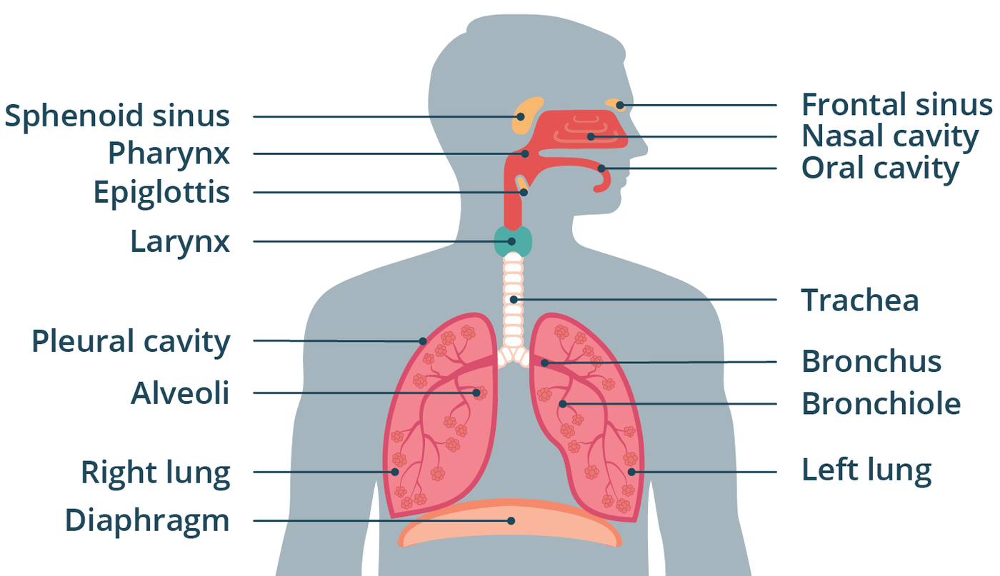
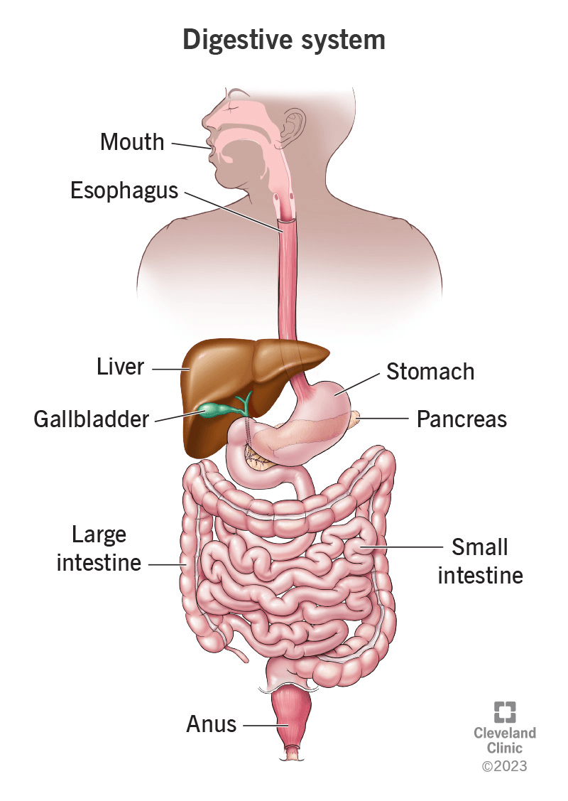
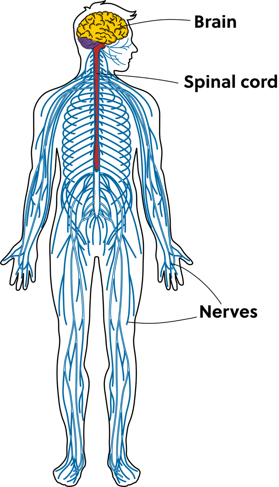

The human body has been evolving over the course of millions of years to sustain life in the intricate and efficient way it does today. Around 78 organs work constantly to do their specific tasks. In order to complete bigger jobs, they work together in organ systems. This week, we’ll go over four of the many organ systems in the human body: the respiratory, digestive, cardiovascular, and nervous systems. We’ll break down each system by examining the organs and structures that allow them to function properly and help maintain a healthy, balanced body.

“The human body is the best picture of the human soul.“ - Ludwig Wittgenstein

## The Respiratory System 🫁

The respiratory system allows the body to take in oxygen and expel carbon dioxide through breathing, supporting gas exchange so cells can produce energy through cellular respiration. It also helps maintain the body’s balance of oxygen and carbon dioxide, which is essential for keeping tissues and organs functioning properly.

**Lungs:** The main organs of the respiratory system, lungs contain millions of tiny air sacs called alveoli. These sacs are surrounded by capillaries and serve as the main site of gas exchange, where oxygen enters the bloodstream, and carbon dioxide leaves it.

**Airways:** The network of passages that move air into and out of the lungs, including the nose, trachea, bronchi, and bronchioles. These structures also help warm, filter, and humidify air before it reaches the lungs.

**Diaphragm:** A large, dome-shaped muscle located beneath the lungs that helps them move. When it contracts, the chest cavity expands, and air is drawn in; when it relaxes, air is pushed out.

## The Digestive System 🍽️

The digestive system is like a long pathway or “tube” that moves food through the body and breaks it down into nutrients. It then allows those nutrients to be absorbed and removes the leftover waste from the body.

**Mouth:** The mouth is where food enters the body. Teeth chew the food into smaller pieces, and saliva contains enzymes that begin breaking it down.

**Stomach:** Food travels to the stomach, where strong acids and digestive enzymes break it down further into a thick liquid called chyme. This is a mix of partly digested food and stomach juices.

**Small Intestine:** The small intestine is the longest part of the digestive system and is where most digestion and nutrient absorption take place. Tiny finger-like structures called villi absorb nutrients into the bloodstream so they can be carried to the rest of the body.

**Large Intestine:** The large intestine removes leftover water, salts, and vitamins, and the remaining waste is formed into solid feces that soon exit the body.

## The Cardiovascular System 🫀

The cardiovascular system moves blood through the body in a continuous loop to deliver oxygen and nutrients to cells and remove carbon dioxide and other wastes. It is essential for maintaining life, as every organ depends on blood flow to receive the materials it needs to function.

**Heart:** A four-chambered muscular organ that pumps blood throughout the body. The top two chambers, called the atria, collect blood coming in, and the bottom two chambers, called the ventricles, squeeze blood out.

**Blood Vessels:** A network of tubes that carries blood to and from the heart and throughout the body. Arteries carry oxygen-rich blood away from the heart, veins return blood to the heart, and capillaries allow oxygen, nutrients, and wastes to exchange with body tissues. 

**Blood:** The fluid that transports materials throughout the cardiovascular system. It consists of a fluid called plasma that holds sugar and proteins, red blood cells that carry oxygen, white blood cells that fight germs, and platelets that clump together to stop bleeding.

## The Nervous System ⚡🧠

The nervous system is the main control center of the body that receives and processes sensory information, then coordinates the response.

**Brain:** While the brain is responsible for thoughts, emotions, memories, and our inner experiences, it also manages the body’s physical functions by processing information from the senses and controlling movement.

**Spinal Cord:** The spinal cord is a long bundle of nerve tissue that connects the brain to the rest of the body. It carries messages to and from the brain and controls reflex actions, allowing the body to react quickly without waiting for the brain.

**Nerves:** Nerves are found throughout the body and carry electrical signals between the brain, spinal cord, muscles, organs, and skin. They allow you to feel pain, touch, and temperature. 

### Myth Buster: Do We Only Use 10% of Our Brains? 🧠

You may have heard that most of our brain capacity isn’t used, but that claim is a myth! Brain scans show that the brain is active across many regions throughout the day, and different parts of it work together for movement, memory, language, emotions, senses, and automatic body functions. Even during sleep, the brain is highly active, processing memories, regulating important body functions, and removing waste products that accumulate during the day.
