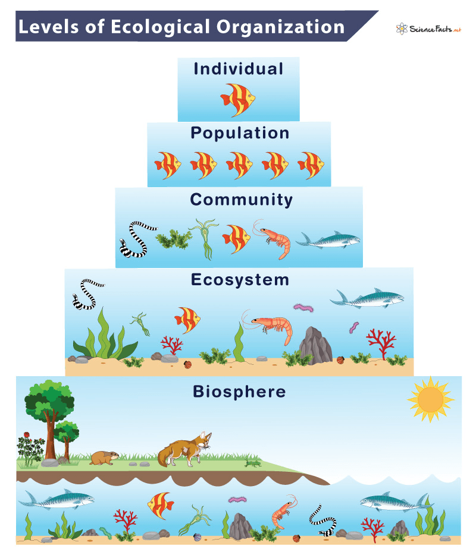
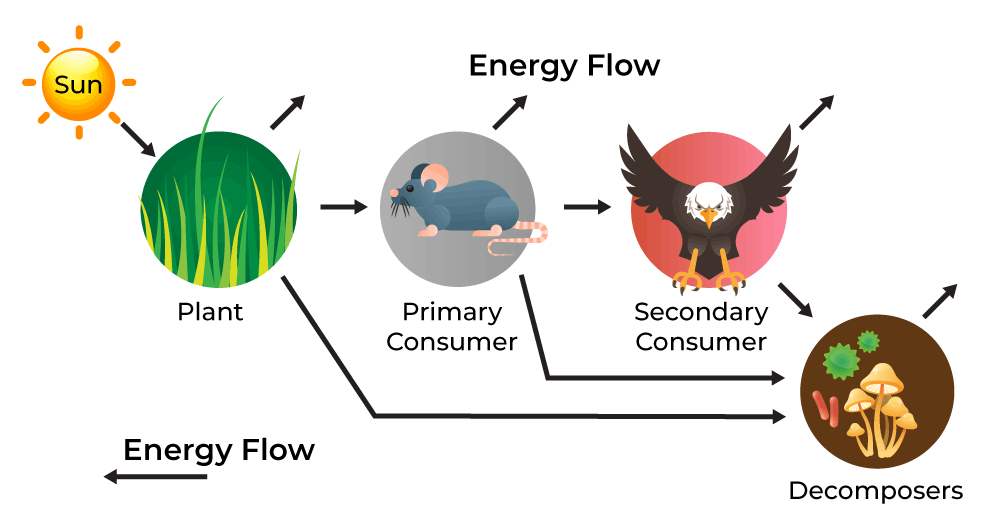
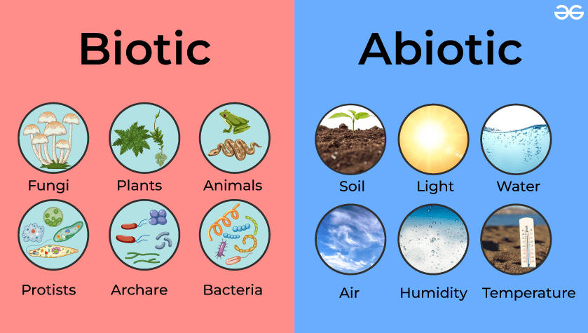

Hello everyone, and happy Sunday! ☀️Have you ever wondered how living things interact with one another and the environment around them? From tiny bacteria in the soil to entire forests and oceans, every organism is connected through a complex web of relationships. This week, we’ll explore the science of ecology and discover how energy, resources, and living organisms work together to survive.

✨*“When we try to pick out anything by itself, we find it hitched to everything else in the universe“* ✨ *- John Muir*

## Ecological Organization 🌿

Ecology is the study of how living things interact with each other and with their environment, and these levels of organization help us understand how one individual survives, grows, and responds to its environment.

**Organism:** A single living thing, such as one deer, one tree, or one bacterium. Studying organisms helps scientists understand how an individual survives, grows, and responds to its environment.

**Population:** A group of organisms of the same species living in the same area. By studying populations, scientists can analyze how their size changes over time, how they reproduce, and how they adapt to environmental pressures.

**Community:** All the different populations living and interacting within the same area. Communities show how species affect one another through competition, predation, cooperation, and other interactions.

**Ecosystem:** A community of living things, as well as the nonliving environment around them.

**Biosphere:** All the ecosystems on Earth combined, representing the broadest level of ecological study.

## The Flow of Energy ⚡️✨

In an ecosystem, energy flows in one direction, from the sun to plants and animals. 

**Producers:** Most producers or autotrophs make their own food from the sun’s energy using photosynthesis. 

**Consumers:** Consumers or heterotrophs cannot make their own food. These organisms eat other living things for energy. In this way, energy flows from the sun to producers to consumers.  

**Energy Loss:** This is the reduction of usable energy as it flows through a food chain. With most energy being used for life or escaping in the form of heat, only about 10% of energy is transferred to the next level.

## Species Interactions 🐝🌸

Similar to humans, many organisms have varying relationships with other organisms, whether both give and take, or one benefit at the cost of the other. 

**Mutualism:** Both species mutually benefit from living closely together. For example, bees get nectar while pollinating flowers.

**Commensalism:** In this relationship, one species benefits while the other is not helped or harmed. Some plants grow high up on the branches of trees for more sunlight, but the tree is not affected.

**Parasitism:** One species—the parasite—benefits by living on or inside the other, which harms the host. A leech drawing blood from another animal is an example of parasitism.

**Amensalism:** The least beneficial of them all. In amensalism, one species is harmed while the other is unaffected. When a small plant grows in a forest of large trees, the trees block sunlight, helping neither and hurting the plant.

## Biotic vs. Abiotic 🌱

Ecosystems are made up of both living and nonliving parts, and these two categories are known as biotic and abiotic factors.

**Biotic Factors:** Biotic factors are the living parts of an ecosystem. They include all organisms, and they affect the ecosystem through feeding relationships, competition, reproduction, and decomposition. Generally, they are classified into three main parts: 

1.  Producers: Organisms that make their own food, usually through photosynthesis. They form the base of most food chains as they capture energy from the sun and turn it into usable chemical energy. 

2.  Consumers: Organisms that get energy by eating other organisms. They cannot make their own food, so they depend on producers or other consumers for energy. 

3.  Decomposers: Organisms that break down dead organisms and waste. They recycle nutrients back into the ecosystem, helping matter move through food webs.

**Abiotic Factors:** The nonliving parts of an ecosystem, such as sunlight, water, air, temperature, soil, and minerals. These factors affect which organisms can survive in an area and how well they can grow and reproduce.

## Fun Science Facts!

🍌 Bananas are slightly radioactive due to their natural potassium content.

🐬 Dolphins have names for each other.

🧪Stomach acid can burn through metal, but doesn’t burn through our stomach lining.

🌎Christopher Columbus never realized he discovered the Americas. He died thinking he had reached Asia.
