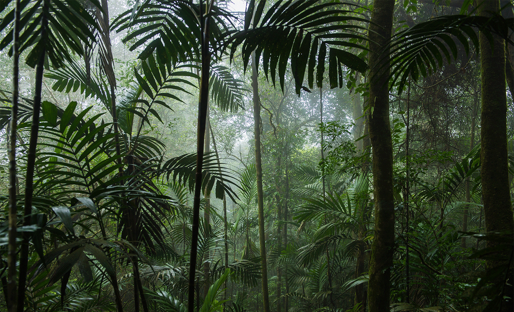
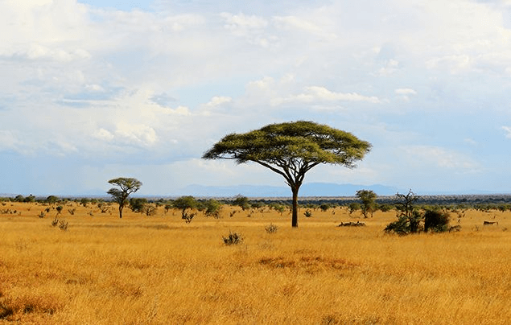
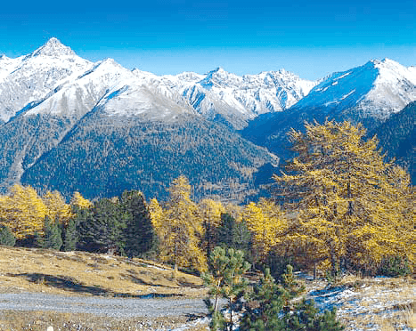

Good morning and happy Sunday! ☀️ This week, we’re exploring the many biomes found across the Earth. Have you ever seen the movie Zootopia? The main city is divided into sections by habitat, some with snow and wind, others hot and humid with dense forest. These sections, with names like “Tundra Town” and “Rainforest District,” each represent a different biome. Let’s dive into the climates, characteristics, inhabitants, and unique features of a few of the world’s biomes!

*“The Earth has music for those who listen.“ – Reginald Holmes*

## Tropical Rainforests 🌴🦜

Home to an incredible variety of plants and animals, tropical rainforests are warm, wet, and full of life all year long. Despite covering just 6% of the Earth’s land surface, they host over half of the world’s plant and animal species!

**Canopy:** The dense upper layer of treetops where most sunlight is captured. This is one of the most important parts of the rainforest because many animals live, feed, and travel here.

**Biodiversity:** Rainforests contain an extremely wide variety of species, making them one of the most complex ecosystems on Earth.

**Adaptations:** Due to the crowded, competitive environment, organisms often have special traits that help them survive. Some plants have large leaves to capture sunlight, while animals may have camouflage, strong climbing abilities, or bright colors for communication.

## Deserts

Covering nearly one third of the Earth, these dry stretches of land can have varying climates and feature especially unique plants.

**Precipitation:** The defining trait of a desert is that it gets very little rain, often less than 10 inches each year. Because of this simple criteria, what counts as a desert can look very different from what you might imagine. 

**Kinds of Deserts:** A hot and dry desert is not the only kind out there. Some deserts can be extremely cold, and others exist in certain coastal areas where cold water currents prevent rain!

**Cacti:** These plants grow almost exclusively in the deserts of North, Central, and South America. They evolved over time to store water in thick stems and defend themselves with sharp spines.

## Savannas

Not quite deserts nor rainforests, savannas are warm ecosystems somewhere in between, with distinct wet and dry seasons.

**Grasses:** The dominant plants in the savanna, grasses grow quickly and can survive dry conditions better than many trees.

**Large Herbivores:** Animals such as zebras, antelope, and elephants are common in savannas. These animals are adapted to travel long distances to find food and water, especially during the dry season.

**Predators:** Savannas are home to predators such as lions, cheetahs, and hyenas. These animals are adapted for hunting in open spaces, where speed and stealth are essential for catching prey.

## Tundras

Tundras are the coldest of all the major biomes on Earth, with average winter temperatures dropping to -34°C (-30°F) or lower. Similar to deserts, they see very little rain each year, but are distinct in other ways.

**Permafrost:** Permafrost is a thick layer of a tundra’s surface that stays frozen solid all year long. It keeps water from seeping into the ground and also stores huge amounts of carbon in organic matter.

**No Trees:** Because permafrost prevents deep tree roots from growing, tundras feature flat, treeless land. Only low plants like moss, lichens, and small shrubs grow.

**The Timberline:** The timberline or tree line on alpine mountains is an imaginary line at the edge of where trees are capable of growing. Above the timberline is a tundra biome.

## Did You Know?

🌳 A single tropical rainforest can have more species of trees than all of North America combined.

🔥 Savanna fires are actually helpful, as they clear out old growth and make room for fresh grass to sprout.

🌱 Rainforest soil is often surprisingly poor in nutrients, even though the forest looks incredibly rich and lush.

🐒 Most animals in the rainforest live in the canopy instead of on the ground.
