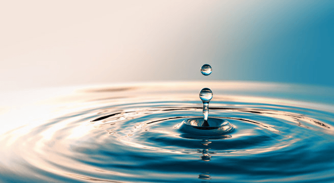
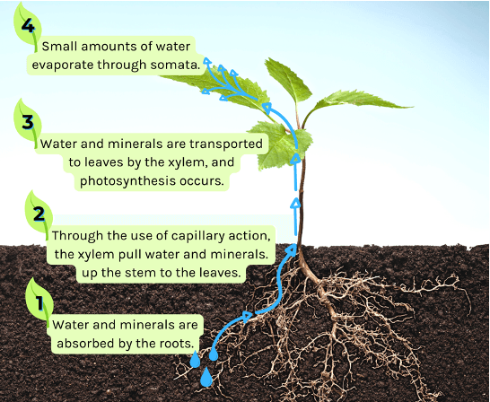

Hello everyone, and happy Sunday! ☀️ Have you ever wondered why ice floats, how trees get water, or why water droplets stick together? You can spot these behaviors everywhere, and they all come from the unique molecular properties of water that make it essential for life on Earth. This week, we’ll explore what makes water so special, from its polarity and hydrogen bonding to its role in plant water transport.

*“Water is the driving force of all nature“ - Leonardo da Vinci*

## ChemQuest News 🗞️

As we recently wrapped up our interviews for officer positions, we would like to thank everyone who took the time to apply and congratulate those who got accepted for the role! Let’s welcome our new team members…

Lucas Zhao – Co-Technology Chair

Aneesha Chennareddy – Co-Advertising Chair

Connor Liu – Fundraising Chair

Aarna Yogish – Co-Volunteer Chair

Anandi Pingle – Co-Volunteer Chair

…and our returning team members with new positions:

Andrea Yao – Co-President

Andrea Hoang – Co-President

Srinita Paul Chowdhury – Vice President

## What Makes It Unique? 🔬

All of water’s unique, life-sustaining properties circle back to one key fact: water is a polar molecule. 

Polarity: A water molecule is made up of one oxygen atom and two hydrogen atoms bonded together. The oxygen atom has a slightly negative charge, and the hydrogen atoms have a slightly positive charge.

Hydrogen Bonding: Like magnets with oppositely charged sides, the negative and positive ends of different water molecules constantly form temporary bonds called hydrogen bonds. 

The Universal Solvent: Water is an excellent solvent for many ionic and polar substances. The polar water molecules surround and separate the ions in ionic compounds 

## Adhesion & Cohesion 💧

By constantly interacting with each other and their surroundings, water molecules create a few special properties:

Cohesion: Water molecules stick to each other through hydrogen bonds. This forms continuous columns of liquid, which is especially important for moving water up through plants.

Adhesion: Water molecules also stick to other surfaces, like the walls of plant vessels. Working together with cohesion, adhesion helps water move through narrow spaces.

Surface Tension: Cohesion creates a strong layer at the water’s surface that resists breaking. This is why water droplets form rounded shapes and why some insects can walk on water.

## Water Movement in Plants 🌿

Plants need to transport water from their roots to their leaves, sometimes against the force of gravity. The special properties of water, along with transpiration and specialized plant tissues, allow water to move continuously throughout the plant.

Capillary Action: Water moves through narrow spaces due to the combined forces of cohesion and adhesion. In plants, these forces help water climb upward through the tiny xylem tubes.

Transpiration: Water vapor evaporates from a plant’s leaves, mainly through tiny openings called stomata. As this water evaporates, it creates a pulling force that draws more water upward from the roots.

Xylem: Specialized tissue that transports water and dissolved minerals from the roots to the leaves. Water flows through long, continuous columns of xylem vessels as it travels throughout the plant.

## Water Turns to Ice 🧊

When water freezes into a solid, it reveals even more unique properties that allow life to exist on Earth. 

Expansion: As water freezes, hydrogen bonding creates a crystal lattice structure that keeps molecules farther apart than in liquid form. This causes water to expand when becoming ice. 

Density: Most substances become denser when they solidify, but water does the opposite. It actually becomes less dense because it expands.

Ice Insulation: Less dense than water, ice floats to the surface of ponds and lakes, forming a layer that keeps the water underneath from freezing. Without the unique properties of water, aquatic ecosystems couldn’t sustain themselves in the winter.
