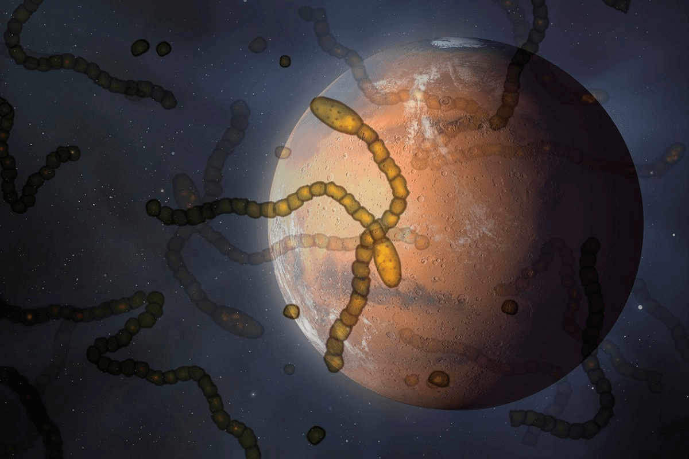
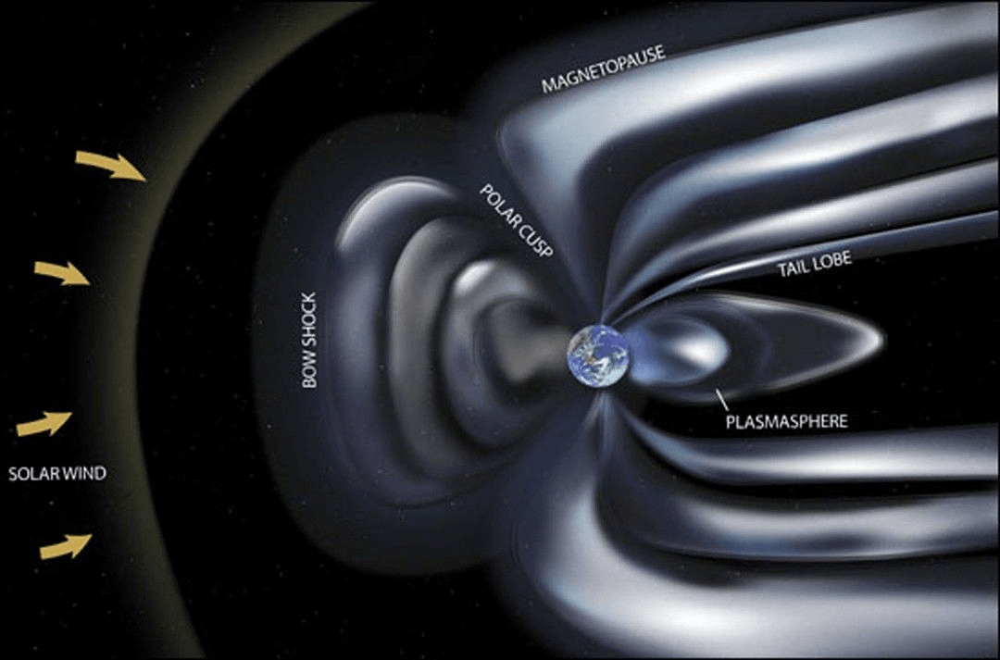
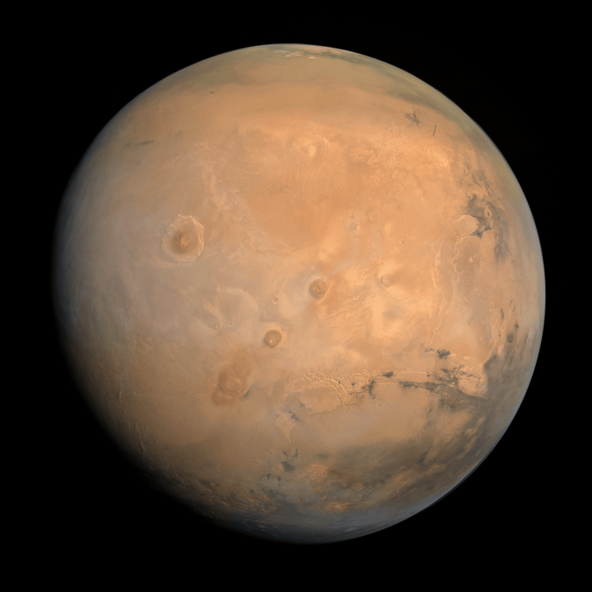

Since the beginning of time, humans have looked up to the stars and wondered what—or who—was out there. Many theories and speculations have been made, and many have spent their lives searching for any signs of extraterrestrial life. This week, we will dive into the topic of aliens! From the types of life to the ethical implications of making contact, we’ll cover it all in this week’s newsletter.

✨*“Somewhere out there, someone may be looking at the stars too.”*✨

## What Counts as Alien Life? 👽

Alien life doesn’t have to look like those creatures you see in movies. Scientists think the first life we find outside of Earth could be tiny and simple, likely living in water, beneath ice, or underground. Even if it would look unfamiliar, an alien would still need energy, chemicals, and a safe environment to survive. They’re just like all life on Earth!

**Microbes:** The most likely form of alien life may be microscopic organisms, similar to bacteria on Earth. They could survive in places where larger organisms could not.

**Extremophiles:** On Earth, some living things survive in extreme heat, cold, pressure, or saltiness. These organisms show us that life can exist in harsher places than we once believed.

**Biosignatures:** Scientists search for clues called biosignatures, which are chemicals or patterns that may suggest life is present. For example, certain gases in a planet’s atmosphere could be due to the presence of living organisms.

## What Makes Earth Special? 🌍

Earth is the only planet we know of that supports life. It has the perfect resources of water, a protective atmosphere, and energy from the Sun. These features make our planet a very special and suitable place in the solar system.

**Water:** Every form of life we know of needs water. Earth has oceans, lakes, rivers, and water vapor, which gives organisms many places to live.

**The Atmosphere:** Earth’s atmosphere contains many important gases, including oxygen for many animals and carbon dioxide for plants. It also helps keep the planet warm enough for water to be in its liquid form.

**Magnetic Fields:** Earth’s magnetic field protects us from many harmful particles that are released from the Sun. Without it, solar radiation could slowly damage our helpful atmosphere and make the planet less welcoming for life.

## Possible Homes 🪐

Though we have yet to discover life anywhere but our planet, scientists have some predictions as to where alien life could exist. 

**Mars:** Rovers have found clear evidence of liquid water existing on the planet billions of years ago, and it’s likely that it had similar conditions to Earth at the time. Scientists believe Mars could have once supported simple bacterial life. 

**Europa:** This icy moon of Jupiter is believed to have a subsurface ocean containing more water than all of Earth’s oceans combined. If any life does exist here, it is likely to be simple, single-celled organisms.

**Enceladus:** Saturn’s moon, Enceladus, also has a hidden saltwater ocean. Unlike Europa, tidal forces create internal heat, and organic molecules (the building blocks of life) were found erupting in giant plumes from the moon's south pole.

## The Challenges of Making Contact 📡

If humans discovered that there really was another civilization out there, we would have to find a way to let them know we exist, and face the question: should we?

**Distance:** The universe is a massive place, meaning sending a message would take an incredibly long time! A two way-conversation might take centuries per reply.

**Language Barriers:** All languages we know were built to be understood by the human brain, using things like subjects, objects, grammar, order, etc. It’s possible that the alien mind is so different from the human mind that we couldn’t decode their language.

**Should We?:** Although it’s a difficult enough task to reach out to a foreign civilization, it’s an impossible one to clearly decide whether we should. It would carry existential risks to broadcast our existence to a technologically superior civilization.

## Fun Facts About Searching for Alien Life

🪐 **Exoplanets** are planets outside our solar system. Scientists have confirmed more than 6,200 exoplanets, and there are likely billions more in our galaxy that remain unconfirmed.

✨ A **light-year** is a measurement of distance, not time. It is the distance light travels in one year (almost 6 trillion miles)!

🔭 **Transit hunting** is one way scientists find exoplanets. When a planet orbits right in front of its star, it makes the star appear slightly dimmer, confirming the existence of an exoplanet in front of that star.

❓ **No alien life has been confirmed yet**. Scientists have found favorable places to look, but no evidence has yet proved that life exists outside of our planet Earth.
