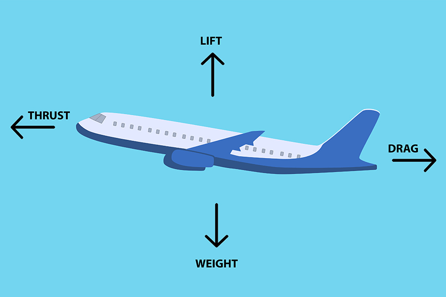
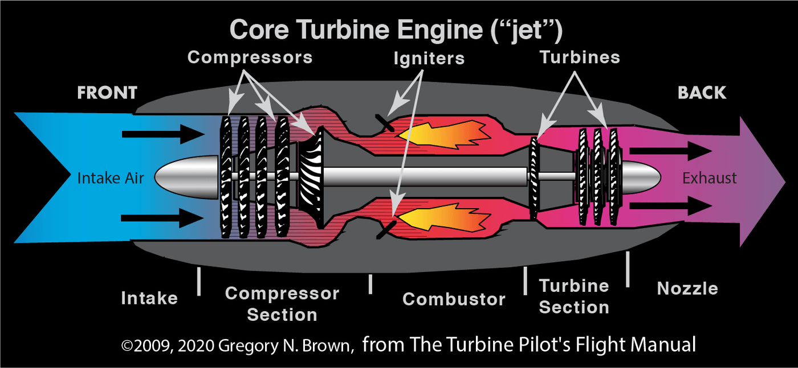
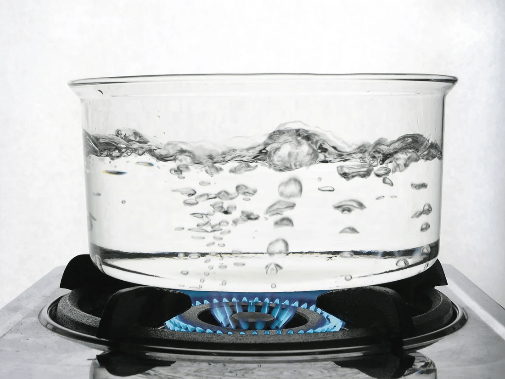

Have you ever watched a plane take off and wondered how something so massive and heavy can fly in the sky like that? A plane is much heavier than air, but its engine pushes it forward, and its wings create lift. Today, we will be learning about the science that makes flight possible, including the forces of flight and how they are used in planes today.

✨*“It is my belief that flight is possible.”*✨ \- Wilbur Wright

## The Four Forces of Flight ✈️

An airplane in motion is constantly facing forces that push it down and back. In order to fly, it must fight back with its own. In this way, there are four combating forces that interact to control its motion.

**Weight:** The weight of gravity pulls the aircraft down toward the center of the Earth

**Lift:** To move upward against gravity, the aircraft creates lift, pushing it up using the wings

**Drag:** While the airplane tries to speed forward, air resistance creates a drag force opposing it. 

**Thrust:** This is the forward force produced by the engines or propellers that counter drag.

## How Wings Create Lift 🪽

Most of an airplane’s lift comes from its wings. As a plane moves forward, its wings guide air downward, and the air pushes back up on them. The shape, speed, and angle of wings all affect how much lift they create. 

**Wing Shape:** A wing is shaped to guide air around it and downward. As the air changes direction, it creates an upward force that helps lift the plane.

**Speed and Angle:** A plane’s wings need air moving past them to create lift. Flying faster can increase lift, but tilting the wings too steeply can disrupt airflow and cause a “stall,” where the wings suddenly lose lift.

**Flaps:** Flaps are hinged panels at the back of the wings. They are extended during takeoff and landing to help the wings create enough lift while the plane is moving more slowly.

## How Jet Engines Push Planes Forward 🔥

Newton’s third law of motion is that every action has an equal and opposite reaction. Knowing this, a jet engine doesn’t exactly push the plane forward, it pushes air backward!

**Air Intake:** A jet engine’s large front fan draws in air. The engine then compresses the air, making it denser and increasing its pressure.

**Combustion:** Inside the combustion chamber, fuel is mixed with the compressed air and ignited. This generates a large amount of energy. 

**Generating Thrust:** The hot gases shoot out the back of the engine, generating the thrust that moves the airplane forward.

## How Pilots Steer and Land 🛬

Pilots steer by moving parts on the wings and tail. These help the plane turn, point its nose up or down, and line up with the runway for landing.

**Ailerons:** Ailerons are panels on the wings. One moves up, and the other moves down, which tilts the plane’s wings so it can make a turn.

**Elevator and Rudder:** The elevator moves the plane’s nose up or down. The rudder moves the tail of the plane side to side, allowing the pilot to guide the plane smoothly.

**Flaps and Spoilers:** During landing, flaps help the plane stay lifted at a slower speed. Once the wheels touch the runway, the spoilers rise from the wings to reduce lift and help the plane slow down.

## Myth buster: Does water really boil at 100°C? 💧

You’ll often hear it explained that 100 degrees celsius is the boiling point of water. Simple, reliable, and easy to remember! But did you know that the boiling point of a water changes based on altitude and air pressure? At high elevations with low pressure, water boils at a lower temperature. At low elevations with high pressure, water requires a higher temperature to boil. In conclusion, it is only true that the boiling point of water is 100°C at standard atmospheric pressure at sea level. 

