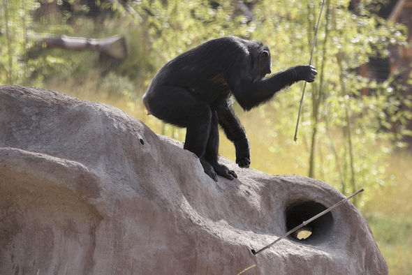
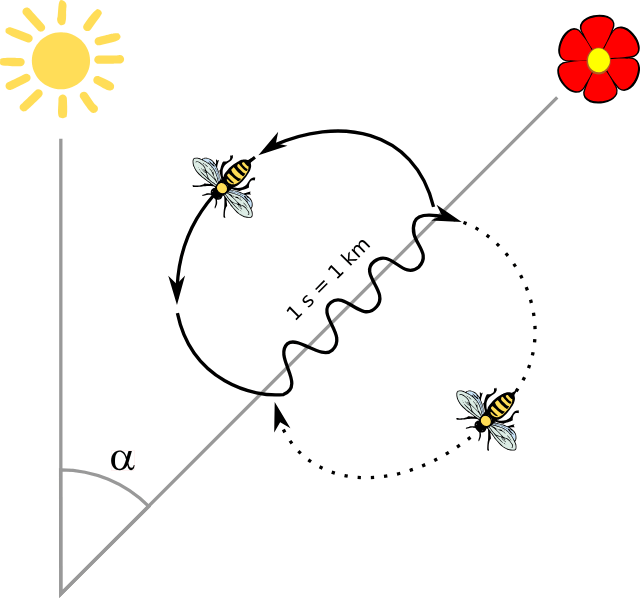
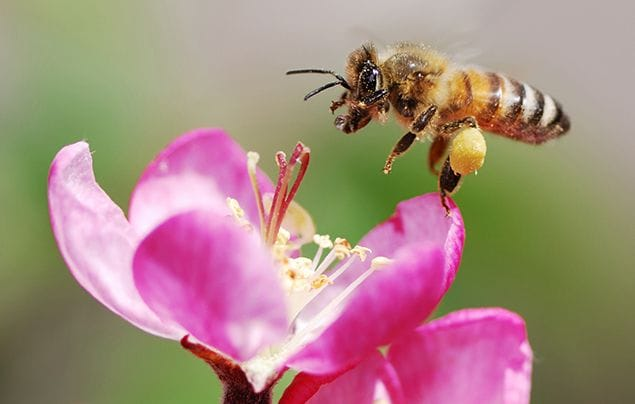

Have you ever wondered how dogs learn tricks or birds remember where they hid their food? Animals use their brains to solve problems, communicate, and learn about their surroundings, just like humans. Some even pass down learned behaviors through generations or populations, which creates animal traditions! Today, we’ll learn about animal cognition and culture, looking at interesting behaviors like clever tool use and whale songs.

*“We are not the only beings with personalities, rational thought, and emotions.“ - Jane Goodall*

## 📣 Save the Date: Upcoming Event!

We’re excited to announce our next event, a STEM day in collaboration with Mathnasium! Have young kids eager to participate in hands-on, interactive science experiments? Join us for a great opportunity to connect, learn, and spread the love of science. We’d love to see you there!

📅 Date: November 7th, 2026

⏰ Time: 1:00 PM - 3:00 PM

📍Location: Mathnasium Glen Mills (100 Ridge Rd #9, Chadds Ford, PA 19317)

Ready to join us? Be sure to RSVP by November 5th using the link below so we can save you a spot!

👉 [RSVP for STEM Day at Mathnasium (Google Form)](https://docs.google.com/forms/d/e/1FAIpQLSdMfeLw0LggZzqKq4d3ySoui755a4Z-H4DFtAHk44ydgNeoAw/viewform)

## How Animals Think and Learn 🧠

Cognition is how animals learn, remember, and make decisions. Different animals have different abilities that help them find food, avoid danger, and respond to other challenges in their environments.

**Learning:** Animals can change their behavior through experience. When a dog receives a treat after sitting, it can learn to link that action with a reward, making it more likely to sit again.

**Memory:** Remembering past experiences is very useful for animals. Scrub-jays can remember what food they hid, where they hid it, and how long ago they hid it, which lets them find the food later.

**Problem-Solving:** Animals sometimes come across challenges that require several steps. In experiments, New Caledonian crows had planned orders of tool use, as they were able to keep track of tools they couldn’t even see while trying to obtain a food reward.

## Animals That Use Tools ⚒️

Some animals use objects around them to reach food or break through protective shells. Certain species even change an object’s shape to make it work better.

**Chimpanzees:** Some chimpanzees insert plant stems into termite nests. When termites cling to the stems, the chimpanzees pull them out and eat the insects. Some chimpanzees even create brush-like tips that help collect more termites!

**New Caledonian Crows:** These birds use sticks and hooked plants to reach insects hiding in wood. A hooked tip helps them catch and pull out food that their beaks can’t reach.

**Sea Otters:** Sea otters use rocks to break open hard shells on prey, like clams or mussels. An otter may rest a rock on its chest and repeatedly strike its food against it.

## How Animals Communicate 🗣️

Animals communicate with each other using sounds, movements, and other signals. These messages can help them find food, recognize friends, or respond to danger.

**Honeybee Dances:** A honeybee can show a “waggle dance” to its colony after finding food. The direction of its movements and the time it spends waggling tell other bees where to fly and how far to travel for that food.

**Dolphin Whistles:** Bottlenose dolphins develop distinctive sounds called signature whistles. Other dolphins can recognize these whistles and copy them, similar to how humans call each other by names.

**Monkey Alarm Calls:** Vervet monkeys make different alarm calls in response to different predators, such as eagles, snakes, and leopards. Based on the particular call nearby monkeys hear, they respond appropriately, maybe by looking upward or climbing into a tree.

## Can Animals Have Culture? 📜

In animal science, culture is learned behaviors that spread between individuals and continue in a group. These traditions are spread when animals learn from others (social learning), rather than simply inheriting these behaviors through genes.

**Whale Songs:** Male humpback whales learn songs from other whales, and new songs can spread between populations across the entire ocean! Researchers have also recorded whales combining parts of old and new songs as they learn.

**Orca Calls:** Groups of killer whales have distinctive calls that are learned and shared. These traditions can even help researchers tell groups of orcas apart based on how different communities sound.

**Bumblebee Traditions:** In an experiment, bumblebees watched trained bees open a food puzzle using one of two methods. The observer bees usually adopted the method they had seen, which let different preferences spread through different groups.

## Myth Buster: Do Goldfish Have a Three-Second Memory? 🐟

You may have heard that goldfish forget everything after just three seconds, but that’s a myth! Goldfish can learn and remember information for way longer than a few seconds. In one study, goldfish were trained to swim a certain distance before turning around. Most of the goldfish turned near the correct spot after the signal telling them to turn was removed. They used cues around them to judge how far they had traveled. Goldfish may have tiny brains, but they definitely have the ability to learn!
