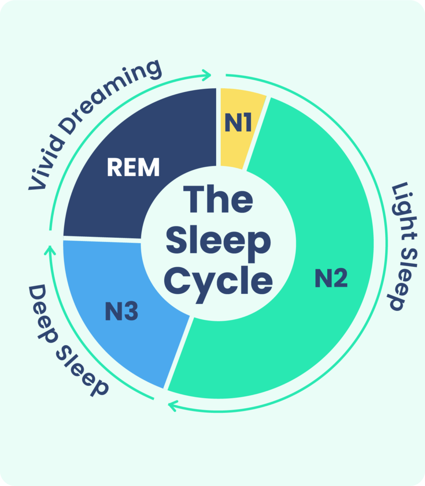
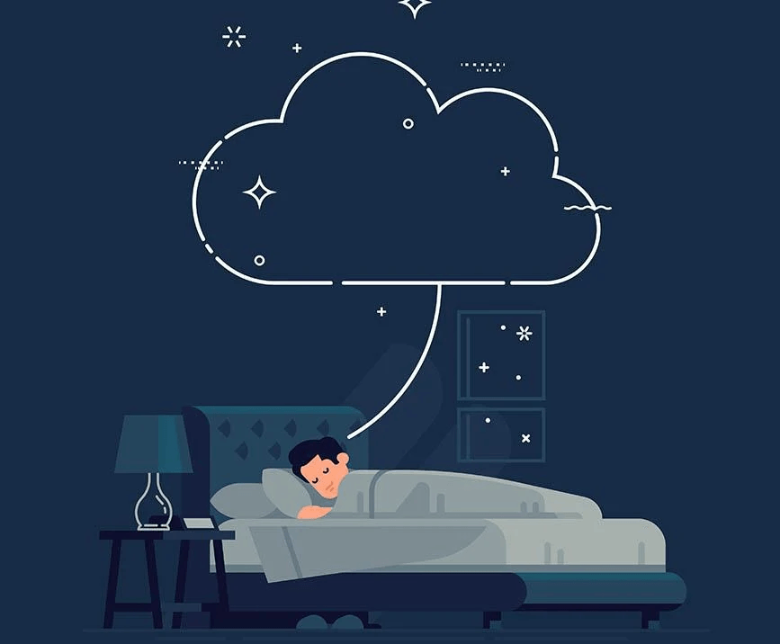

Have you ever wondered what our brains do while our bodies are asleep? Turns out, there’s a lot more going on than you might think! This week we’ll be uncovering the science of sleep: exploring the stages of sleep, our internal clock, and delving into the more unusual aspects of the brain while unconscious.

*“Each night, when I go to sleep, I die. And the next morning, when I wake up, I am reborn.“* 

*\- Mahatma Gandhi*

## Stages of Sleep 😴

**NREM Stage 1:** This stands for Non-Rapid Eye Movement, and it’s the transition stage from wakefulness to sleep. Your heart rate slows down, but you can still be easily awakened. 

**NREM Stage 2:** This stage is like light sleep. You’re now officially asleep and your brain produces brief bursts of rhythmic activity called "sleep spindles" that help block out external noise.

**NREM Stage 3:** Stage three is a true deep sleep and difficult to wake up from. Have you ever slept through a loud thunderstorm you have no memory of? You were probably in NREM3!

**REM Sleep:** Finally you enter REM sleep, where brain activity increases to levels similar to when you are awake. Your most vivid dreams occur at this stage. To prevent you from acting out your dreams, your brain puts most of your body into a temporary muscle paralysis. 

## The Internal Clock ⏰

Your body has an internal clock that follows a roughly 24-hour cycle called the circadian rhythm. It helps regulate when you feel awake and when you feel sleepy.

**Light:** Light is one of the biggest signals that controls your circadian rhythm. When light enters your eyes, it sends signals to your brain that it's daytime. When it gets dark, your brain signals your body to produce more melatonin, a hormone that helps you feel sleepy.

**Morning People vs. Night Owls:** Have you ever wondered why some people naturally wake up early while others prefer staying up late? This is partly due to differences in people's internal clocks, also known as their chronotypes.

**Jet Lag:** When you travel across several time zones, your body's internal clock can become out of sync with the local time. It can make you feel tired, confused, or wide awake at unusual times because your body hasn't adjusted to the new schedule yet.

## Dreams

Scientists think that humans dream for many reasons including to organize our memories from that day and process our emotions.

**Nightmares:** Nightmares are unpleasant, vivid dreams that can cause strong negative emotions like fear or sadness. They are often caused by stress in our daily lives or trauma disorders.  

**Recurring Dreams:** Sometimes you can have the same dream over and over again. For many, these are actually recurring nightmares. Up to 75% of adults experience recurring dreams at some point in their lives.

**Lucid Dreaming:** Being in a lucid dream means you realize you are in a dream while the dream is still happening. Some people can actually control what happens in their lucid dreams!

## Unusual Sleep Phenomena 🛌

Sleep alone is weird enough, but let’s dive into some of the even weirder things that happen during sleep.

**Sleepwalking:** Sleepwalking usually happens in NREM sleep stage 3. It ranges from simple things like sitting up, talking, or walking around the room to more complex actions like getting dressed and driving.

**Exploding Head Syndrome:** This is a harmless sleep disorder that causes you to imagine a sudden, loud noise like an explosion right as you fall asleep or wake up. 

**Sleep Paralysis:** This is a state where you are awake and conscious of your surroundings, but your body is still temporarily paralyzed by your brain from REM sleep. Despite it sounding scary, sleep paralysis is completely harmless and usually only lasts a few seconds to a few minutes. 

## Fun Facts About Sleep

🐬Dolphins can sleep with half of their brain awake while the other half rests! This allows them to keep swimming, surface for air, and watch for predators.

🥱You spend about one third of your life asleep.

🎬Some people dream in black and white. 

🧠The average person has around 4-6 dreams per night but doesn’t remember them all.
