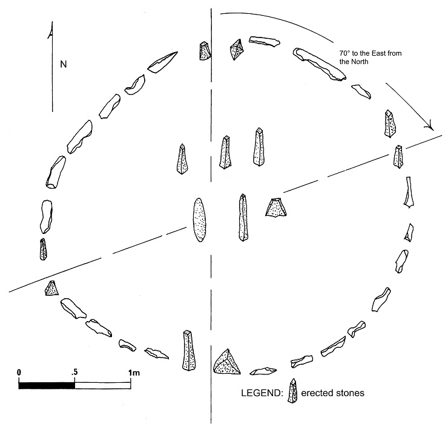
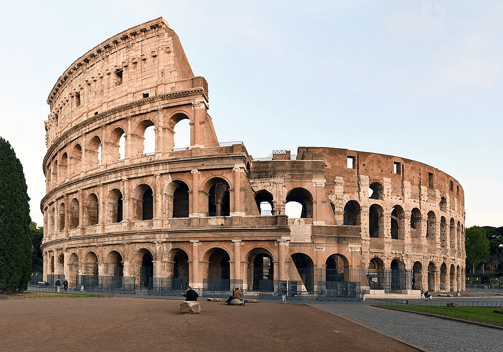

Humans leading complex lives and building entire civilizations have existed long before history books. It’s easy to forget that people living thousands of years ago were no less intelligent than we are today. In fact, prehistoric humans found many ways to make their lives easier through science and the development of ancient technology. This week, we’ll dive into the science, technology, and ingenuity of the past to try and reconstruct ancient life! 🛖

✨_“Human nature is the one constant through human history. It is always there“_ ✨

_– Thucydides_

## Ancient Stones and Skywatchers 🗿

Before inventing telescopes, people had special ways to track the Sun and Moon. The things they left behind can still surprise us, from a set of bronze gears to a staircase that chirps.

**Acoustic Archaeology:** A model of Stonehenge showed that voices would have sounded louder inside the stone circle. Additionally, at a Maya pyramid in Chichén Itzá, clapping near the stairs can send back an echo that sounds like a bird!

**The Antikythera Mechanism:** This device used bronze gears to turn pointers on dials. It could even help people predict when eclipses would happen.

**Nabta Playa Stone Circle:** This circle in southern Egypt contains some stones that line up with the sunrise around the longest day of the year. The circle may have helped people mark the start of summer.

## How Ancient People Managed Water and Soil 💦🌱

How do you get water to a farm without a pump? What can you do when crops won’t grow well in the soil? Ancient innovators came up with very clever answers to these problems.

**Persian Qanat Systems:** People in what is now Iran dug tunnels to bring underground water to farms and towns. The tunnels sloped just enough for water to flow on its own.

**Nabataean Flash-Flood Harvesting:** The Nabataeans built dams and channels to steer floodwater away from parts of their city. They also stored water in underground tanks called cisterns to prepare for droughts.

**Amazonian Terra Preta:** Even today, Kuikuro communities in the Amazon continue to use ash and food scraps to make soil richer. Their soil looks a lot like the dark earth, or _terra preta_, that archaeologists have found at ancient sites.

## Material Science 🪨

You might think ancient technology was inferior to today’s, but humans back then were utilizing chemistry before it was ever taught in schools!

**Roman Concrete:** Romans used a "hot-mixing" method with reactive quicklime to make their concrete. The material they created would recrystallize as water entered any cracks, healing itself and strengthening over time.

**Damascus Steel Nanowires:** Damascus steel was known for its exceptional sharpness. It was later discovered that the forging techniques accidentally created carbon nanotubes inside blades.

**Mayan Blue Pigment:** The Maya combined indigo dye with a naturally occurring clay mineral called palygorskite, which formed molecular bonds to create a blue pigment that resisted centuries of tropical acid and heat.

## Ancient Diets & DNA 🦷

It sounds impossible to reconstruct the lives and diets of humans who lived before history was recorded, but scientists have figured out some odd ways to trace what they ate. 

**The Plague:** Scientists have extracted DNA from the teeth of people who died thousands of years ago to determine that they were infected with the same plague that devastated medieval Europe. 

**Neanderthal Dental Tartar:** Plaque accumulates on teeth and eventually mineralizes into tartar if it isn't removed. Scientists can analyze this in prehistoric humans to reconstruct their diets. 

**Old Chewing Gum:** Someone living about 5,700 years ago chewed a piece of resin, spat it out, and left it behind. The DNA that was extracted revealed not only her genetics, but also the meal she had eaten beforehand.

## Myth Buster: Did Aliens Build the Pyramids?

Nope! Archaeologists found the town where the Egyptian builders lived. Some stones even have the names of work crews written on them. We’re still figuring out how the workers got the biggest blocks into place, but we know who built the pyramids: ancient Egyptians 🙂.
